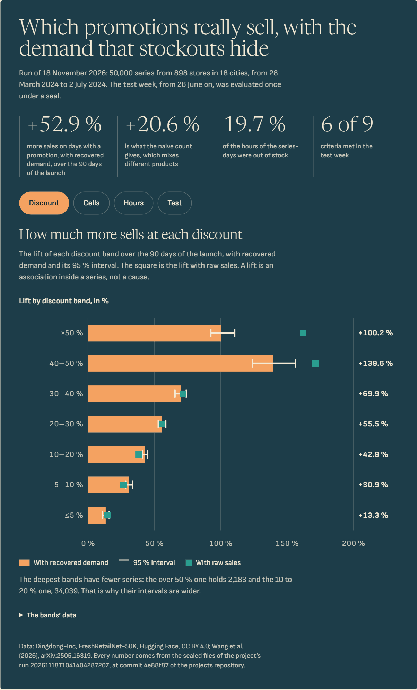
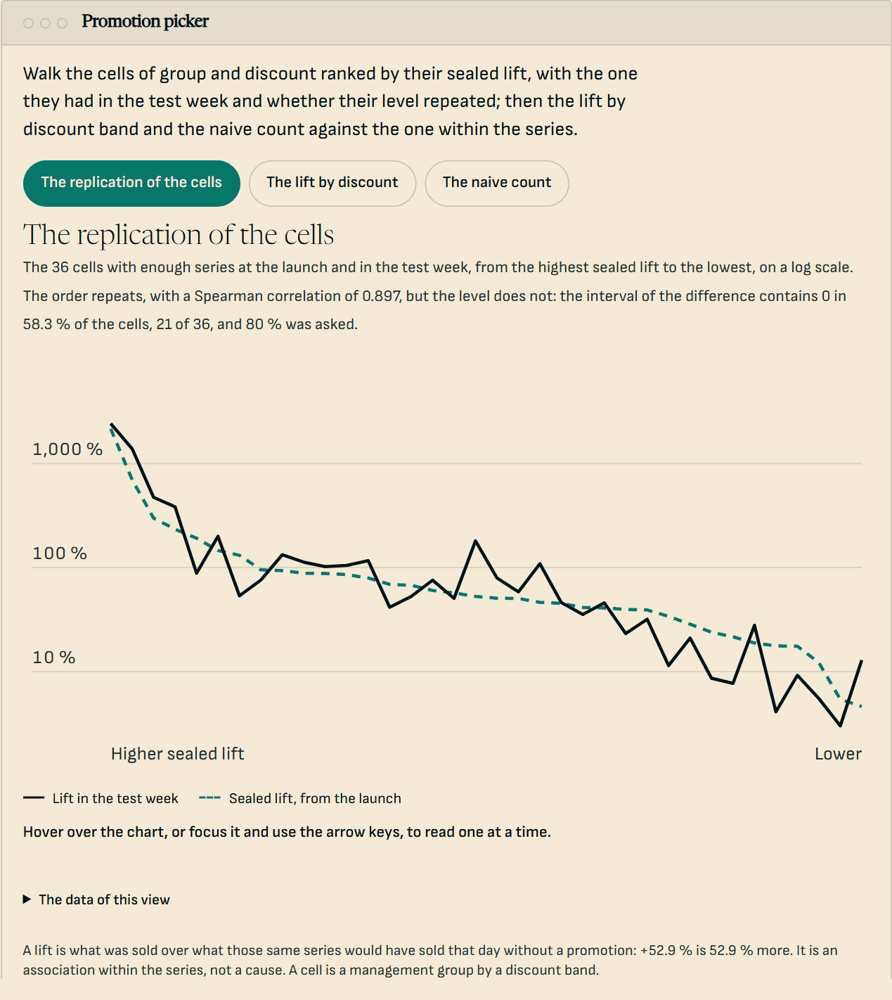
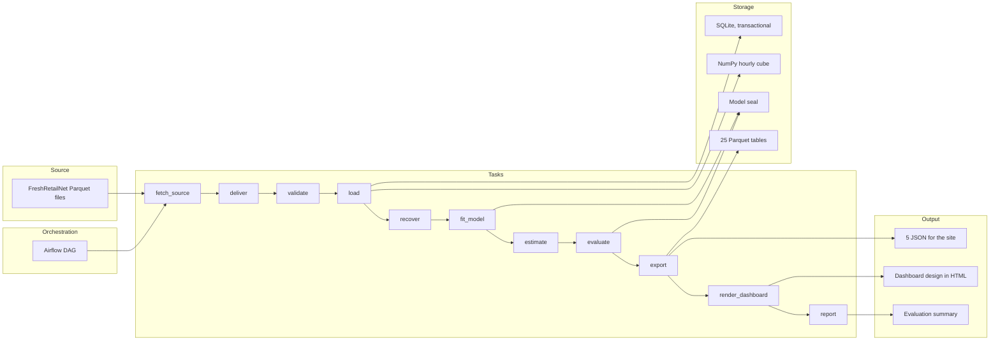

# Which promotions really sell

**English** · [Español](README.es.md)

A ranking of promotions by group and discount, corrected for stockouts.



|  |  |
| --- | --- |
| **Result** | 6 of 9 success criteria met |
| **Tech stack** | Python, NumPy, pandas, PyArrow, scikit-learn, SQLite, Parquet, Apache Airflow, Docker |
| **Techniques** | Stockout-censored demand, IPF counterfactual, Two-way bootstrap, Ranking with indistinguishable groups |
| **To audit** (in Spanish) | [Model card](docs/model-card.md) · [Independent evaluation](docs/evaluation.md) · [Latest run: validation](reports/validation/latest.md) · [Latest run: results](reports/evaluation_summary.md) · [Decision log](docs/decisions.md) |

## 1. Executive summary

### 1.1 Business problem and solution

**Business problem and target audience.** Built for the sales and category teams of a fresh-food retailer with online orders, which runs discounts almost every week and has to decide which ones to repeat. The usual count compares the days with a promotion with the days without one, and comes out wrong for two reasons: promotions are assigned by series and by product, so the days with a promotion belong to other products, and in the hours out of stock sales drop even though there is demand. Over 50,000 store and product series, from 898 stores in 18 cities and 865 products, that count gives +20.6 %, against +52.0 % within the same series.

**Proposed solution.** A daily flow that checks the hourly sales, flags the hours out of stock and recovers their demand, and measures the lift in sales of each combination of management group and discount band against what those same series would have sold at that hour without a promotion, with a 95 % interval. The central deliverable is a ranking of cells in three readings:

- **Order of the cells:** which combinations of group and discount sell the most; it is the reading that repeats from one week to the next.
- **Indistinguishable groups:** cells whose intervals overlap are not shown as different.
- **Hidden demand:** how much of the demand of the days with a promotion stays in the hours out of stock, as a lower bound.

### 1.2 Success criteria and impact

**Criteria set before measuring.** Before the code was written, nine criteria with a threshold were committed to Git, with what was expected of each. Among them: that the recovery beats the series’ simple mean, that stockouts hide part of the effect, that the order of the cells repeats in the test week with a Spearman correlation of at least 0.80, that the level of each cell repeats in at least 80 % of them and that the forecast with the cell’s lift beats the naive rule. The last two were expected, before measuring, probably not to be met.

**Impact and main result.** In the test week, evaluated once under a seal, the order of the cells repeated (Spearman 0.897 over 36 cells) and more discount gave more lift. The size of each lift repeated in only 21 of 36 cells, where 80 % was asked; recovering the demand did not change the total lift in any detectable way (+47.9 % against +46.5 % with raw sales) and the forecast with the cell’s lift did not beat the naive rule (a WAPE of 40.3 % against 35.0 %). The ranking helps decide which discount to repeat, not to promise how much sales will rise.



## 2. Datasets and preparation

### 2.1 Sources, scope and granularity

- FreshRetailNet-50K. Dingdong-Inc, on Hugging Face; Wang et al. (2026), arXiv:2505.16319. https://huggingface.co/datasets/Dingdong-Inc/FreshRetailNet-50K (CC BY 4.0)

| Attribute | Specification |
| --- | --- |
| Original volume (M × N) | 4,850,000 rows × 19 columns, in two Parquet files: train.parquet, 4,500,000 rows in 106,436,287 bytes, and eval.parquet, 350,000 rows in 8,440,124 bytes |
| Project scope | 50,000 store and product series: 898 stores in 18 cities, 865 products, 7 management groups and 32 first categories |
| Period covered | 97 days, from 28 March 2024 to 2 July 2024, with 24 hourly values a day |
| Granularity and integrity | One row per series and day, with the sales and stock status of each hour; reading demands the exact schema, hourly lists of length 24 with no nulls and unique keys |
| Unit of analysis | The cell, a management group by one of 7 discount bands: the dataset carries no price, channel or promotion identifier |
| Split in time | 65 days of training, 7 of purge, 9 of V1, 9 of V2 and 7 of test, from 26 June 2024 to 2 July 2024 |

<details>
<summary>Fields available in the dataset (19)</summary>

| Column | Content | Unit | Data type |
| --- | --- | --- | --- |
| `city_id` | The store’s city | — | Integer (int64) |
| `store_id` | Store | — | Integer (int64) |
| `management_group_id` | The product’s management group, where the cells are built | — | Integer (int64) |
| `first_category_id` | First product category | — | Integer (int64) |
| `second_category_id` | Second product category | — | Integer (int64) |
| `third_category_id` | Third product category | — | Integer (int64) |
| `product_id` | Product | — | Integer (int64) |
| `dt` | Day, YYYY-MM-DD | — | Text (string) |
| `sale_amount` | Sales of the day; forbidden: it is the sum of the 24 hours | normalized sales, no units | Decimal (float64) |
| `hours_sale` | Sales of each hour | normalized sales, no units | List of 24 decimals |
| `stock_hour6_22_cnt` | Hours out of stock from 6 to 21 h; forbidden: it holds the state of the hidden hours | — | Integer (int32) |
| `hours_stock_status` | Stock status of each hour: 1 out of stock, 0 in stock | 0 or 1 | List of 24 integers |
| `discount` | Discount of the day | factor of the price (1 = no cut) | Decimal (float64) |
| `holiday_flag` | Holiday | 0 or 1 | Integer (int32) |
| `activity_flag` | Promotion flag: the project’s definition of a promotion | 0 or 1 | Integer (int32) |
| `precpt` | Precipitation of the day; forbidden | — | Decimal (float64) |
| `avg_temperature` | Mean temperature of the day; forbidden | — | Decimal (float64) |
| `avg_humidity` | Mean humidity of the day; forbidden | — | Decimal (float64) |
| `avg_wind_level` | Mean wind level of the day; forbidden | — | Decimal (float64) |

</details>

The pipeline drops the six forbidden columns on reading: sale_amount and stock_hour6_22_cnt hold the sales and stock of the hours a mask hides, and the weather is the one observed that same day.

### 2.2 Cleaning and quality rules

- **Day states.** Each series-day is promo (a flag with a valid discount, 37.8 %), regular (no flag and no cut: the control, 47.7 %), unflagged_cut (a discount with no flag, 14.1 %, measured apart) or anomalous (0.4 %, counted and set aside).
- **Discounts that cannot be read.** A discount of 0 (16,039 rows) or above 1 (34 rows) is set aside and counted; the flag with no discount appears in 38,405 series-days and the discount with no flag in 635,063.
- **Hours out of stock.** The share of series-days out of stock goes from 6.2 % at 6 h to 41.0 % at 21 h, and the first hour out of stock falls mostly at 6 h (14.7 %) and at 17 h (11.3 %). Stockouts are tails of the day: 86.41 % of the series-days that run out of stock stay out until 21 h.
- **The night, out of the analysis.** Outside the hours from 6 to 21 falls 4.8 % of the sales, which is neither recovered nor measured.
- **Checking each delivery.** 31 rules: 18 blocking ones stop the run if they fail, 9 warnings flag or set rows aside and 4 only report. In the run, 6 warnings flagged rows and no delivery was rejected.

## 3. Architecture and methodology

The system runs as a flow of eleven sequential tasks, the same from the command line and from the promolift_daily DAG of Apache Airflow in Docker: fetch_source → deliver → validate → load → recover → fit_model → estimate → evaluate → export → render_dashboard → report. Since the dataset is historical, the flow simulates operation in 9 deliveries: a launch with the 90 days of training and refit, seven daily deliveries of the test week and a close that evaluates it.

### 3.1 Source and ingestion

- **Pinned source (fetch_source).** The flow downloads nothing: it reads the dataset’s two Parquet files of the pinned commit only if their size and SHA-256 fingerprint match the configuration’s. If one is missing or does not match, the task ends with a source rejection without writing to the database.
- **Strict reading.** The Parquet files are treated as untrusted: pyarrow reads them with caps on bytes, rows and row groups, the exact schema of 19 columns, hourly lists of length 24 with no nulls and unique keys.
- **Simulated deliveries (deliver).** Since the dataset is a fixed extraction of 97 days, deliver acts as the source system: it publishes the next pending delivery (the launch with the 90 days of train.parquet, a daily one with one day of eval.parquet or the close with no rows), and with none pending the run ends as no_delivery.
- **Quality gate (validate).** It checks each delivery before loading it: a blocking rule that fails quarantines the delivery and rejects the run without writing to SQLite; warnings flag or set rows aside and informational ones only count. With the model’s, which the launch checks, there are 31 rules.

### 3.2 Orchestration and transformation

- **Flow control (Apache Airflow).** The promolift_daily DAG runs the eleven tasks once a day, with one run and one task active at a time, because the warehouse is a SQLite file with a single writer. A rejection by the validation, the source or the leak tripwire fails the task with no retries; any other error retries once, after 5 minutes, from load on.
- **Transactional transformation (load).** It loads the delivery in a single transaction with its checks, all or nothing, and after the commit copies its hours into the NumPy cube. The staging layer builds the series-days with their day state and their sums from 6 to 21 h.
- **Frozen model (fit_model).** At the launch it chooses the recovery method on V1 and freezes it in an .npz artefact with no Python objects, read only if its size and SHA-256 match the recorded ones; in each daily run it only checks it.
- **Insert-only issuing (recover, estimate).** Each daily run recovers the hours out of stock of its day with the sealed method and issues once the lift of the day per cell and 4 forecasts per series-day with a promotion. What was issued is never changed.



### 3.3 Storage and data modelling

- **Transactional and audit database (SQLite).** It holds the series and the series-days with their state, the deliveries and the runs, the outcome of each rule, the effects, the forecasts and the evaluation, with the tables of what was issued and sealed insert-only.
- **Hourly cube (NumPy).** The 24 hours of each series-day stay out of SQL, in .npy files per delivery opened read-only, with each one’s SHA-256 in a manifest; SQLite’s sums per series-day are checked against the cube.
- **The seal.** It keeps the launch’s model and the test’s evaluation with the fingerprint of every configuration key that changes a sealed value: an evaluation with another configuration is refused before writing, and whatever is computed afterwards is reported apart, as post-seal.
- **Star-schema analytical layer (Parquet).** The export task writes a star schema of 25 Parquet tables, with unique keys and referential integrity checked before writing and a manifest written last.

<details>
<summary>Data model (25 tables)</summary>

| Table | Kind | Columns | Joins |
| --- | --- | --- | --- |
| `Calendar` | dimension | 7 | — |
| `Hour` | dimension | 3 | — |
| `Management group` | dimension | 2 | — |
| `Discount band` | dimension | 4 | — |
| `Cell` | dimension | 4 | — |
| `Sales version` | dimension | 2 | — |
| `Method` | dimension | 3 | — |
| `City` | dimension | 2 | — |
| `Frozen model` | dimension | 6 | — |
| `Run` | dimension | 14 | — |
| `Lift per cell` | fact | 17 | Cell (`cell_key`); Sales version (`version_key`) |
| `Lift per band` | fact | 12 | Discount band (`band_key`); Sales version (`version_key`) |
| `Lift per group` | fact | 8 | Management group (`group_key`); Sales version (`version_key`) |
| `Total lift` | fact | 10 | Sales version (`version_key`) |
| `Lift of the day per cell` | fact | 8 | Calendar (`date_key`); Cell (`cell_key`); Sales version (`version_key`) |
| `Hourly profile` | fact | 7 | Calendar (`date_key`); Hour (`hour`); Management group (`group_key`) |
| `Stockouts per day` | fact | 7 | Calendar (`date_key`); Management group (`group_key`); City (`city_key`) |
| `Recovery check` | fact | 13 | Method (`method_key`) |
| `Forecasts` | fact | 7 | Method (`method_key`) |
| `Replication of the cells` | fact | 11 | Cell (`cell_key`) |
| `Test criteria` | fact | 12 | — |
| `Example day` | fact | 4 | — |
| `Leakage demonstration` | fact | 4 | — |
| `Data quality` | fact | 8 | Calendar (`date_key`) |
| `Validation rules` | fact | 9 | Run (`run_key`) |

</details>

### 3.4 Experimentation and machine learning

- **Rigour and traceability protocol.** The ten acceptance criteria and what was expected of each were committed to Git before the first line of code, and the decision log keeps each choice with its options, its reason and its status. The configuration fixes the seed, the 500 resamples, the minimum of 30 series per cell and the edges of the seven bands. Every validation figure says which blocks of days its method was fitted on, and none comes from a method fitted on its own block.

#### 3.4.1 Feature engineering and baseline

The unit is the series-day, with its 16 hours from 6 to 21 h. The recovery reads only what a stockout leaves: the mean of the in-stock hours of the series, the hour and the day state (R1), and that level scaled by what the series sold that same day before the stockout (R2). The counterfactual is a(series, hour) · b(group, day), fitted only on the regular days, so each series is compared with itself at the same hour and on the same day of its group. There are three baselines: the naive count for the effect (+20.6 %), the simple mean R1 for the recovery and, for the forecast, the naive rule F1, the mean of the series’ own previous 7 days.

**Which baselines the forecast must beat, and with which metric** (D15)

- **Selected alternative:** The WAPE of the in-stock hours’ mass of the series-days with a promotion, against three baselines: F0 with no lift, F2a with a single lift and F1, the series’ own naive rule. With that metric, always zero gives 100 % and the methods separate; the in-stock hours are the only ones with an observed truth. The forecast is not the product: it only measures whether the cell’s lift adds information, so no forecast that beats F1 is sought.
- **Rejected alternatives:** Hourly MAE: always zero has the lowest hourly error, because hourly sales are intermittent.
- **Rejected alternatives:** Hourly WAPE over the in-stock hours: zero’s is exactly 100 % and any average’s goes above 100 %.
- **Rejected alternatives:** A quantile metric: the forecast is not the product: it only measures whether the cell’s lift adds information.

#### 3.4.2 Modelling decisions and ablation (ADR)

<details>
<summary>5 decisions, each with what was rejected</summary>

**How to check the recovery without knowing the demand of an hour out of stock** (D07)

- **Selected alternative:** A synthetic censoring: the tail of the day is hidden in series-days in stock all day, where the real sales are known, and the WAPE of the hidden mass summed by series is judged, with the total bias and the one it induces in the lift. The effect sums demand by series and by cell, and an hourly metric rewards zero. What the simulation does not check is published: real stockouts arrive on days of more demand, which is why what is recovered is a lower bound.
- **Rejected alternatives:** The error by hour: no method beats predicting zero: zero’s hourly WAPE is 100 % and every method’s goes above 108 %.
- **Rejected alternatives:** Hiding hours at random: it does not look like a stockout, which is a tail of the day; it stays as a contrast.

**Which recovery method to use, and where to choose it** (D08)

- **Selected alternative:** R2 with κ = 0.25, the series’ mean scaled by the level of the same day, chosen on V1 with everything fitted on the training, shown without choosing anything on V2 and refitted on the 90 days. On V1 its error by series is 32.4 %, against 38.1 % for the simple mean and 34.0 % for gradient boosting; on V2, 31.6 % against 37.5 % and 35.2 %. V2 leaves an honest out-of-sample figure. The choice falls on the edge of the κ grid, and that is said.
- **Rejected alternatives:** R3, gradient boosting with a Poisson loss: it erred more on V1 and on V2, with a bias of −8.7 % on V2.
- **Rejected alternatives:** Choosing on the whole validation: it leaves no out-of-sample figure to read the chosen method on.
- **Rejected alternatives:** Cross-validation by blocks of days: it adds complexity with no use: the choice is of one parameter.

**How to control that the days with a promotion belong to other products** (D09)

- **Selected alternative:** A multiplicative counterfactual a(series, hour) · b(group, day), fitted by iterative proportional fitting (IPF) only on the regular days, with the lift as what was observed over the counterfactual. It controls the product, the store and the hour, and also the weekday, the holidays and each group’s common shocks, without fitting over a million fixed effects with a matrix; the IPF is written with NumPy. It does not control why the promotion was launched, and that is said: the lift is an association within the series.
- **Rejected alternatives:** The ratio paired by series and hour: it controls neither the weekday nor the group’s change of level.
- **Rejected alternatives:** A Poisson regression with fixed effects in statsmodels: it needs a matrix of over a million fixed effects.
- **Rejected alternatives:** A synthetic control: it is for one treated series, not for tens of thousands.

**How to measure the uncertainty of each lift** (D12)

- **Selected alternative:** A two-way resampling, with weights of whole series and whole days, 500 resamples with a fixed seed and the counterfactual fixed. It covers the dependence between the hours of a series and between the series of one day. With both ways a cell’s median width is 24.1 points, against 14.2 with series only, and 183 of 903 pairs of cells overlap.
- **Rejected alternatives:** Resampling series only: it ignores a day’s common shocks; it stays as an informative variant.
- **Rejected alternatives:** Refitting the IPF in each resample: it multiplies the cost by 500 and does not fit in the launch’s time.

**What is ranked, and when two cells are not shown as different** (D13)

- **Selected alternative:** Cells of management group by discount band with at least 30 series, ranked by their lift, and indistinguishable groups: the cells joined by overlapping intervals share a group. With no promotion identifier, the cell is the unit the dataset allows, and almost all have enough series. With the 90 days, 43 cells fall into 3 indistinguishable groups. The seal keeps another 5 groups, from a walk that set overlapping cells apart: the independent evaluation found it, and they are published beside them, labelled.
- **Rejected alternatives:** First category by band: it gives cells with very few series.
- **Rejected alternatives:** The bands alone: they do not answer the effect by category and discount level that was asked for.

</details>

#### 3.4.3 Validation protocol (time split and sealed test)

A split in time, by day: 65 days of training, 7 of purge, V1 (9 days) to choose the recovery method, V2 (9 days) as a preview that chooses nothing and the test week (7 days), evaluated once with the frozen model refitted on the 90 days up to 25 June 2024. Each daily run issued its day with what was sealed, and what was evaluated is what was issued. The recovery was judged with the synthetic tail censoring in each block, and the test’s result stayed in a seal that is never rewritten: an evaluation with another configuration is refused before writing.

### 3.5 Consumption and governance

- **Consumption interfaces.** The Parquet tables feed the dashboard design in HTML, with five pages and previews of the real data, and five small JSON files for this site, with a manifest that gives each one’s size and SHA-256; a mixed set is refused.
- **Governance artefacts.** The report task writes the evaluation summary from the seal. With it go the model card (intended and unintended use, data, criteria, limits and timings), the data dictionary, the runbook and the decision log.
- **Full lineage.** Every published table carries the key of the run that wrote it, the instant of computation and the fingerprints of both Parquet files; the effect facts also say whether their figure is sealed or post-seal.
- **Independent evaluation.** An evaluation made outside the build recalculated every figure with its own reader of the Parquet files and found four blockers; they were fixed, and a later check found them fixed, with no new blockers.

## 4. Final product

### 4.1 Operational deliverables

- **Audited daily pipeline.** Verified in a full run of 18 November 2026 on the two real Parquet files: all 9 deliveries, the launch, 7 daily ones and the close, loaded without a rejection and were checked against 31 rules: 18 reject the delivery if they fail, 9 flag, set aside or warn, and 4 only report. Then it flags the hours out of stock, recovers their demand and calculates, by cell, the lift of the day and, by series-day with a promotion, 4 forecasts. With the fix that followed the independent evaluation, each daily run takes less than a minute on the development machine, 42 to 44 s; in the original run it took 62 to 68 s, above the 60 s limit. It is built for Airflow, where it was tested in Docker.
- **Tracking the test week.** Below is each of the 7 days of the test: the lift of the day in each discount band against the sealed lift of the same band, with the series-days it stands on. In the deepest band, with 29 to 107 series-days a day, the lift of the day goes from +110.2 % to +967.8 %, against +100.2 % sealed: the days move a lot where there are few series. The replication of the 36 cells, with the sealed lift and the test’s side by side, is in the picker of the executive summary: in 21 the level repeats and in 15 it does not. And the 4 forecasts: the cell’s lift improves on a single lift, but loses to the naive rule.
- **Dashboard.** A ranking of which combinations of category and discount sell the most, with each effect’s interval and the hours out of stock in view, in the dashboard shown at the top, drawn from the run’s real numbers. The 25 tables of a star schema and the dashboard’s design in HTML are delivered, with 5 pages.

### 4.2 Reading the current results

A snapshot of the test week, from 26 June 2024 to 2 July 2024, as the seal of run 20261118T083929959268Z left it:

- **Deliveries.** 9 deliveries loaded and 0 rejected; 6 of the 31 rules flagged rows.
- **Total lift of the test.** +47.9 % with recovered demand and +46.5 % with raw sales, over 103,629 series-days with a promotion.
- **Last day.** On 2 July 2024, +50.6 % with recovered demand and +56.5 % with raw sales, with 21.4 % of the hours from 6 to 21 out of stock.
- **Ranking.** With the 90 days, 43 cells ranked in 3 indistinguishable groups; in the test, the order repeated with a correlation of 0.897 and the level in 21 of 36 cells.

## 5. Conclusion

### 5.1 Evaluation against the success criteria

**Status:** 6 of 9 success criteria met.

**Not met:**

- C04, stockouts hide part of the effect: recovering the demand did not change the total lift in any detectable way, +47.9 % against +46.5 % with raw sales, with a difference from −1.81 to +4.36 points. It was the only one expected to be met; that the interval contains 0 does not prove that stockouts hide nothing.
- C06, the level of each cell repeats: the interval of the difference between the test and the seal contains 0 in 58.3 % of 36 cells, and 80 % was asked.
- C09, the forecast with the lift beats the naive rule: it does not, with a WAPE of 40.3 % against 35.0 % and a difference from +1.92 to +8.32 points.

The verdict against the nine criteria with a threshold set before building, evaluated once on the test week:

- **The recovery beats the simple mean (C01 to C03).** R2 with κ = 0.25 has an error by series of 31.1 % against 35.6 % for the simple mean, with a difference from −4.69 to −4.25 points; the bias of the recovered mass is −0.2 % and moves the lift by 3.8 %, below the 5 % asked.
- **The order repeats (C05 and C07).** The Spearman correlation between the sealed lift and the test’s is 0.897 over 36 cells, with 0.80 asked, and that of the band’s depth with its lift is 1.000, with 0.90 asked.
- **The cell’s lift adds information (C08).** It improves the forecast over a single lift: a WAPE of 40.3 % against 43.9 %, with a difference from −4.07 to −3.19 points.
- **What was expected.** It came out as written before measuring, except for C04: C06 and C09 were expected probably not to be met, and no criterion or threshold was changed afterwards.

**Comparison on the test week**

| Method evaluated | WAPE on the test | Role in the system |
| --- | --- | --- |
| R2 with κ = 0.25 | 31.1 % | Chosen recovery: the demand of the hours out of stock (error of the hidden mass, by series) |
| R3, gradient boosting | 33.0 % | Machine-learning comparison, set aside on V1; bias of −13.0 % |
| R1, the simple mean | 35.6 % | Recovery baseline |
| F1, the naive rule | 35.0 % | Baseline forecast: the mean of the series’ previous 7 days; the best (error of the in-stock mass) |
| F2, the cell’s lift | 40.3 % | Forecast with the cell’s lift: improves on F2a and does not beat F1 |
| F2a, a single total lift | 43.9 % | Baseline forecast with a single lift |
| F0, the counterfactual with no lift | 44.9 % | Baseline forecast with no lift |

### 5.2 Methodological limits

The project measures an association within the series, not a cause: the counterfactual is adjusted for the hour and the group’s day, but does not know whether the promotion was launched because more demand was expected, and the level of the lift depends on the fitting window. The recovery is a lower bound of the hidden demand, because real stockouts arrive on the days of more demand and the synthetic censoring does not reproduce them. It is a single retailer, in 18 cities of one country, over 97 days and with no yearly seasonality, with normalized sales and no price: it does not speak of revenue, margin or units, and the unit is the cell, not a promotion. The test week is a single one, with 103,629 series-days with a promotion and 36 comparable cells, and the time zone is an assumption.

### 5.3 Future work

- **A scheduled run on real deliveries.** The full run was made from the command line, and the Airflow DAG was tested in Docker in quick mode on synthetic data; the daily DAG still has to run on a source that publishes deliveries.
- **More test weeks.** Repeat the replication in other weeks to tell what in C06 belongs to the week and what to the method, and follow the order of the cells over time.
- **A source with prices.** With prices and a promotion identifier, the effect could be read by promotion and not only by cell; with normalized sales there are no units to add up.

## Run it

Python 3.11, on PowerShell, from the repository folder:

```powershell
py -3.11 -m venv .venv
.venv\Scripts\python -m pip install -r requirements-dev.txt
$env:PYTHONPATH = "src"

# The Parquet files: pinned to the dataset commit, size and SHA-256 checked, saved in data\raw\
.venv\Scripts\python research\s00_download.py

# Tests, without the ones that need the real Parquet files or Docker
.venv\Scripts\python -m pytest

# Quick end-to-end run on synthetic data; everything stays in data\quick\, which is not versioned
.venv\Scripts\python -m promolift make-fixture data\quick
.venv\Scripts\python -m promolift replay --config config\pipeline.quick.toml

# Real run: the launch, seven daily deliveries and the close; then the next pending one
.venv\Scripts\python -m promolift replay
.venv\Scripts\python -m promolift run

# Tests with the real Parquet files
.venv\Scripts\python -m pytest -m real_data

# Documentation figures and the results block of README.es.md
.venv\Scripts\python -m promolift figures
.venv\Scripts\python -m promolift docs-sync
```

Every operation, with its failures and how to recover, is in the [runbook](docs/runbook.md) (in Spanish).

## Source and licence

Data source: Dingdong-Inc, FreshRetailNet-50K, Hugging Face, CC BY 4.0 (https://creativecommons.org/licenses/by/4.0/), commit `c374e859`; Wang et al. (2026), arXiv:2505.16319. Copy used: the two Parquet files of the pinned commit, `train.parquet` (106,436,287 bytes, SHA-256 `6706832db892bbae4969c19d87e07975d2543d2ba7d7d4756360654785de5a3d`) and `eval.parquet` (8,440,124 bytes, SHA-256 `1b118840664280c6b88bffc84c80ee1f54c05d911e354b7599e5da10995e960e`).

The raw data is not versioned, and the flow requires each file to have the pinned size and hash. The dataset carries no personal data: stores and products are numeric identifiers.
