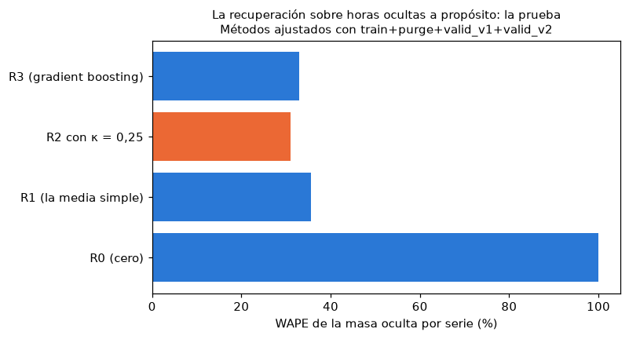
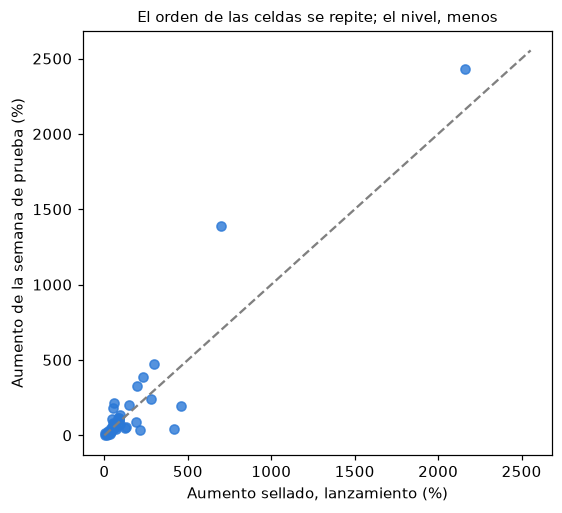
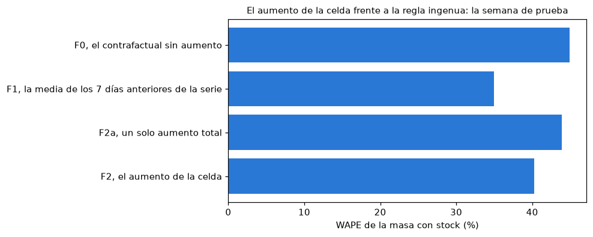

# Qué promociones venden de verdad

Un flujo que carga cada día las ventas por hora de 50.000 series tienda × producto de un comercio de perecederos con pedidos en línea, las valida, marca las horas sin stock y recupera la demanda que esconden; estima cuánto sube la venta en los días con promoción frente a lo que esa misma serie vendería a esa hora sin ella, con un intervalo del 95 %, y ordena las combinaciones de grupo y descuento sin presentar como distintas las que se pisan. Y mide, con criterios fijados antes de construir, si ese resultado se repite en la semana siguiente: **el orden de qué promociones venden más se repite y el tamaño de cada aumento no, y el aumento de cada celda mejora un pronóstico frente a un aumento único pero no supera a mirar la última semana de la propia serie.**

## El problema

Un comercio de perecederos lanza descuentos casi todas las semanas y quiere saber cuáles venden de verdad. La cuenta habitual compara la venta de los días con promoción con la de los días sin ella, y sale mal por dos motivos. Los días con promoción son de otros productos: la promoción se asigna por serie y por producto, no por calendario, y la serie explica el 44 % de su variación y el producto el 35 %, mientras que el día de la semana, la semana y el feriado juntos explican menos del 0,5 %. Y en las horas sin stock la venta cae aunque la gente quiera comprar, así que la venta observada esconde parte de la demanda, y más en los días con promoción. Comercial decide qué descuento repetir mirando un aumento que mezcla productos y quiebres, categoría no sabe si una línea responde más a la promoción o solo se quedó sin stock antes, y abastecimiento no ve cuánta demanda se perdió.

El dato es FreshRetailNet-50K (Dingdong-Inc, Hugging Face, CC BY 4.0): 50.000 series de 898 tiendas en 18 ciudades y 865 productos, 97 días (2024-03-28 a 2024-07-02), con 24 valores horarios de venta y de estado del stock por serie-día y un par de campos de promoción. La venta está normalizada y sin unidades, no hay precio ni canal ni identificador de promoción, y la marca y el descuento no coinciden: el 14,11 % de las series-días tiene un descuento sin marca. En las horas de 06 a 21, el 19,9 % de las horas está sin stock, desde el 6,2 % a las 6 h hasta el 41,0 % a las 21 h.

Lo que el proyecto encontró, medido en la semana de prueba, una sola vez y bajo un sello (seis de los nueve criterios con umbral se cumplen):

- **El orden de las celdas se repite** (C05: Spearman 0,897 sobre 36 celdas) y **más descuento da más aumento** (C07: 1,000), pero **el tamaño de cada aumento no se repite**: el intervalo de la diferencia entre la prueba y lo sellado contiene 0 en el 58,3 % de las celdas, y se pedía el 80 % (C06, no se cumple, como se esperaba).
- **El aumento de cada celda mejora el pronóstico frente a un aumento único** (C08) **pero no supera a la regla ingenua**, la media de los 7 días anteriores de la propia serie: WAPE 40,3 % frente a 35,0 % (C09, no supera, como se esperaba).
- **Recuperar la demanda de las horas sin stock funciona como método** (C01 a C03: WAPE por serie 31,1 % frente a 35,6 % de la media simple, sin sesgo grande) **pero en la semana de prueba no cambia el aumento total de forma detectable**: +47,9 % recuperado frente a +46,5 % crudo, una diferencia de +1,37 puntos que va de −1,81 a +4,36 (C04, no se cumple, y es el único criterio que se esperaba cumplido y no lo hizo).
- **Un requerimiento de rendimiento no se cumple** (RNF02): cada corrida diaria tarda de 62 a 68 s y el límite es 60 s. Se dice en «Los resultados» y queda abierto para las correcciones que siguen a la evaluación independiente.

## La solución

Un flujo de once tareas que simula la operación sobre el archivo histórico: un lanzamiento con los 90 días de entrenamiento y reajuste, siete entregas diarias (2024-06-26 a 2024-07-02, la semana de prueba) y un cierre que evalúa, nueve corridas más una décima sin entrega. En cada una carga las series-días de la entrega en SQLite, las valida con 31 reglas, marca las horas sin stock, recupera la demanda de esas horas y emite, por celda de promoción, la suma observada, la contrafactual y el aumento del día, y por serie-día con promoción cuatro pronósticos. Lo emitido no se cambia.

Cuatro piezas hacen el trabajo:

1. **Los estados del día.** Cada serie-día es `promo` (marca con descuento válido), `regular` (sin marca y sin rebaja: el control), `unflagged_cut` (descuento sin marca, que se mide aparte) o `anomalous` (descuento 0 o mayor que 1, que se cuenta y se aparta).
2. **La recuperación de la demanda** (R0 cero, R1 la media de la serie, la hora y el estado, R2 R1 escalada por el nivel del mismo día y R3 gradient boosting con pérdida de Poisson), elegida en V1 con una censura sintética de horas que sí tuvieron stock, donde la venta real se conoce, y juzgada por la masa que devuelve sumada por serie. Gana R2 con κ = 0,25.
3. **El contrafactual de la misma serie, la misma hora y el mismo día del grupo** (ajuste proporcional iterativo, IPF, sobre los días `regular`), con el aumento como observado sobre contrafactual, en dos versiones (venta cruda y demanda recuperada) y con un intervalo del 95 % que remuestrea series y días enteros.
4. **El ranking de celdas** (7 grupos de gestión × 7 bandas de descuento, con al menos 30 series) en grupos indistinguibles: dos celdas cuyos intervalos se pisan no se presentan como distintas.

El resultado central no es un modelo sino una medición. Se compara con criterios C01-C10 fijados antes de construir, con lo esperable escrito por adelantado (que C06 y C09 probablemente no se cumplirían), y se sella: la prueba se evalúa una sola vez y lo sellado no se reescribe. Cada cifra de validación dice con qué bloques de días se ajustó su método. Salió desfavorable en tres criterios: el pronóstico con el aumento de la celda no supera a la regla ingenua (C09), el tamaño de cada aumento no se repite (C06) y recuperar la demanda no cambió el aumento total de forma detectable (C04).

- **La corrección de dos fuentes de error**: comparar productos distintos, que explica la mayor parte de la diferencia entre la cuenta ingenua (+20,6 % sobre los 90 días) y el aumento dentro de la serie (+52,0 % crudo), y las horas sin stock, que esconden mucho menos.
- **Un efecto descriptivo, no causal**: todo aumento es una asociación dentro de la serie, ajustada por la hora y el día del grupo; no dice si la promoción se lanzó porque se esperaba más demanda.
- **El flujo y el sello**: nueve corridas validadas y cargadas todo o nada, un modelo congelado y una prueba evaluada una vez bajo un sello que no se reescribe, con un solo escritor por carpeta de datos.
- **El tablero y el sitio**: las 25 tablas del modelo estrella, el diseño de cinco páginas en HTML y cinco JSON pequeños para el sitio, con un manifiesto que se escribe al final.

## Los resultados

Corrida real del 2026-11-18 sobre los dos Parquet de FreshRetailNet-50K: el lanzamiento (`L2024-06-25`, corrida `20261118T082648095357Z`), siete entregas diarias y el cierre (`C2024-07-03`, corrida `20261118T083929959268Z`). El método de recuperación se ajustó con el entrenamiento (2024-03-28 a 2024-05-31), se eligió con V1 (06-08 a 06-16), V2 (06-17 a 06-25) quedó de vista previa, y todo se reajustó con los 90 días hasta 06-25; la semana de prueba, del 2024-06-26 al 2024-07-02, se evaluó una sola vez y quedó en el sello `reports/model_seal.json`, que no se reescribe. Los criterios se fijaron y se confirmaron en Git antes del primer código (`docs/requirements.md`, sección 8.1; `docs/decisions.md`, D16), junto con lo que se esperaba: que C06 y C09 probablemente no se cumplirían y que C01, C02, C04, C05, C07 y C08 sí. **Salió como se esperaba salvo en C04**, que se esperaba cumplido y no se cumplió. Ningún criterio ni umbral se cambió.

<!-- results:start -->
## Resultados

Criterios fijados antes de construir, evaluados una vez sobre la prueba.

| Criterio | Umbral | Valor | Cumple | Veredicto |
| --- | --- | ---: | --- | --- |
| C01 La recuperación supera a la media simple | límite superior del intervalo del 95 % de WAPE por serie (recuperación) − WAPE por serie (R1) < 0, en la máscara de cola de la prueba | 0,311 | sí | La recuperación (R2 con κ = 0,25) supera a la media simple (R1) en la máscara de cola de la prueba: WAPE por serie 31,1 % frente a 35,6 %; la diferencia va de −4,69 a −4,25 puntos. |
| C02 La masa recuperada no tiene sesgo grande | \|sesgo de la recuperación\| ≤ 0,10 en la máscara de cola de la prueba | −0,002 | sí | El sesgo de la masa recuperada cumple: la recuperación estima 0,2 % de menos y se pedía a lo sumo 10,0 %. |
| C03 La recuperación no cambia el aumento | \|(1 + sesgo en días con promoción) / (1 + sesgo en días regulares) − 1\| ≤ 0,05 en la máscara de cola de la prueba | −0,038 | sí | La recuperación no cambia el aumento: el sesgo en días con promoción frente al de los días regulares lo mueve 3,8 %, y se pedía a lo sumo 5,0 %. |
| C04 Los quiebres esconden parte del efecto | límite inferior del intervalo del 95 % del aumento total recuperado − el crudo, en la prueba, > 0 | 0,479 | no | Los quiebres no esconden parte del efecto: el aumento total con la demanda recuperada es 47,9 % frente a 46,5 % con la venta cruda; la diferencia va de −1,81 a 4,36 puntos. |
| C05 El orden de las celdas se repite | correlación de Spearman entre los aumentos sellados y los de la prueba, en las celdas con series suficientes en las dos, ≥ 0,80 | 0,897 | sí | El orden de las celdas se repite en la semana de prueba: correlación de Spearman 0,897 entre el aumento sellado y el de la prueba, sobre 36 celdas, y se pedía al menos 0,80. |
| C06 El nivel de cada celda se repite | proporción de esas celdas cuyo intervalo de la diferencia prueba − sellado contiene 0 ≥ 0,80 | 0,583 | no | El nivel de cada celda no se repite: el intervalo de la diferencia prueba − sellado contiene 0 en el 58,3 % de 36 celdas, y se pedía al menos 80,0 %. |
| C07 Más descuento, más aumento | correlación de Spearman entre la profundidad de la banda y su aumento en la prueba ≥ 0,90 | 1,000 | sí | Más descuento, más aumento: correlación de Spearman 1,000 entre la profundidad de la banda y su aumento en la prueba, y se pedía al menos 0,90. |
| C08 El aumento de la celda mejora el pronóstico | límite superior del intervalo del 95 % de WAPE(F2) − WAPE(F2a) < 0, en las series-días con promoción de la prueba | 0,403 | sí | El aumento de la celda mejora el pronóstico frente a un aumento único (F2a): WAPE de F2 40,3 % frente a 43,9 % de F2a; la diferencia va de −4,07 a −3,19 puntos. |
| C09 El pronóstico con el aumento supera a la regla ingenua | límite superior del intervalo del 95 % de WAPE(F2) − WAPE(F1) < 0, en las mismas series-días | 0,403 | no | El pronóstico con el aumento de la celda no supera a la regla ingenua (F1), la media de los días anteriores de la propia serie: WAPE de F2 40,3 % frente a 35,0 % de F1; la diferencia va de 1,92 a 8,32 puntos. |
| C10 Variantes y seguimiento (informativo) | sin umbral: que esté escrito y sea consistente | sin dato | informativo | Informativo, sin umbral: se escribieron 257 cifras de variantes y el seguimiento de 7 días de la prueba. |

Validación (V2, no la prueba; métodos ajustados con train): recuperación sobre la máscara de cola.

| Método | WAPE por serie | Sesgo |
| --- | ---: | ---: |
| R0 (cero) | 100,0 % | −100,0 % |
| R1 (la media simple) | 37,5 % | 2,3 % |
| R2 con κ = 0,25 | 31,6 % | 0,7 % |
| R2 con κ = 0,50 | 32,1 % | 1,0 % |
| R2 con κ = 1,00 | 33,4 % | 1,4 % |
| R2 con κ = 2,00 | 34,8 % | 1,8 % |
| R3 (gradient boosting) | 35,2 % | −8,7 % |

Estado: sealed. Corrida 20261118T083929959268Z del 2024-07-03 00:00:00.
<!-- results:end -->

Cómo se lee, con las cifras de la semana de prueba (103.629 series-días con promoción):

| | Cruda | Recuperada |
| --- | --- | --- |
| Aumento total de la prueba | +46,5 % [41,0; 52,3] | +47,9 % [44,1; 51,2] |
| Aumento total sellado, con los 90 días | +52,0 % [49,7; 54,8] | +52,9 % [51,2; 54,9] |

- **C01 a C03 se cumplen: la recuperación es mejor que la media simple y casi no tiene sesgo.** C01: WAPE por serie 31,1 % frente a 35,6 % de R1; la diferencia va de −4,69 a −4,25 puntos. C02: sesgo de −0,2 % (se pedía a lo sumo 10 %). C03: el sesgo de la recuperación en días con promoción frente al de los días regulares mueve el aumento 3,8 % (se pedía a lo sumo 5 %). Estas cifras son de la máscara de cola de la prueba y el método se ajustó con los 90 días hasta 06-25 (`train+purge+valid_v1+valid_v2`).
- **C04 no se cumple, y se esperaba que sí.** En la prueba, los quiebres no esconden parte del efecto que se pueda distinguir de 0: la diferencia entre el aumento recuperado y el crudo es de +1,37 puntos y va de −1,81 a +4,36. El planificador había medido +4,20 puntos sobre el entrenamiento ([+2,73; +5,76], con otra ventana de ajuste) y con los 90 días del lanzamiento la diferencia es de +0,9 puntos. El resultado es el que salió: recuperar la demanda no cambió el aumento de forma detectable en esta semana.
- **C05 y C07 se cumplen: el orden se repite.** C05: correlación de Spearman 0,897 entre el aumento sellado y el de la prueba sobre 36 celdas, y se pedía 0,80. C07: 1,000 entre la profundidad de la banda y su aumento en la prueba, y se pedía 0,90. Las bandas selladas van de +100,2 % (más del 50 %) y +139,6 % (40 a 50 %) a +13,3 % (hasta el 5 %), recuperadas.
- **C06 no se cumple (esperado): el tamaño de cada aumento no se repite.** El intervalo de la diferencia prueba − sellado contiene 0 en el 58,3 % de 36 celdas (21 de 36), y se pedía el 80 %. El intervalo de dos vías (series y días) es 1,70 veces más ancho que el de solo series y aun así no alcanza: el nivel del aumento de una celda es una descripción del período, no una promesa para la semana siguiente. Además, el nivel depende de la ventana con que se ajusta el contrafactual: sobre las mismas series-días el aumento crudo es +56,52 % con el ajuste del entrenamiento y +47,86 % con el de los 90 días (D09).
- **C08 se cumple y C09 no supera: el aumento de la celda agrega información, pero no gana a la regla ingenua.** C08: WAPE de F2 40,3 % frente a 43,9 % de F2a, un solo aumento total; la diferencia va de −4,07 a −3,19 puntos. C09: WAPE de F2 40,3 % frente a 35,0 % de F1, la media de los 7 días anteriores de la serie; la diferencia va de +1,92 a +8,32 puntos. El pronóstico no es el producto (D15): solo mide si el aumento agrega información.
- **C10 es informativo:** 257 cifras de variantes y el seguimiento de los 7 días de la prueba, de +40,8 % a +55,4 % recuperado por día.
- **RNF02 no se cumple todavía (requerimiento abierto).** La repetición completa tarda 876 s (14,6 min contra 20), el lanzamiento 310 s (contra 12 min) y el cierre 120 s, pero las siete corridas diarias tardan de 62 a 68 s contra un límite de 60 s: la carga (unos 25 s) y la exportación (unos 32 s) reconstruyen todo en cada entrega. Su prueba, `tests/e2e/test_real.py::test_every_daily_run_takes_at_most_the_required_seconds`, está en rojo a propósito. La corrección se mide sobre una copia de `data/` y va después de la evaluación independiente; lo sellado no se reconstruye.
- **Memoria** (RNF03): el pico de la repetición completa es de 4.077,9 MB de `PeakWorkingSetSize` (el límite es 12 GB de ese contador); `PeakPagefileUsage`, informativo, 5.808,7 MB.









## En qué consiste

Once tareas que corren siempre en este orden, las mismas desde la línea de comandos (`python -m promolift run`) y desde el DAG de Apache Airflow (`promolift_daily`):

```mermaid
flowchart LR
  A[fetch_source<br/>dos Parquet con tamaño y huella fijados] --> B[deliver<br/>la siguiente entrega]
  B --> C[validate<br/>31 reglas]
  C --> D[load<br/>SQLite, todo o nada]
  D --> E[recover<br/>demanda de las horas sin stock]
  E --> F[fit_model<br/>elige, congela y sella en el lanzamiento]
  F --> G[estimate<br/>aumento por celda y pronósticos]
  G --> H[evaluate<br/>la prueba, una vez]
  H --> I[export<br/>25 Parquet y 5 JSON]
  I --> J[render_dashboard<br/>HTML]
  J --> K[report<br/>cierra la corrida]
```



La segunda tarea hace de sistema de origen: como el conjunto es una extracción fija de 97 días, el flujo lo reparte en un lanzamiento con los 90 días de `train.parquet`, siete entregas diarias con un día de `eval.parquet` cada una y un cierre sin filas que evalúa, y una décima corrida termina `no_delivery`. La tercera corta el flujo, sin tocar nada, si la entrega no cumple el contrato. Un día se conoce completo al cerrar (un supuesto, no un dato del conjunto).

El método se elige una sola vez, en el lanzamiento, y queda congelado: su artefacto (un `.npz` sin objetos de Python) se lee solo si su tamaño y su SHA-256 coinciden con los registrados. Lo emitido se escribe en tablas de solo inserción. El sello guarda la huella de cada clave de la configuración que cambia un valor sellado: una evaluación de la prueba con otra configuración se rechaza antes de escribir, y lo que se calcule después con otra configuración se informa aparte, como posterior al sello. Un solo proceso escribe la carpeta de datos a la vez: cada tarea toma un bloqueo y un segundo proceso se rechaza con código 2 sin escribir.

Sobre la fuente: los dos Parquet se tratan como no confiables. Los lee pyarrow con tope de bytes, de filas y de grupos de filas, esquema exacto, listas horarias de largo 24 sin nulos y claves únicas, y se aceptan solo si su tamaño y su SHA-256 son los fijados. El flujo no descarga nada: los coloca quien corre el proyecto (ver «Cómo correrlo de punta a punta»).

## Los datos

| | |
| --- | --- |
| Fuente | FreshRetailNet-50K (Dingdong-Inc, Hugging Face, CC BY 4.0), commit `c374e859` |
| Archivos | `train.parquet`, 106.436.287 bytes, 4.500.000 filas; `eval.parquet`, 8.440.124 bytes, 350.000 filas; las huellas completas están en «Fuente y licencia» |
| Series | 50.000 series tienda × producto, de 898 tiendas en 18 ciudades y 865 productos; 7 grupos de gestión y 32 primeras categorías |
| Período | 97 días, del 2024-03-28 al 2024-07-02; 90 de entrenamiento y reajuste y 7 de prueba |
| Por fila | 24 valores horarios de venta (normalizada, sin unidades) y de estado del stock (0 o 1), y nueve campos diarios: la marca de promoción, el descuento, el feriado y el clima, entre otros |
| Lo que no trae | Precio, canal, unidades y un identificador de promoción: la unidad de análisis es la celda de grupo y banda, no la promoción |

El conjunto esconde cosas que el proyecto mide y no corrige a ciegas:

- **Los dos campos de promoción no coinciden.** La marca (`activity_flag`) y el descuento (`discount`) discrepan: hay descuento sin marca en el 14,11 % de las series-días (635.063) y marca sin descuento en 38.405. Un descuento 0 (16.039 filas) y uno mayor que 1 (34) no se pueden interpretar y se apartan; uno de 0 a 0,5 es la banda más profunda.
- **Los quiebres son colas del día.** El 86,41 % de las series-días que se quedan sin stock entre 06 y 21 siguen así hasta las 21 h; la primera hora sin stock tiene mediana 15 h, y el 14,7 % de las que se quedan sin stock empiezan a las 6 h. Los quiebres llegan antes en los días de más demanda: una censura que depende de la demanda.
- **La noche casi no vende** (el 4,8 % de la venta cae de 22 a 5 h) y no se recupera ni se mide: el análisis cubre las horas de 06 a 21.
- **Dos campos diarios son sumas de las horas**: `sale_amount` y `stock_hour6_22_cnt` contienen el objetivo del mismo día, y un método que los lea acierta en la simulación y nunca en un quiebre real. El flujo los descarta al leer y tiene una trampa de fuga (M01) que detiene el lanzamiento.


La partición en el tiempo, por día, con 7 días de purga entre el entrenamiento y V1:

| Bloque | Días | Fechas | Para qué |
| --- | --- | --- | --- |
| Entrenamiento | 65 | 2024-03-28 a 2024-05-31 | Ajustar R1-R3 y el contrafactual de la elección |
| Purga | 7 | 2024-06-01 a 2024-06-07 | Ninguno |
| V1 | 9 | 2024-06-08 a 2024-06-16 | Elegir el método de recuperación y κ |
| V2 | 9 | 2024-06-17 a 2024-06-25 | Vista previa de la recuperación y réplica del entrenamiento; no elige nada |
| Prueba | 7 | 2024-06-26 a 2024-07-02 | `eval.parquet`; se evalúa una vez, con lo sellado |

El lanzamiento reajusta con los 90 días hasta 06-25. No hay estacionalidad anual: 97 días no la contienen (D14).

## Los algoritmos

**La cuenta que sale mal.** Comparar la venta de los días con promoción con la de los días sin ella da +20,6 % sobre los 90 días, porque mezcla productos. Comparar cada serie consigo misma, a la misma hora y ajustando por el día de su grupo, da +52,0 % crudo y +52,9 % recuperado: la mayor parte de la diferencia es mezcla de productos y no quiebres.

**La demanda de las horas sin stock** (`recovery.py`). R1 es la media de las horas con stock de la serie, la hora y el estado; R2 la multiplica por el nivel del mismo día, `k = (O + κ·m) / (E + κ·m)`, con κ de 0,25 a 2; R3 es un `HistGradientBoostingRegressor` con pérdida de Poisson. A nivel de la hora, ningún método supera a predecir cero (el WAPE horario de cero es 100 % y el de cualquier método pasa de 108 %), porque la venta horaria es intermitente: por eso la recuperación se juzga por la masa que devuelve sumada por serie, con una censura sintética que oculta la cola del día de series-días con stock todo el día. La elección fue R2 con κ = 0,25, el borde de la grilla (V1: WAPE por serie 32,4 % frente a 38,1 % de R1 y 34,0 % de R3; V2: 31,6 %, 37,5 % y 35,2 %, métodos ajustados con train). Lo que la simulación no valida: los quiebres reales llegan en días de más demanda y las series-días con stock todo el día no representan esa selección; por eso el aumento recuperado es una cota inferior del que esconden los quiebres, no una corrección exacta (D34).


**El contrafactual** (`effect.py`). La venta esperada de una serie-día con promoción es `a(serie, hora) · b(grupo, día)`, con `a` y `b` ajustados por IPF solo sobre los días `regular` (30 iteraciones; el cambio máximo de `b` entre 30 y 60 es de 10⁻¹⁴). Una serie sin ningún día `regular` no tiene contrafactual y no entra en ningún efecto. El aumento es la suma observada sobre la suma del contrafactual menos 1, y no es causal.

**Los intervalos** (`bootstrap.py`). Remuestreo de dos vías, con pesos de series enteras y de días enteros (500 remuestras, semilla 0), con el contrafactual fijo. En las celdas con 30 series, el ancho mediano es 24,1 puntos con las dos vías y 14,2 con solo series; se pisan 183 de 903 pares de celdas (106 con solo series).

**El ranking** (`ranking.py`). Las celdas con al menos 30 series se ordenan por su aumento y se reparten en grupos indistinguibles: dos celdas que se pisan comparten grupo. Con los 90 días, 43 celdas quedan ordenadas en 5 grupos. El orden se repite en la prueba (C05) y el nivel no (C06).


## El producto

**Un flujo diario y una línea de comandos.** `python -m promolift replay` corre el lanzamiento, las siete entregas y el cierre; `run` corre la siguiente entrega pendiente con las once tareas, y `task` una sola. El DAG de Airflow `promolift_daily` corre las mismas tareas en Docker, con todos los secretos del entorno y una inicialización que se detiene en su primer error.

**El diseño del tablero** (`dashboard/powerbi-design.html`): cinco páginas, las 21 medidas DAX, las tablas, las relaciones y la carga en Power Query, con vistas previas de los datos reales, para armarlo a mano en Power BI Desktop. **El `.pbix` todavía no está hecho**: lo arma quien tenga Power BI Desktop siguiendo el HTML.

**Las tablas del modelo estrella** (`outputs/powerbi/`): 10 dimensiones y 15 hechos en Parquet, con claves únicas e integridad referencial, descritas en `docs/data-dictionary.md`.

**La exportación para el sitio** (`outputs/site/`): cinco JSON que suman menos de 200 KB y un manifiesto con el tamaño y el SHA-256 de cada uno, escrito al final; un conjunto mezclado se rechaza. Las figuras de este README se dibujan solo desde esos archivos verificados con `python -m promolift figures`.


## La documentación

| Documento | Qué contiene |
| --- | --- |
| [docs/research.md](docs/research.md) | La investigación del conjunto: quiebres, promociones, confusión, fugas, las líneas base y una primera mirada del efecto, con las contradicciones con el sitio |
| [docs/requirements.md](docs/requirements.md) | Requerimientos, datos medidos y criterios de aceptación, con los criterios del modelo fijados antes de construir |
| [docs/plan.md](docs/plan.md) | Arquitectura, módulos, contratos y las 21 unidades de trabajo |
| [docs/decisions.md](docs/decisions.md) | Registro de decisiones, cada una con su contexto, opciones, decisión, motivo, lo que afecta, quién y estado |
| [docs/model-card.md](docs/model-card.md) | Ficha del modelo: uso, datos, estados del día, recuperación, contrafactual, intervalos, ranking, criterios, límites, tiempos y la suite |
| [docs/data-dictionary.md](docs/data-dictionary.md) | Diccionario de datos: los campos de origen con su uso, los estados del día y las bandas, y una tabla por Parquet generada desde el modelo semántico con `docs-sync` |
| [docs/runbook.md](docs/runbook.md) | Qué hacer cuando algo no sale como se esperaba: R1 a R12 (los Parquet, la lectura, las entregas, la trampa de fuga, el artefacto, el sello, el bloqueo, un análisis nuevo, Airflow, reconstruir desde cero, el cubo) |
| [docs/paso-a-paso.md](docs/paso-a-paso.md) | La cronología real del proyecto, commit por commit, desde el registro y `git log` |
| [docs/review-advisories.md](docs/review-advisories.md) | Las advertencias de las revisiones nativas, cada una con su ubicación y su estado |

`docs/evaluation.md`, la evaluación independiente, todavía no existe: se hace después de esta documentación.

La evaluación independiente todavía no se hizo, de modo que las advertencias de las revisiones siguen abiertas, el requerimiento de tiempo de la corrida diaria (RNF02) sigue sin cumplirse y esta documentación se sincroniza otra vez después de la última corrección (plan, sección 28).

Advertencias abiertas: `U01/S1`, `U01/S2`, `U02-U03/S1`, `U02-U03/S2`, `U05/S1`, `U06/W1`, `U07/S1`, `U08/S1`, `U08/S2`, `U08/W1`, `U09/S1`, `U11/S1`, `U14/S1`, `U14/S2`, `U17/S1`, `U17/S2`, `research/S1`, `research/S2`, `research/S3`

## Con IA, de punta a punta

Este proyecto lo construyen agentes de IA, cada uno con el modelo que el dueño pidió para su tarea (Opus para los planes, la arquitectura y la evaluación, Sonnet para la programación, Haiku para tareas acotadas como investigar), con una persona definiendo el rumbo. Lo que sigue es lo que consta en el registro del documento de seguimiento (`odd/tasks/portfolio-projects.md`, L70 a L81) y en `git log`:

- **Datos e investigación** (L70, L71). Un agente con Haiku bajó FreshRetailNet-50K con un script fijado al commit del conjunto, comprobó sus dos huellas, perfiló quiebres, promociones, confusión y fugas, midió las líneas base y una primera mirada del efecto (+11,1 % crudo, +38,6 % recuperado) y escribió `research.md` sin calcular nada sobre la semana de prueba. Encontró nueve contradicciones con lo que dice el sitio y doce preguntas abiertas.
- **Requerimientos y plan** (L72). Un agente con Opus leyó la investigación y los documentos del proyecto 05 con su evaluación, y repitió parte de la medición **leyendo solo `train.parquet`**: encontró que a nivel de la hora ningún método de recuperación supera a predecir cero, que los quiebres son colas del día, que el día de control mueve el efecto más que los quiebres, que el orden de las celdas se repite en la validación pero su nivel no y que el aumento de la celda no gana a la última semana de la serie. Fijó C01-C10 con lo esperable (que C06 y C09 probablemente no se cumplirían), 40 decisiones (hoy son 41) y 21 unidades de trabajo, y todo se confirmó en Git (`ed6d6c4`) antes de la primera línea de código.
- **Programación** (L73, L75, L77, L79, L81). Agentes con Sonnet escribieron U01 a U19 de a una a cuatro unidades por sesión, cada una con su prueba primero y su commit: el entorno, la configuración, el accesorio sintético con su demanda latente, la lectura estricta de los Parquet, las entregas y la validación, el almacén, las máscaras y la recuperación, el contrafactual y el remuestreo, el lanzamiento con su sello, la corrida diaria, la evaluación de la prueba, el modelo estrella, el diseño del tablero, la exportación para el sitio, el bloqueo, las tareas y los rechazos, la línea de comandos, Airflow en Docker y la corrida real. Cada unidad vio su prueba fallar antes de escribir el código, y se probaron mutaciones de las reglas de negocio (el registro cuenta cuáles sobrevivieron y por qué).
- **Revisión** (L74, L76, L78, L80). La revisión nativa de Gentle AI revisó la investigación y U01 a U18, con el consentimiento aceptado de forma automática por pedido del dueño: cada unidad de riesgo alto sola y el resto en tramos. Aprobó todo lo que revisó, con 20 hallazgos entre sugerencias y advertencias, que `docs/review-advisories.md` lista con su ubicación; uno se corrigió (`f553c1e`) y los demás siguen abiertos. Un tramo de documentos no tenía riesgo para revisar y otro superó el presupuesto de contexto, y el registro lo dice.
- **Una decisión del dueño** (L79). La suite rápida pasó el límite de 120 s (tardó 125 s). El agente le preguntó por Telegram con tres salidas (fijar `pytest-xdist`, subir el límite o sacar de la suite por defecto las pruebas del flujo) y el dueño eligió subir el límite: pasó a 180 s con un presupuesto de trabajo de 150 s (`4e73cdd`, D29).
- **La corrida real** (L81, `6253c31`). Una sola vez: `replay` sobre los dos Parquet reales, la evaluación de la prueba bajo el sello y la corrida sin entrega, con los tiempos y la memoria medidos. Salió como se escribe arriba: seis de nueve criterios se cumplen, C06 y C09 no, como se esperaba, y C04 no, contra lo esperado. Una prueba de tiempo quedó en rojo a propósito (RNF02). Antes se corrigió una advertencia de una revisión (`f553c1e`).
- **Esta documentación.** El README, la ficha del modelo, el diccionario, el runbook, el paso a paso y las advertencias los escribe un agente con Sonnet con la prueba primero (`tests/docs/test_docs.py`): cada prueba nombrada se vio fallar contra el documento que faltaba antes de escribirlo. Las cifras salen de los archivos sellados y del resumen, y una prueba las compara a los decimales que el documento escribe. Su entrada en el registro la escribe quien orquesta después de ella.
- **Lo que no se hizo todavía.** La evaluación independiente, sus correcciones y su comprobación, la página del sitio y el `.pbix`.
- **Memoria.** Engram guarda el contexto entre sesiones; el documento de seguimiento conserva las palabras del dueño tal cual y lo que hizo cada sesión.

## Para qué sirve

- **Equipo comercial.** Ve cuáles combinaciones de grupo y descuento vendieron más que el contrafactual de su propia serie en el período, con su intervalo y con el aviso de cuáles no se distinguen. El orden es confiable de una semana a la siguiente (C05, C07); el tamaño de cada aumento no (C06), así que sirve para decidir qué descuento repetir y no para prometer cuánto va a subir la venta la semana que viene.
- **Equipo de categoría.** Ve que, en este conjunto, comparar productos distintos explica la mayor parte de la diferencia de la cuenta habitual, y que recuperar la demanda de las horas sin stock cambia poco el aumento total (C04).
- **Abastecimiento.** Ve cuánto de la demanda de los días con promoción queda escondido en las horas sin stock (la masa recuperada) y la tasa de quiebre por hora, con la aclaración de que la recuperación es una cota inferior.
- **Quien trabaje con datos de comercio** ve cómo se juzga una recuperación sin verdad, por qué una métrica horaria premia al cero, cómo se estima un aumento dentro de la serie y cómo se evalúa una vez, con criterios fijados antes.
- **Para un tablero:** las tablas en estrella y el diseño en HTML dicen cómo armar las cinco páginas en Power BI Desktop.

Lo que no sirve: leer un aumento como causal, prometer el aumento de una promoción futura, hablar de ingreso o margen (no hay precio y la venta está normalizada), identificar una promoción individual (la unidad es la celda), ni generalizar más allá de 18 ciudades de un país y 97 días de un solo operador.

## Cómo correrlo de punta a punta

Requisitos: Windows 10 u 11 (o Linux), Python 3.11 y, solo para Airflow, Docker Desktop con al menos 12 GB. No se usa el Python global: el proyecto trae su propio entorno. El paquete no se instala: los comandos lo encuentran con `PYTHONPATH` en `src`, como hacen las pruebas y el compose.

```powershell
cd 06-Ecommerce-Promotion-Lift
py -3.11 -m venv .venv
.venv\Scripts\python -m pip install -r requirements-dev.txt
$env:PYTHONPATH = "src"
```

**1. Los Parquet.** El flujo no los descarga. Se bajan con el script de la investigación, que los fija al commit del conjunto y comprueba tamaño y SHA-256, y quedan en `data\raw\` (que no se versiona):

```powershell
.venv\Scripts\python research\s00_download.py
```

`train.parquet` debe pesar 106.436.287 bytes y `eval.parquet` 8.440.124; las dos huellas están en «Fuente y licencia». Si falta uno o no coincide, la tarea `fetch_source` termina con salida 3 y no escribe más que el informe de validación y el estado de la corrida (runbook R1).

**2. Pruebas** (sin las que necesitan los Parquet reales ni Docker). La suite por defecto recoge 857 pruebas y termina en menos de 180 s en el equipo de desarrollo (ver la ficha del modelo):

```powershell
.venv\Scripts\python -m pytest
```

**3. Modo rápido**, sobre datos sintéticos. Todo lo que lee y escribe queda en `data\quick\` (no se versiona): no toca el almacén, los Parquet, el HTML, los reportes ni el sello de la corrida real.

```powershell
.venv\Scripts\python -m promolift make-fixture data\quick
.venv\Scripts\python -m promolift replay --config config\pipeline.quick.toml
```

**4. Corrida real**, con los Parquet ya en su lugar. `replay` corre el lanzamiento, las siete entregas diarias y el cierre; `run` corre la siguiente entrega pendiente con las once tareas en orden, y `task` una sola tarea de una corrida:

```powershell
.venv\Scripts\python -m promolift replay
.venv\Scripts\python -m promolift run
.venv\Scripts\python -m pytest -m real_data      # pruebas con los Parquet reales; la de tiempo de la corrida diaria falla (RNF02)
```

**5. Figuras de la documentación y bloque de resultados del README** (`docs-sync` copia el resumen en el README y escribe, desde el modelo semántico, la tabla de cada Parquet en `docs/data-dictionary.md`; un segundo uso no cambia nada):

```powershell
.venv\Scripts\python -m promolift figures
.venv\Scripts\python -m promolift docs-sync
```

Todos los comandos aceptan `--config RUTA` y `-v`; salen con 0, 1 (una tarea falló), 2 (uso, configuración, una corrida cerrada o un bloqueo tomado) o 3 (la fuente o la entrega rechazadas). La corrida real ya se hizo y su sello está versionado: repetirla reescribe las salidas versionadas con sus propias claves de corrida, y con otra configuración el resultado se guarda aparte, como posterior al sello, y no reemplaza el sellado. Para repetirla sin tocar lo versionado, usar el modo rápido.

Medido en la corrida real, en el equipo de desarrollo y en un solo proceso (D29, D39): la repetición completa tardó 876 s (14,6 min contra 20); el lanzamiento 310 s (contra 12 min); las siete corridas diarias de 62 a 68 s contra un límite de 60 s (**no se cumple**); el cierre 120 s; la corrida sin entrega 1 s. El pico de memoria fue de 4.077,9 MB de `PeakWorkingSetSize` (el límite es 12 GB de ese contador) y de 5.808,7 MB de `PeakPagefileUsage` (informativo).

## Paso a paso

El proyecto se construyó en 21 unidades de trabajo, cada una con sus pruebas y su commit: la investigación y el plan, el entorno y las dependencias, la configuración y la clasificación de claves, el accesorio sintético, la lectura de los Parquet, las entregas y la validación, el almacén, las máscaras y la recuperación, el contrafactual y el remuestreo, el lanzamiento y el sello, la corrida diaria, la evaluación, el modelo estrella, el diseño del tablero, la exportación para el sitio, el bloqueo, las tareas, la línea de comandos, Airflow y Docker, la corrida real y la documentación. [docs/paso-a-paso.md](docs/paso-a-paso.md) cuenta la cronología real, con el commit de cada paso, desde el registro de seguimiento y `git log`.

## Fuente y licencia

Fuente de datos: Dingdong-Inc, FreshRetailNet-50K, Hugging Face, CC BY 4.0 (https://creativecommons.org/licenses/by/4.0/), commit `c374e859`; Wang et al. (2026), arXiv:2505.16319. Copia usada: los dos Parquet del commit fijado, `train.parquet` (106.436.287 bytes, SHA-256 `6706832db892bbae4969c19d87e07975d2543d2ba7d7d4756360654785de5a3d`) y `eval.parquet` (8.440.124 bytes, SHA-256 `1b118840664280c6b88bffc84c80ee1f54c05d911e354b7599e5da10995e960e`).

Los datos crudos no se versionan: el flujo no descarga nada y exige que cada archivo tenga el tamaño y la huella fijados. El conjunto no trae datos personales: las tiendas y los productos son identificadores numéricos. La cifra de 1,43 veces de mediana por serie que da el artículo usa otra definición que este proyecto (cociente de sumas) y no se compara con la propia (D37); la medida con la definición del artículo sobre el entrenamiento fue de 1,38.
