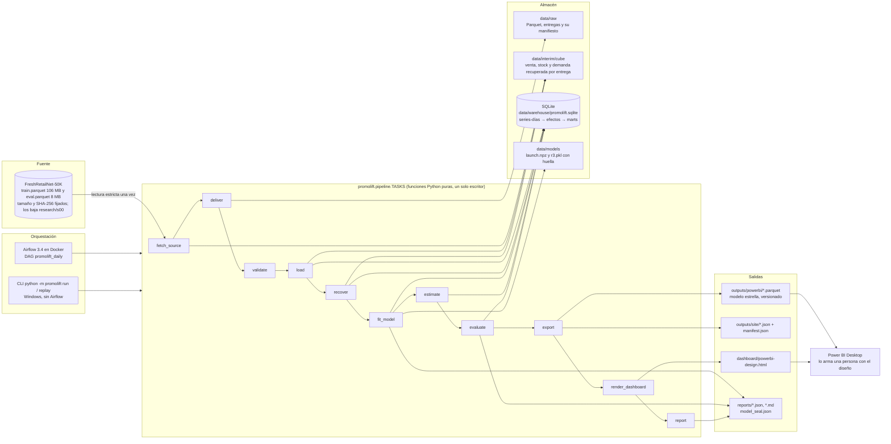

# Plan de implementación: qué promociones venden de verdad, con la demanda que esconden los quiebres

Fecha: 2026-11-17. Lee primero `requirements.md` (RF, RNF, AC y los criterios C01-C10) y `decisions.md` (D01-D40). Este plan dice cómo construirlo; si un detalle no está aquí ni allí, la decisión vuelve a quien planifica: no se adivina. Las suposiciones se marcan como **[Supuesto]** y lo que hay que comprobar antes de escribir código, como **[Verificar]**.

Convenciones: documentación en español neutro; código, identificadores, tablas y columnas en inglés; medidas DAX, títulos de visuales y textos del sitio en español. Comandos para Windows (PowerShell) y el `.venv` del proyecto; rutas relativas a `06-Ecommerce-Promotion-Lift/`. **El paquete se llama `promolift`** (variables de entorno `PROMOLIFT_*`, DAG `promolift_daily`, proyecto de Docker Compose `promolift-airflow`) y **el alcance de los commits es `promotion-lift`** (el de la investigación, `6afd46c`; por ejemplo `feat(promotion-lift): …`, `test(promotion-lift): …`; D31). Cuando este plan dice «como el proyecto 05», el código de referencia es el de `05-Mining-Flotation-Silica/` en su último commit corregido (`79ed5cc`, con la documentación de `c49bde3`), que se adapta y se copia, no se importa.

## 1. Arquitectura



Principios (los de los proyectos 01 a 05, más los de sus evaluaciones):

- Cada tarea es una función `fn(ctx: RunContext) -> dict` sin dependencias de Airflow. El DAG y la CLI recorren la misma tupla `TASKS`.
- Las tareas se pasan estado por archivos y tablas: `data/interim/runs/<run_key>.json` guarda lo que produjo cada tarea.
- **Un solo escritor**: `max_active_runs=1`, `max_active_tasks=1` y, además, todo comando que escribe toma `data/interim/pipeline.lock` antes de su primera escritura (D26).
- Toda salida versionada se escribe a un temporal, se sincroniza y se renombra con `os.replace`; los conjuntos de archivos llevan un manifiesto escrito al final.
- **La serie-día manda**: el grano de todo lo que se carga, se recupera y se emite es la serie-día de 06 a 21; las horas viven en el cubo (arreglos de NumPy), las sumas por serie-día en SQLite (D22).
- **El contrafactual es uno**: una sola función (`effect.counterfactual`) da `a(s, h) · b(g, d)`; los efectos, los pronósticos, las variantes y la corrida diaria pasan por ella.
- **La recuperación es una**: `recovery.recover_day` recupera un día con el método sellado; la carga real y la censura sintética la llaman igual (la máscara solo cambia qué horas se tratan como sin stock).
- Los cálculos que terminan en un valor sellado reciben solo la **vista sellada** de la configuración (`SealedConfig`), construida con las claves de la huella (D17).
- **Cada cifra dice con qué se ajustó**: toda fila de validación lleva `fit_blocks` (por ejemplo `train`), y nada ajustado con un bloque se mide en ese bloque como si fuera fuera de muestra (la lección A2 del proyecto 05; D21).
- Toda ruta relativa de la configuración, de `--config` y de `PROMOLIFT_CONFIG` se resuelve contra la carpeta del proyecto (D27).

## 2. Estructura de carpetas

```text
06-Ecommerce-Promotion-Lift/
  README.md
  pyproject.toml              # paquete promolift (src layout), pytest, marcas y la suite por defecto
  requirements.txt            # ejecución (flujo y DAG), fijadas con == (D33)
  requirements-dev.txt        # -r requirements.txt, pytest
  requirements-research.txt   # el de la investigación (ya versionado)
  .gitignore                  # data/raw/, data/interim/, data/warehouse/, data/models/, data/quick/, airflow/logs/, airflow/config/, airflow/plugins/, airflow/.env, reports/validation/history/
  .dockerignore               # solo requirements.txt entra al contexto de la imagen
  config/
    pipeline.toml             # configuración completa (sección 4)
    pipeline.quick.toml       # modo rápido: extends = "pipeline.toml", todo bajo data/quick/
  sql/
    schema/001_core.sql  002_effects.sql  003_eval.sql
    staging/stg_series_days.sql
    marts/powerbi/
    checks/load/  checks/model/         # chk_*.sql: cada consulta devuelve las filas que violan
  src/promolift/
    __init__.py  __main__.py  cli.py  config.py  pipeline.py  lock.py  sysinfo.py  files.py
    schema.py  ingest.py  days.py  cube.py  deliveries.py  validate.py  warehouse.py
    split.py  masks.py  recovery.py  effect.py  bootstrap.py  ranking.py  forecast.py
    registry.py  launch.py  daily.py  evaluation.py  variants.py  leakage_demo.py  reporting.py
    export.py  site_export.py  figures.py  texts.py
    dashboard/__init__.py  dashboard/semantic_model.py  dashboard/render.py  dashboard/svg.py
  airflow/
    Dockerfile  docker-compose.yaml  .env.example  init.sh
    dags/promolift_daily.py
  research/                              # s00-s10 de research.md y research/plan/p01-p07 (ya versionados)
  dashboard/powerbi-design.html          # generado (versionado)
  outputs/powerbi/*.parquet              # generado (versionado, ≤ 25 MB cada uno)
  outputs/site/*.json, manifest.json     # generado (versionado, ≤ 200 KB sin el manifiesto)
  reports/evaluation_summary.json|.md    # generado (versionado)
  reports/model_seal.json                # sello (versionado; D17)
  reports/validation/latest.json|.md     # generado (versionado); el historial no
  docs/  research.md requirements.md plan.md decisions.md
         data-dictionary.md model-card.md runbook.md paso-a-paso.md review-advisories.md evaluation.md figures/*.png
  tests/
    conftest.py               # accesorios de sesión y el presupuesto de la suite (sección 24)
    fixtures/make_fixture.py  fixtures/hand_cases.py
    unit/  contract/  integration/  e2e/  docs/
  data/raw/  data/interim/  data/warehouse/  data/models/  data/quick/   # nunca versionados
```

Entorno (U01): el `.venv` ya existe con `requirements-research.txt`; U01 instala `requirements-dev.txt` encima y corre `pip check` (comprobado por su código de salida, no por un texto de la salida: la advertencia R3-pip-check-stdout-substring del proyecto 05). Las pruebas, el compose y los comandos del README usan `PYTHONPATH=src`, como los proyectos 03 a 05 (instalar el paquete es un pendiente del dueño, sección 29).

Marcas de pytest: `real_data` (los Parquet reales en `data/raw/`), `docker` y `slow` (informativa). Por defecto: `-m "not real_data and not docker"`.

## 3. Flujo de datos

Un lanzamiento, siete entregas diarias y un cierre componen la historia (D18); una corrida más termina como `no_delivery`. El día `d` se conoce completo al cerrar (`as_of` = 00:00 del día siguiente; D05).

| Entrega | Días | `as_of` | Qué pasa además |
| --- | --- | --- | --- |
| `L2024-06-25` | 2024-03-28 a 2024-06-25 (90, `train.parquet`) | 2024-06-26 00:00 | Ajusta R1-R3 en el entrenamiento, elige el método y κ en V1 (máscara de cola), guarda la vista previa de V2, la réplica del entrenamiento en la validación y los pronósticos de la validación (todo con `fit_blocks = train`); reajusta la recuperación y el contrafactual con los 90 días; estima los efectos publicados con sus intervalos y el ranking; corre la trampa M01 y la demostración de la fuga; sella el lanzamiento |
| `D2024-06-26` … `D2024-07-02` | un día de `eval.parquet` cada una | 00:00 del día siguiente | Recupera el día con el método sellado, ajusta `b(g, d)` con sus días `regular`, emite el efecto del día por celda y banda, los pronósticos F0, F1, F2a y F2 de cada serie-día con promoción y la máscara de cola del día con lo que el método estima en sus horas ocultas |
| `C2024-07-03` | ninguno | 2024-07-03 00:00 | **Evalúa la prueba una vez** desde lo emitido, con las variantes de C10, y la sella |

1. `fetch_source`: comprueba que `train.parquet` y `eval.parquet` existen y tienen su tamaño y su SHA-256 aceptados (V01; si no, `SourceError`, salida 3, runbook R1). Si faltan los tensores canónicos de `data/interim/` o su huella de origen no es la de los archivos, lee los dos Parquet (V02-V07) y escribe el marco de series, el de series-días y los tensores por día con su manifiesto de huellas al final (sección 6). Si ya están, no hace nada.
2. `deliver`: publica la siguiente entrega pendiente en `data/raw/deliveries/<delivery_id>.days.parquet` (las series-días del período, sin listas horarias) y `<delivery_id>.cube.npz` (la venta y el estado de las horas del período, float32 e int8), con su período, filas y SHA-256. Sin pendientes: registra la corrida `no_delivery`, refresca lo exportado si existe y corta el flujo.
3. `validate`: reglas V10-V15 y V20-V27 sobre la entrega y lo ya cargado; reporte (y su copia en `reports/validation/history/<run_key>.json`). Con bloqueantes: cuarentena, corrida `rejected`, `ValidationError`.
4. `load`: se niega si la validación de esta corrida no existe o falló, o si otra corrida cargó la entrega; en una transacción agrega las series-días a `series_days` (sumas de 06 a 21, horas con y sin stock, estado, banda) y los perfiles a `hour_profile`, copia el cubo de la entrega a `data/interim/cube/` y corre `sql/checks/load/`. Abre la fila de `pipeline_runs` como `running`.
5. `recover`: en el lanzamiento, nada (la recuperación del período de lanzamiento la hace `fit_model` después de elegir el método); en una diaria, recupera las horas sin stock de 06 a 21 del día con el método sellado y escribe `<delivery_id>.recovered.npy` y `recovered_sum` de cada serie-día.
6. `fit_model`: en el lanzamiento, comprueba los tamaños (M06), ajusta R1-R3 en el entrenamiento, construye las máscaras de V1 y V2, elige en V1, aplica M01, guarda la vista previa, la réplica y los pronósticos de la validación, reajusta el elegido con los 90 días y recupera el período, ajusta el contrafactual crudo y el recuperado con los 90 días, guarda el artefacto con su huella, lo registra y escribe la parte del lanzamiento del sello. En las demás corridas, comprueba la huella del artefacto (M03) y el estado del sello (M05); no reajusta.
7. `estimate`: en el lanzamiento, los efectos publicados (celdas, bandas, grupos, total, `unflagged_cut`, ingenuo) con intervalos de dos vías y el ranking → `effect_estimates`, `effect_draws_digest` (solo inserción); en una diaria, `b(g, d)` del día, `daily_cell`, `forecasts` y `mask_checks` del día (solo inserción). El cierre no emite.
8. `evaluate`: si la corrida es el cierre y la prueba no está evaluada, evalúa la prueba (C01-C10 y las variantes de la sección 16) y escribe la parte de la prueba del sello, o comprueba que reproduce la sellada.
9. `export`: reconstruye los marts de Power BI, corre `sql/checks/model/` y exporta el modelo estrella y los archivos del sitio con su manifiesto (la corrida sigue `running` en la tabla exportada).
10. `render_dashboard`: HTML del diseño desde la especificación y los Parquet exportados.
11. `report`: escribe `reports/evaluation_summary.*` y `reports/validation/latest.*` y cierra la corrida en este orden: SQLite `ok`, `dim_pipeline_run.parquet` reescrita sola, `outputs/site/summary.json` y el manifiesto reescritos, el HTML, y recién entonces la entrega queda `loaded` en el manifiesto de entregas (el orden del proyecto 05).

## 4. Configuración

`config/pipeline.toml`, leído con `tomllib`, con dataclasses congeladas y comprobación clave por clave como el proyecto 05: una sección o clave desconocida, una faltante, un tipo equivocado o un par desordenado son `ValueError` con el nombre de la clave. `PROMOLIFT_CONFIG` elige otro archivo y `PROMOLIFT_HOME` la carpeta del proyecto; una ruta relativa en cualquiera de las dos, o en `--config`, se resuelve contra la carpeta del proyecto.

```toml
[source]                             # D02, D03
train_path = "data/raw/train.parquet"
train_bytes = 106436287
train_sha256 = "6706832db892bbae4969c19d87e07975d2543d2ba7d7d4756360654785de5a3d"
eval_path = "data/raw/eval.parquet"
eval_bytes = 8440124
eval_sha256 = "1b118840664280c6b88bffc84c80ee1f54c05d911e354b7599e5da10995e960e"
max_bytes = 268435456                # 256 MiB por archivo
max_rows = 6000000
max_hourly_sale = 1000.0             # el máximo real es 16,9 (research.md)
dataset_commit = "c374e85975c82816c495acfa904cc55ab14a47d3"

[calendar]                           # D05
first_day = 2024-03-28
launch_last_day = 2024-06-25
last_day = 2024-07-02
day_hours = [6, 21]                  # primera y última hora del análisis, inclusive

[days]                               # D03, D04
regular_min_discount = 0.999
anomalous_max_discount = 0.0         # descuento <= esto es anómalo
anomalous_min_discount = 1.0         # descuento > esto es anómalo
bands = [0.0, 0.5, 0.6, 0.7, 0.8, 0.9, 0.95, 1.0]   # bordes de las siete bandas de D13

[split]                              # D14
train = [2024-03-28, 2024-05-31]
purge = [2024-06-01, 2024-06-07]
valid_v1 = [2024-06-08, 2024-06-16]
valid_v2 = [2024-06-17, 2024-06-25]
test = [2024-06-26, 2024-07-02]
min_masked_days = 10000              # M06

[recovery]                           # D06-D08
methods = ["r1", "r2", "r3"]
kappas = [0.25, 0.5, 1.0, 2.0]
mask_seed_v1 = 0
mask_seed_v2 = 1
mask_seed_test = 2
mcar_hours = 3
r3_train_days = 150000
r3_max_iter = 200
r3_learning_rate = 0.1
r3_max_leaf_nodes = 31
r3_min_samples_leaf = 50
random_state = 0
leak_tripwire_ratio = 0.5            # M01

[effect]                             # D09-D11
ipf_iterations = 30
versions = ["raw", "recovered"]       # el único valor aceptado: otro sale con 2 antes de escribir (D47)

[bootstrap]                          # D12
resamples = 500
seed = 0
recovery_resamples = 500

[ranking]                            # D13
min_series = 30

[forecast]                           # D15
naive_days = 7

[variants]                           # D16: informadas, nunca usadas para elegir
control_any_flag0 = true
series_only_intervals = true
mcar_mask = true
first_category_cells = true

[criteria]                           # preregistrados (requirements.md 8.1)
c02_max_abs_bias = 0.10
c03_max_abs_lift_bias = 0.05
c05_min_spearman = 0.80
c06_min_consistent_share = 0.80
c07_min_spearman = 0.90

[site]
max_total_bytes = 204800

[paths]
raw_dir = "data/raw"
interim_dir = "data/interim"
warehouse = "data/warehouse/promolift.sqlite"
models_dir = "data/models"
outputs_dir = "outputs/powerbi"
site_dir = "outputs/site"
reports_dir = "reports"
seal = "reports/model_seal.json"
dashboard_html = "dashboard/powerbi-design.html"
readme = "README.md"
figures_dir = "docs/figures"
```

**Qué claves entran en la huella del sello** (D17). `config.py` declara `FINGERPRINT_KEYS` y `UNSEALED_KEYS` con el nombre completo de cada hoja; una prueba exige que cada hoja de `PipelineConfig` esté en exactamente una (AC18).

- `FINGERPRINT_KEYS`: `source.dataset_commit` y todas las claves de `[calendar]`, `[days]`, `[split]`, `[recovery]`, `[effect]`, `[bootstrap]`, `[ranking]`, `[forecast]`, `[variants]` y `[criteria]`. La huella agrega las huellas observadas de los dos archivos (`train_sha256_seen`, `eval_sha256_seen`).
- `UNSEALED_KEYS`: el resto de `[source]` (rutas, tamaños y huellas aceptados, topes), `[site]` y `[paths]`. Ninguna cambia un valor sellado: los cálculos sellados reciben `SealedConfig`, y una prueba estática comprueba que `days.py`, `split.py`, `masks.py`, `recovery.py`, `effect.py`, `bootstrap.py`, `ranking.py`, `forecast.py`, `evaluation.py` y `variants.py` no reciben `PipelineConfig`.
- **Nombres de las huellas** (lección A8 del proyecto 05): `config_sha256` es siempre la huella de la vista sellada; la del archivo TOML se llama `config_file_sha256` y solo aparece en el estado de la corrida.

`config/pipeline.quick.toml`: `extends = "pipeline.toml"`; `[source]` con `data/quick/train.parquet` y `data/quick/eval.parquet`, `train_bytes = 0`, `eval_bytes = 0` y huellas vacías (modo rápido: la primera huella vista se registra en `data/quick/source.lock.json` y las siguientes deben coincidir, como el modo local del proyecto 05); `[recovery] r3_train_days = 2000`, `r3_max_iter = 20`; `[bootstrap] resamples = 100`, `recovery_resamples = 100`; `[ranking] min_series = 5`; `[split] min_masked_days = 50`; `[paths]` todas bajo `data/quick/`, incluidos el sello, el README, las figuras y el sitio. `_check` rechaza además: huellas vacías fuera de `data/quick/`; una ruta relativa que sale de la carpeta del proyecto; bloques de `[split]` desordenados, que se solapan o fuera de `[calendar]` (con el nombre del borde); `test` distinto de los días posteriores a `launch_last_day`; bandas no crecientes o que no empiezan en 0 y terminan en 1; `regular_min_discount` fuera de (0, 1]; `kappas` vacía o con un valor ≤ 0; `day_hours` fuera de 0-23 o desordenadas.

## 5. Almacenamiento

Dos formas, cada una para lo suyo (D22): **SQLite** para lo relacional (series, series-días, entregas, corridas, validación, efectos, pronósticos y evaluación) con archivos SQL en capas y controles en SQL; **el cubo** para las horas (`data/interim/cube/<delivery_id>.{sales,stock,recovered}.npy`, float32 e int8, series × días × horas, con manifiesto y SHA-256 por archivo), que se lee con `np.load(..., mmap_mode="r", allow_pickle=False)`. Guardar las 116 millones de horas como filas de SQLite haría el almacén de varios GB sin que ninguna consulta las necesite **[Inferido]**.

Reglas del runner (`warehouse.py`), las del proyecto 05: `connect()` en modo autocommit con `journal_mode=DELETE`, `synchronous=FULL`, `foreign_keys=ON`, caché de 64 MiB; transacciones explícitas `BEGIN IMMEDIATE`; **nunca** `executescript()`; sentencias partidas con `sqlite3.complete_statement`; marts con `DROP TABLE IF EXISTS` + `CREATE TABLE AS` dentro de la transacción; parámetros con nombre; una transacción propia que se deshace ante un error (no el `COMMIT` pase lo que pase que señaló la advertencia R4-store-validation-commit-on-error del proyecto 05).

`sql/schema/001_core.sql` (clave primaria entre paréntesis):

- `series` (`series_key`): `store_id`, `city_id`, `product_id`, `management_group_id`, `first_category_id`, `second_category_id`, `third_category_id`.
- `series_days` (`series_key`, `date_key`): `delivery_id`, `day_state` (`promo`, `regular`, `unflagged_cut`, `anomalous`), `band` (0-6 o nulo), `activity_flag`, `discount`, `holiday_flag`, `raw_sum` (06 a 21), `instock_hours`, `stockout_hours`, `instock_sum`, `recovered_sum` (nulo hasta `recover` o el lanzamiento), `fully_out` (sin stock de 06 a 21).
- `hour_profile` (`date_key`, `management_group_id`, `hour`, `day_state`): `series_days`, `sales_sum`, `stockout_count`.
- `deliveries` (`delivery_id`): `kind` (`launch`, `daily`, `close`), `first_day`, `last_day`, `as_of`, `series_days`, `sha256`, `status` (`published`, `loaded`, `rejected`), `run_key`.
- `pipeline_runs` (`run_key`): `started_at`, `finished_at`, `status` (`running`, `ok`, `failed`, `rejected`, `no_delivery`), `delivery_id`, `as_of`, `train_sha256`, `eval_sha256`, `series_days_delivery`, `rows_issued`, `peak_working_set_mb`, `peak_commit_mb`, `memory_counter`, `message`.
- `validation_results` (`run_key`, `rule_id`): `name_es`, `severity`, `scope`, `aggregation` (`source`, `per_run`, `latest`), `passed`, `series_days_affected`, `hours_affected`, `examples_json` (claves, nunca valores medidos).

`sql/schema/002_effects.sql` (todas de solo inserción con tres disparadores, `BEFORE UPDATE`, `BEFORE DELETE` y un `BEFORE INSERT` que aborta si la clave ya está, también ante `INSERT OR REPLACE` y `ON CONFLICT DO UPDATE`, como el proyecto 05):

- `model_registry` (`model_version`): `trained_as_of`, `artifact_name`, `artifact_sha256`, `r3_name`, `r3_sha256`, `config_sha256`, `recovery_json` (método, κ, cifras de V1 y V2), `validation_digest`.
- `recovery_checks` (`scope`, `mask`, `method`): `fit_blocks`, `series`, `masked_days`, `hidden_hours`, `hidden_mass`, `wape_series`, `bias`, `bias_promo`, `bias_regular`, `lift_bias`, `ci_low_vs_r1`, `ci_high_vs_r1`. `scope` en `valid_v1`, `valid_v2`, `test`.
- `effect_estimates` (`scope`, `version`, `unit`, `unit_key`, `control`): `fit_blocks`, `observed`, `counterfactual`, `lift`, `ci_low`, `ci_high`, `ci_kind` (`two_way`, `series_only`), `series`, `series_days`, `ranked`, `tier`. `scope` en `launch`, `valid_replication`, `test`; `unit` en `overall`, `cell`, `band`, `group`, `first_category_cell`, `unflagged_band`, `naive_pooled`; `control` en `regular`, `any_flag0`.
- `daily_cell` (`date_key`, `version`, `cell_key`): `observed`, `counterfactual`, `lift`, `series_days`, `stockout_hours`, `run_key`.
- `forecasts` (`series_key`, `date_key`, `method`): `forecast`, `observed_instock`, `scope` (`valid`, `test`), `run_key`. Métodos `f0_no_lift`, `f1_naive`, `f2a_overall_lift`, `f2_cell_lift`.
- `mask_checks` (`series_key`, `date_key`, `method`): `cut_hour`, `hidden_mass`, `estimate`, `day_state`, `run_key` (la máscara de cola de cada día de la prueba con lo que estima cada método).

`sql/schema/003_eval.sql`: `eval_criteria` (`criterion_id`, `seal_state`), `eval_replication` (`cell_key`, `seal_state`), `eval_forecast` (`method`, `seal_state`), `eval_variants` (`variant`, `unit_key`, `seal_state`), `eval_leakage` (`check`), `eval_pairs` (`scope`, `ci_kind`); `seal_state` en `sealed`, `post_seal`; las filas `sealed` son de solo inserción y las `post_seal` se reemplazan al repetir la corrida.

`stg_series_days` no está en el esquema: la crea `sql/staging/stg_series_days.sql` con `CREATE TABLE AS` en cada reconstrucción (la unión de `series_days` con `series` y el bloque de cada día, calculado en SQL con los bordes de `[split]` como parámetros con nombre; `split.block_of` es la misma regla en Python y una prueba las compara bajo dos particiones).

## 6. Contrato del Parquet, entregas y validación

`schema.py` es la única fuente de los nombres: `SOURCE_SCHEMA` (las 7 columnas de identificadores, `dt`, los 9 campos diarios y las 2 listas, con su tipo de pyarrow **[Verificar en U04 contra `pq.read_schema` de los dos archivos]**), `DAILY_KEPT` (`discount`, `activity_flag`, `holiday_flag`), `FORBIDDEN_COLUMNS` (`sale_amount`, `stock_hour6_22_cnt`, `precpt`, `avg_temperature`, `avg_humidity`, `avg_wind_level`) y `TARGET_COLUMNS` (la venta de las horas ocultas y `observed_instock`). Una prueba comprueba que no se solapan.

Reglas. Las de la fuente corren en `fetch_source`, una vez por huella; las de la entrega, en `validate`; las del modelo, donde se indica. **Agregación** dice cómo se publica la regla entre corridas en `validation_rules.json`: `source` (una vez), `per_run` (se suma sobre las corridas cargadas) o `latest` (se lee una vez de la última corrida cargada). Cifras de la fuente real entre paréntesis (research.md y `p01`; el total con `eval.parquet` sale de la corrida real).

| ID | Severidad | Alcance | Agregación | Regla | Acción |
| --- | --- | --- | --- | --- | --- |
| V01 | bloqueante | fuente | source | Cada archivo existe y tiene el tamaño y la huella aceptados (o la registrada, en modo rápido) | Rechazo: el almacén, el cubo, el modelo, el sello y lo publicado no cambian; el informe de validación registra el rechazo (D23); runbook R1 |
| V02 | bloqueante | fuente | source | Esquema exacto: las 18 columnas de `SOURCE_SCHEMA`, en orden y con su tipo | Rechazo |
| V03 | bloqueante | fuente | source | Archivo ≤ `max_bytes`, filas ≤ `max_rows`, metadatos de pyarrow leídos antes que los datos | Rechazo |
| V04 | bloqueante | fuente | source | Cada lista horaria con 24 valores, sin nulos ni NaN; venta finita en [0, `max_hourly_sale`]; estado en {0, 1} | Rechazo |
| V05 | bloqueante | fuente | source | (tienda, producto, día) único; `dt` con formato `YYYY-MM-DD` dentro de `[calendar]`; `train` y `eval` sin solaparse y contiguos | Rechazo |
| V06 | bloqueante | fuente | source | Jerarquía: cada producto con una sola cadena de categorías y un grupo; cada tienda con una ciudad | Rechazo |
| V07 | bloqueante | fuente | source | Cada serie tiene los 97 días | Rechazo |
| V10 | bloqueante | entrega | per_run | La entrega es la siguiente del plan y su período empieza el día siguiente al fin de la anterior | Rechazo |
| V11 | bloqueante | entrega | per_run | Cada serie-día de la entrega está dentro de su período | Rechazo |
| V12 | bloqueante | entrega | per_run | Ninguna serie-día de la entrega está ya en el almacén | Rechazo |
| V13 | bloqueante | entrega | per_run | Series-días, archivos y SHA-256 son los del manifiesto; solo el cierre puede no tener filas | Rechazo |
| V14 | bloqueante | entrega | per_run | Las sumas de `days.parquet` son las del cubo de la entrega (recalculadas) | Rechazo |
| V15 | bloqueante | entrega | per_run | La entrega no trae ninguna columna de `FORBIDDEN_COLUMNS` | Rechazo |
| V20 | advertencia | días | per_run | Descuento 0 (16.039 en el entrenamiento) | `anomalous`: se cuenta y se excluye del efecto (D03) |
| V21 | advertencia | días | per_run | Descuento mayor que 1 (34) | `anomalous` |
| V22 | advertencia | días | per_run | Descuento entre 0 y 0,5 (15.886; 99,99 % con marca) | Se usa: es la banda 0 (D03) |
| V23 | advertencia | días | per_run | Marca 1 con descuento 1 (38.378 con marca y sin descuento) | Se usa: banda 6 (0,95 a 1) |
| V24 | advertencia | días | per_run | Marca 0 con descuento menor que 0,999 (`unflagged_cut`: 14,11 % de las series-días) | Efecto aparte, nunca control (D04) |
| V25 | advertencia | días | per_run | Serie-día sin stock de 06 a 21 | Se recupera con R1 (κ no tiene día del que aprender) |
| V26 | advertencia | fuente | source | `sale_amount` distinto de la suma horaria (0 en el entrenamiento) | Se cuenta; el campo no pasa de la lectura |
| V27 | advertencia | fuente | source | `stock_hour6_22_cnt` distinto del conteo de horas sin stock de 6 a 21 (0) | Igual |
| I01 | informativa | días | per_run | Horas sin stock de 0 a 5 y 22 a 23 | Solo cuenta: no se recuperan (D05) |
| I02 | informativa | días | per_run | Días con `holiday_flag = 1` | Solo cuenta (lo absorbe `b(g, d)`) |
| I03 | informativa | modelo | per_run | Series sin día `regular` en el período de ajuste (4.254 en el entrenamiento) | Solo cuenta; quedan fuera del efecto |
| I04 | informativa | modelo | per_run | Filas emitidas (efectos, pronósticos, máscaras) | Solo cuenta |
| M01 | bloqueante | modelo | latest | Trampa de fuga: el WAPE por serie del método elegido en V1 < `leak_tripwire_ratio` × el de R1 | Detiene el lanzamiento: «posible fuga» (D19, R5) |
| M02 | bloqueante | modelo | per_run | Las entradas de la recuperación y del contrafactual no tienen ninguna columna prohibida | Falla la tarea |
| M03 | bloqueante | modelo | per_run | El artefacto tiene la huella registrada (antes de leerlo) y el `.npz` no trae objetos | Falla la tarea (D20, R6) |
| M04 | bloqueante | modelo | per_run | Aumentos, contrafactuales y pronósticos finitos; contrafactual > 0 donde se divide | Falla la tarea |
| M05 | advertencia | modelo | latest | La configuración es distinta de la sellada | Todo lo calculado es `post_seal`; la evaluación de la prueba sin sello de prueba se rechaza (D17) |
| M06 | bloqueante | modelo | latest | V1 y V2 con al menos `min_masked_days` series-días enmascarables; cada bloque con días `promo` y `regular` | `BlockSizeError` antes de ajustar |

`ValidationReport` como el del proyecto 05 (con `not_evaluated` y hasta 5 ejemplos por regla, como claves), con `series_days_affected`, `hours_affected` y `aggregation` en cada `RuleResult`.

Entregas (`deliveries.py`): el plan sale de la configuración: el lanzamiento con todos los días hasta `launch_last_day`, una entrega por día hasta `last_day` y el cierre. Identificadores: `L<launch_last_day>`, `D<día>` y `C<día siguiente a last_day>`. Manifiesto `data/raw/deliveries/manifest.json` con versión (`{"version": 1, "entries": [...]}`), escrito a un temporal y renombrado; el SHA-256 de una entrega es el de `<sha256 de days.parquet>\n<sha256 de cube.npz>`.

## 7. SQL

- `sql/staging/stg_series_days.sql`: `series_days` unida a `series` y al bloque del día, con los días cerrados en `:as_of` (`date < :as_of`).
- `sql/checks/load/`: `chk_series_day_unique`, `chk_delivery_period`, `chk_day_state_rules` (el estado y la banda que da `days.day_state` para la marca y el descuento guardados, la misma regla en SQL; una prueba compara las dos sobre todos los bordes de AC04), `chk_hours_add_up` (`instock_hours + stockout_hours = 16`), `chk_sums_match_cube` (una muestra fija de 1.000 series-días por entrega contra el cubo, con su suma a 10⁻⁶; la muestra completa la hace V14), `chk_profile_matches_days` (`hour_profile` suma lo mismo que `series_days` por día y grupo).
- `sql/marts/powerbi/` y `sql/checks/model/` (corren en `export`): `chk_one_daily_cell_per_key`, `chk_forecasts_only_promo_days`, `chk_four_forecasts_per_series_day`, `chk_interval_contains_lift`, `chk_ranked_cells_have_min_series`, `chk_tiers_are_overlap_groups`, `chk_fk_*` (una por relación), `chk_star_keys_unique`.

## 8. Estados del día y bandas (`days.py`)

```python
def day_state(flag: np.ndarray, discount: np.ndarray, view: SealedConfig) -> np.ndarray   # promo, regular, unflagged_cut, anomalous
def band_of(discount: np.ndarray, view: SealedConfig) -> np.ndarray                         # 0-6 o -1
```

- `anomalous` si `discount ≤ anomalous_max_discount` o `discount > anomalous_min_discount`; si no, `promo` si `flag = 1`; `regular` si `flag = 0` y `discount ≥ regular_min_discount`; `unflagged_cut` en el resto (D04).
- Bandas por profundidad `1 − discount`, con los bordes de `[days] bands` sobre el descuento: banda 0 `(0, 0,5)`, 1 `[0,5; 0,6)`, … 5 `[0,9; 0,95)`, 6 `[0,95; 1]` (el 1,0 de una marca sin rebaja cae en la 6). La regla es la de research.md `s09`, con el 1,0 incluido.
- **Los bordes se prueban uno por uno** (la lección B1 del proyecto 05: una regla que se escribió bien pero cuyos bordes nadie probó): `tests/unit/test_days.py::test_every_boundary_of_the_day_state_and_band_rules` recorre 0, 0,0001, 0,4999, 0,5, 0,9, 0,95, 0,998, 0,999, 1,0, 1,001 y 1,088 con marca 0 y 1, con el estado y la banda escritos a mano.

## 9. Partición (`split.py`)

```python
def block_of(days: pd.DatetimeIndex, view: SealedConfig) -> pd.Series       # train, purge, valid_v1, valid_v2, test, outside
def check_split(view: SealedConfig) -> None                                   # SplitError con el nombre del borde
```

- Bloques por día (D14). Los días de la purga no pertenecen a ningún bloque del modelo. `check_split` exige bloques en orden, sin solaparse, dentro de `[calendar]`, y `test` = los días posteriores a `launch_last_day`; la configuración lo comprueba al cargarse y `fit_model` otra vez antes de ajustar.

## 10. Entradas y fuga (`cube.py`, `recovery.py`)

```python
class LeakageError(RuntimeError): ...
@dataclass(frozen=True)
class DayInputs: series_key: np.ndarray; date_key: int; sales: np.ndarray; stock: np.ndarray; state: np.ndarray; band: np.ndarray; group: np.ndarray
def day_inputs(cube: Cube, conn, date_key: int, view: SealedConfig) -> DayInputs     # un día, horas 06-21
def build_inputs(frame: pd.DataFrame) -> pd.DataFrame                              # M02 y LeakageError para las filas de R3
```

- `DayInputs` es lo único que reciben la recuperación de un día y la máscara: la venta y el estado de 06 a 21 de ese día, el estado del día, la banda y el grupo. No hay ningún campo diario más; una prueba estática recorre `cube.py`, `masks.py`, `recovery.py`, `effect.py` y `forecast.py` y falla si nombran una columna de `FORBIDDEN_COLUMNS` (AC10).
- **Las horas ocultas no se leen** (AC11): `masks.apply(inputs, mask)` devuelve un `DayInputs` con esas horas marcadas sin stock y su venta reemplazada por `NaN`; la recuperación nunca lee una hora sin stock, y una prueba cambia los valores ocultos y compara las estimaciones con igualdad exacta.
- **El día manda** (AC11, AC12): la recuperación de un día de la prueba usa ese día y el artefacto; cambiar cualquier valor de otro día no la cambia, y las cifras de una entrega de 1 día y de 7 días son las mismas byte a byte (la prueba arma un plan de prueba con una entrega de 7 días).

## 11. Máscaras y recuperación (`masks.py`, `recovery.py`)

```python
def first_stockout_pmf(stock: np.ndarray, days_mask: np.ndarray) -> np.ndarray       # 16 probabilidades, de 06 a 21
def mask_tail(inputs: DayInputs, pmf: np.ndarray, rng) -> Mask                       # series-días con stock todo el día y estado promo o regular
def mask_random(inputs: DayInputs, hours: int, rng) -> Mask
@dataclass(frozen=True)
class Recovery: method: str; kappa: float | None; base: np.ndarray; r3: object | None   # base: (series, 2, 16)
def fit_base(cube, conn, blocks, view) -> np.ndarray                                    # R1: media de las horas con stock por serie, hora y estado (promoción o no)
def recover_day(rec: Recovery, inputs: DayInputs) -> np.ndarray                         # (series, 16): las horas con stock como estaban; las sin stock, recuperadas
def hidden_mass(rec: Recovery, inputs: DayInputs, mask: Mask) -> tuple[np.ndarray, np.ndarray]   # lo estimado y la verdad, por serie-día
```

| Método | Estimación de una hora `h` sin stock de la serie `s` en el día `d` | Uso |
| --- | --- | --- |
| R0 | 0 (la venta observada) | Referencia |
| R1 | `base(s, estado, h)`; sin valor en ese estado, el de cualquier estado; sin ninguno, 0 | Candidato; referencia de C01 |
| R2 | `base(s, estado, h) · k`, `k = (O + κ·m) / (E + κ·m)` con O la venta de las horas con stock del día, E la de `base` en esas horas y m la de `base` en las 16 horas | Candidato (κ de `kappas`) |
| R3 | `HistGradientBoostingRegressor(loss="poisson")` con la hora, el corte, `base`, O, E, m, la marca, la profundidad, el día de la semana y el grupo, ajustado sobre máscaras de cola del entrenamiento | Candidato |

- **El estado de `base`** es la marca: `promo` usa la media de los días con marca; `regular` y `unflagged_cut`, la de los días sin marca (como research.md V4). Una serie-día `fully_out` (V25) recibe R1 en R2 (con O = E = 0, `k = 1`). Un día con m = 0 recibe 0.
- **La elección** (D08): con R1 y R3 ajustados en el entrenamiento, la máscara de cola de V1 (semilla `mask_seed_v1`) y el WAPE de la masa por serie (requerimientos, sección 8.1), el de menor valor; empate a 10⁻⁶, el primero de R1, R2 con κ creciente, R3. La vista previa en V2 (semilla `mask_seed_v2`) se guarda rotulada `fit_blocks = train`; no elige nada. Lo esperable (`p06`): R2 con κ = 0,25, el borde de la grilla, que se dice como tal.
- **El reajuste**: el elegido vuelve a ajustar `base` (y R3, si es él) con los 90 días; κ no cambia. La distribución de la primera hora sin stock (`pmf`) es la del entrenamiento y se sella.
- **Censura sintética en la prueba**: cada diaria aplica `mask_tail` a su día con la semilla `mask_seed_test` combinada con el `date_key` (`np.random.default_rng([mask_seed_test, date_key])`) y guarda en `mask_checks` lo que estiman R1, R2 con el κ sellado y R3 y la verdad; la evaluación lee de ahí (C01-C03).
- Pruebas (AC14): R1 y R2 exactos en un caso a mano de 2 series × 2 días con una hora sin stock y un día `fully_out`; las horas con stock y las nocturnas no cambian; la máscara solo toma series-días con stock todo el día; su corte sigue `pmf` (una prueba de bondad con 100.000 sorteos, tolerancia escrita); la misma semilla da la misma máscara.

## 12. Contrafactual y efectos (`effect.py`)

```python
@dataclass(frozen=True)
class Counterfactual: a: np.ndarray; b: np.ndarray; days: np.ndarray; version: str     # a: (series, 16), NaN sin día regular; b: (grupos, días)
def fit_ipf(values: CubeView, regular: np.ndarray, group: np.ndarray, iterations: int) -> Counterfactual
def day_factor(values: CubeView, cf: Counterfactual, regular: np.ndarray, group: np.ndarray, date_keys) -> np.ndarray   # b de días nuevos con a fijo
def records(values, cf, mask) -> Records                                         # por serie-día: observado y contrafactual (sumas de 06 a 21)
def lifts(rec: Records, unit_of: np.ndarray, n_units: int) -> np.ndarray       # Σ observado / Σ contrafactual − 1
```

- **El modelo** (D09): `m(s, h, d) = a(s, h) · b(g(s), d)`, el modelo de Poisson con efectos de serie-hora y de grupo-día, ajustado por ajuste proporcional iterativo (IPF) solo sobre los días `regular`: `a(s, h) = Σ_d y / Σ_d b(g, d)` y `b(g, d) = Σ_{s ∈ g, h} y / Σ_{s ∈ g, h} a(s, h)`, alternando `ipf_iterations` veces desde `b = 1`. Converge: el cambio máximo de `b` entre 30 y 60 iteraciones es 3,65 · 10⁻¹⁴ (`p05`). Absorbe el nivel de cada serie y su perfil horario, el día de la semana, los feriados, el cambio de nivel de la validación y los choques comunes de cada grupo y día.
- **El aumento** (D10): `Σ observada / Σ contrafactual − 1` sobre las series-días de la unidad, horas de 06 a 21; las versiones `raw` (venta cruda en el ajuste y en el observado) y `recovered` (demanda recuperada en los dos).
- **Unidades** (D11): `overall` (todos los días `promo`), `cell` (grupo × banda), `band`, `group`, `unflagged_band` (días `unflagged_cut` por banda: su propio efecto), `naive_pooled` (la media de todas las series-días con promoción frente a la de todas las `regular`, sin serie ni día: la cuenta que sale mal, para el sitio) y, como variante, `first_category_cell` (primera categoría × banda).
- **El control** es `regular`; la variante `any_flag0` usa cualquier día sin marca (research.md): +45,01 % frente a +60,72 % en el entrenamiento (`p04`).
- **En la prueba**: `a` sellado y `b(g, d)` de cada día de la prueba con sus propios días `regular` (`day_factor`): el efecto de un día compara sus series con promoción contra las series sin promoción del mismo día y del mismo grupo.
- Pruebas (AC15): IPF exacto en un caso a mano de 2 series × 3 días (con `a` y `b` escritos); con el accesorio `lift`, el aumento recuperado de cada banda contiene el plantado en su intervalo y el crudo queda por debajo; con `null`, el intervalo del total contiene 0; una serie sin día `regular` no entra en ningún efecto.

## 13. Intervalos y ranking (`bootstrap.py`, `ranking.py`)

```python
def two_way_draws(rec: Records, unit_of, n_units, resamples, seed, *, days=True) -> np.ndarray   # (resamples, n_units)
def interval(draws: np.ndarray) -> tuple[np.ndarray, np.ndarray]                             # percentiles 2,5 y 97,5
def series_draws(errors_by_series, resamples, seed) -> np.ndarray                             # C01-C03
def rank_cells(lift, low, high, series, min_series) -> pd.DataFrame                           # rank, ranked, tier
def overlapping_pairs(low, high, ids) -> tuple[int, int]
```

- **Dos vías** (D12): en cada remuestra, un peso por serie (`bincount` de `integers(0, S, S)`) y uno por día (`integers(0, D, D)`), y el peso de cada serie-día es el producto; el contrafactual queda fijo (no se reajusta por remuestra: el IPF de 50.000 series cambia poco y `b` ya absorbe el día). Con `days=False`, solo series (la variante). Lo medido (`p04`): el de dos vías es 1,80 veces más ancho; se pisan 157 de 903 pares en lugar de 87.
- **El ranking** (D13): se ordenan las celdas con al menos `min_series` series; las demás se muestran «con pocas series, sin ordenar». **Grupo indistinguible** (`tier`): se recorren las celdas ordenadas por su aumento y una celda abre un grupo nuevo solo si su intervalo no se pisa con el de ninguna celda del grupo abierto; el sitio y el tablero dicen «estas celdas no se distinguen entre sí». Se publican los pares que se pisan, con su total.
- **Nota del 2026-11-18 (correcciones, B1 de la evaluación)**: el recorrido del párrafo anterior no es la regla de RF15 (nunca une una celda a un grupo ya cerrado); el grupo indistinguible que se publica es el componente conexo del grafo de solapes (`ranking.overlap_groups`, columna `overlap_group`), y el recorrido queda solo como el `tier` que guarda el sello (D45).
- Pruebas (AC16, AC17): la misma semilla da las mismas remuestras; cada remuestra pesa series y días enteros; un caso a mano de 3 series × 2 días da sus sumas; las celdas por debajo del mínimo no se ordenan; los grupos de un caso a mano de cinco intervalos son los escritos.

## 14. Pronósticos (`forecast.py`)

```python
def forecasts(values: CubeView, cf: Counterfactual, b_day: np.ndarray, lifts: Lifts, inputs: DayInputs, history: CubeView, view) -> pd.DataFrame
```

- Para cada serie-día `promo` del día, la masa de sus horas **con stock** de 06 a 21 (la venta que se observa sin censura): F0 `Σ a · b(g, d)`; F2a, F0 × (1 + aumento total sellado); F2, F0 × (1 + aumento sellado de su celda; si la celda no tiene aumento, el total); F1, la media de la venta de cada hora con stock en los `naive_days` días anteriores de la serie (D15).
- Qué sabe cada uno en el día `d` (RNF06 h): la historia de la propia serie hasta `d − 1`, el artefacto sellado y los días `regular` de **otras** series del mismo día (para `b(g, d)`). Es un pronóstico con controles del mismo día: mide si el aumento de la celda agrega información, no un pronóstico que se pudiera hacer la víspera (D15).
- En el lanzamiento, lo mismo sobre la validación con todo ajustado en el entrenamiento (`scope = valid`, `fit_blocks = train`): F0 48,37 %, F1 35,64 %, F2a 45,62 %, F2 43,37 % (`p04`, `p05`).

## 15. Lanzamiento congelado, corrida diaria y sello (`registry.py`, `launch.py`, `daily.py`)

```python
@dataclass(frozen=True)
class LaunchBundle: version: str; recovery: Recovery; pmf: np.ndarray; cf_raw: Counterfactual; cf_rec: Counterfactual; lifts: dict; series_keys: np.ndarray
def save_artifact(bundle: LaunchBundle, models_dir: Path) -> tuple[str, str | None]          # launch.npz (arreglos y un JSON) y r3.pkl si R3 existe
def load_artifact(models_dir: Path, registry_row) -> LaunchBundle                            # M03: tamaño, SHA-256 y allow_pickle=False antes de leer
def sealed_view(cfg: PipelineConfig, train_sha256: str, eval_sha256: str) -> SealedConfig
def config_fingerprint(view: SealedConfig) -> str                                           # SHA-256 del JSON canónico
def seal_state(seal_path: Path, config_sha256: str) -> Literal["none", "match", "post_seal"]
def write_launch_seal(seal_path: Path, launch: dict) -> None                                # creación exclusiva; una vez
def write_test_seal(seal_path: Path, test: dict) -> None                                    # una vez
def check_test_evaluation(seal_path: Path, view: SealedConfig) -> Literal["first", "repeat", "post_seal"]   # o EvaluationRefusedError
def run_day(conn, cube, bundle, run: RunMeta, view) -> DayResult                             # recover + estimate de una diaria
```

- **El artefacto** (D20): `launch.npz` guarda solo arreglos numéricos (`base`, `pmf`, `a` y `b` de las dos versiones, los aumentos por unidad, las claves de las series) y un JSON en un arreglo de bytes con el método, κ y las versiones; se lee con `allow_pickle=False` después de comprobar tamaño y SHA-256 contra el registro. R3 se guarda en `r3.pkl` solo porque un `HistGradientBoostingRegressor` no tiene otra forma, y se carga con el procedimiento del proyecto 05: tamaño con `stat`, los bytes una vez, `hmac.compare_digest` y recién entonces `pickle.loads` de esos bytes. La huella protege de un archivo reemplazado o dañado, no de quien reescriba el archivo y el registro a la vez (D20).
- **Sello** (`reports/model_seal.json`, versionado):

  ```json
  {
    "version": 1,
    "launch": {
      "run_key": "...", "as_of": "2024-06-26 00:00:00", "train_sha256": "6706...5a3d", "eval_sha256": "1b11...960e",
      "config_sha256": "...", "sealed_config": {"days": {}, "split": {}, "...": "toda la vista sellada"},
      "model_version": "v1", "artifact_sha256": "...", "r3_sha256": "...",
      "recovery": {"method": "r2", "kappa": 0.25, "wape_v1": 0.0, "wape_v2": 0.0, "pmf": []},
      "effects": {"overall": {"raw": {}, "recovered": {}}, "cells": [], "bands": [], "groups": [], "pairs": {}},
      "validation": {"replication": {}, "forecast": {}, "recovery_v2": {}},
      "validation_digest": "..."
    },
    "test": {
      "run_key": "...", "as_of": "2024-07-03 00:00:00", "config_sha256": "...",
      "criteria": [{"id": "C01", "value": 0.0, "baseline_value": 0.0, "ci_low": null, "ci_high": null, "passed": false, "verdict_es": "..."}],
      "recovery": {}, "effects": {}, "replication": [], "forecast": {}, "variants": [], "days": []
    }
  }
  ```

  (los valores son de forma, no resultados). `validation_digest` es la huella de las cifras de validación (recuperación en V1 y V2, réplica y pronósticos) redondeadas a 6 decimales y ordenadas.
- **Reglas del sello** (D17), las del proyecto 05: sin sello, el lanzamiento escribe `launch`; con sello y el mismo `config_sha256`, comprueba `validation_digest`, el método, κ, los aumentos y los intervalos (distintos: `SealMismatchError` que nombra cada valor, runbook R7); con otro `config_sha256`, la corrida sigue y todo es `post_seal` (M05), con un aviso que nombra las claves que difieren; **la evaluación de la prueba con otra configuración mientras el sello no tiene `test` se rechaza antes de escribir** (`EvaluationRefusedError` → `RunRefusedError`, salida 2), y el rechazo alcanza a toda tarea de la corrida del cierre (lección A1 del proyecto 04). Ninguna parte se reescribe: creación exclusiva; la parte de la prueba se vuelve a leer tras escribirla. Una repetición con la misma configuración compara todo lo sellado redondeado a 6 decimales salvo `run_key`, `as_of` y las huellas de los artefactos.
- **La corrida diaria** (`run_day`): `recover_day` del día, `day_factor` del día en las dos versiones, `daily_cell` (por celda y banda), `forecasts` y `mask_checks`, todo en una transacción que lee dentro de ella qué ya está emitido y **no lo toca**; se niega (`ScoringError`) a emitir un día que no es el de su entrega.

## 16. Evaluación, variantes, criterios y resumen (`evaluation.py`, `variants.py`, `reporting.py`, `leakage_demo.py`)

Cohorte, definiciones y umbrales: `requirements.md`, sección 8.1. **Lo que se evalúa es lo que se emitió**: las cifras de la prueba salen de `daily_cell`, `forecasts` y `mask_checks`, no de un cálculo nuevo; los efectos de la semana de prueba se arman sumando `daily_cell` y, para sus intervalos, con las series-días de la prueba y el `b` emitido de cada día.

- `evaluate_test(conn, cube, bundle, view) -> EvaluationResult`: recuperación (WAPE por serie, sesgo, sesgo por estado, sesgo del aumento) de cada método en las máscaras emitidas, con el intervalo de series de R* − R1; efectos de la semana (total crudo y recuperado con el intervalo pareado de su diferencia; celdas y bandas con intervalos de dos vías); réplica (Spearman de las celdas ordenadas en los dos, proporción de celdas con el intervalo de la diferencia que contiene 0, remuestreando por separado el lanzamiento y la prueba); pronósticos (WAPE y sesgo de F0, F1, F2a y F2, con los intervalos de dos vías de F2 − F2a y F2 − F1).
- `evaluate_criteria(result, view)` y `criteria_from_seal(seal)` comparten `_criteria_of`: `criterion_id`, `value`, `baseline_value`, `ci_low`, `ci_high`, `threshold_es`, `passed`, `seen_by_research`, `seen_by_planner`, `verdict_es` de plantillas fijas de `texts.py`. Cada veredicto **nombra su comparación** (la advertencia A7 del proyecto 05: el README atribuyó a C03 una comparación que no era la suya); por ejemplo «El pronóstico con el aumento de la celda no supera a la media de los 7 días anteriores de la serie: WAPE 43,4 % frente a 35,6 %; la diferencia va de … a …». C10 no tiene `passed`. Un criterio que no se puede calcular queda `passed = false` con el motivo.
- `variants.run(conn, cube, bundle, view)` (solo dentro de la evaluación, después de escrita la parte del lanzamiento del sello): `control_any_flag0`, `series_only_intervals` (y sus pares que se pisan), `mcar_mask` (las tres horas al azar sobre las mismas series-días), `unflagged_band`, `first_category_cell`, `per_day_band`. Una prueba estática exige que `recovery.choose`, `effect`, `ranking` y `forecast` no lean `eval_variants` ni importen `variants`.
- `leakage_table(conn, cube, view)` (en el lanzamiento; no escribe en `model_registry`, `effect_estimates`, `daily_cell` ni `forecasts`): el WAPE por serie en V2 de una recuperación que lee `sale_amount` (`sale_amount` menos la venta de las horas con stock, repartida por `base`) frente al sellado, para mostrar que la fuga de los campos diarios da un resultado imposible en un quiebre real; y la cuenta ingenua (`naive_pooled`) frente al efecto ajustado.
- `write_summary(...)` escribe `reports/evaluation_summary.{json,md}`: cada celda escapa `|`; cada cifra se formatea desde el número con `texts.es()` a los decimales que dice la tabla de la sección 21 (nunca a mano: la lección B3 del proyecto 05). `docs-sync` copia el Markdown entre `<!-- results:start -->` y `<!-- results:end -->` del README.
- Antes del cierre, el resumen dice «La prueba se evalúa con el cierre del 2024-07-03» y los criterios quedan `pending`; las cifras de validación sí se muestran, rotuladas con sus bloques de ajuste.
- **Después del sello** (D21): si el sello tiene `test` y el almacén no tiene C01 sellado, C01-C09 y las cifras de la prueba salen de `criteria_from_seal`, cada uno debe devolver su entrada a 6 decimales o el sello no se toma (`SealError`).

## 17. Seguimiento diario

No hay un seguimiento aparte: lo que vería el equipo comercial cada mañana es `daily_cell` del día anterior (aumento de cada celda y banda en las dos versiones, horas sin stock) y los pronósticos frente a lo vendido. `fact_daily_cell` lo lleva al tablero (página 4) y `operation.json` al sitio. Nada de lo diario cambia el método, `a` ni los aumentos sellados (D18).

## 18. Sin API

El sitio no promete una API para este proyecto (`promotion-lift.ts`: automatización, modelo en uso y tablero). No se construye; si el dueño la quiere, es un pendiente (sección 29) con el diseño del proyecto 05.

## 19. Salidas: modelo estrella

Parquet, uno por tabla, con esquema Arrow tomado de la especificación y metadatos `promolift.run_key`, `promolift.as_of`, `promolift.train_sha256`, `promolift.eval_sha256`, `promolift.attribution`. Todo va a `outputs/powerbi/` (versionado).

Dimensiones (clave en negrita):

| Tabla | Columnas |
| --- | --- |
| `dim_date` | **`date_key`** int32, `date`, `weekday_es`, `is_weekend`, `holiday_flag`, `block`, `block_es` |
| `dim_hour` | **`hour`** int8 (0-23), `in_analysis` (06 a 21), `label_es` |
| `dim_group` | **`group_key`** int8 (0-6), `label_es` («Grupo 0» …; el conjunto no nombra los grupos) |
| `dim_band` | **`band_key`** int8 (0-6), `discount_low`, `discount_high`, `depth_label_es` («más del 50 %», «40 a 50 %», …, «hasta 5 %») |
| `dim_cell` | **`cell_key`** string, `group_key`, `band_key`, `label_es` |
| `dim_version` | **`version_key`** string (`raw`, `recovered`), `label_es` («venta cruda», «demanda recuperada») |
| `dim_method` | **`method_key`** string (R0-R3 y F0-F2), `kind_es` («recuperación», «pronóstico»), `label_es` |
| `dim_city` | **`city_key`** int16, `label_es` |
| `dim_model` | **`model_key`**, `model_version`, `recovery_method`, `kappa`, `config_sha256`, `seal_state` |
| `dim_pipeline_run` | **`run_key`** y las columnas de `pipeline_runs` |

Hechos:

| Tabla | Grano | Columnas |
| --- | --- | --- |
| `fact_cell_effect` | alcance × versión × celda × tipo de intervalo | `scope`, `version_key`, `cell_key`, `observed`, `counterfactual`, `lift`, `ci_low`, `ci_high`, `ci_kind`, `series`, `series_days`, `ranked`, `rank`, `tier`, `fit_blocks`, `seal_state` |
| `fact_band_effect` | alcance × versión × banda × control | `scope`, `version_key`, `band_key`, `control`, `lift`, `ci_low`, `ci_high`, `series`, `series_days`, `day_state` (`promo`, `unflagged_cut`), `seal_state` |
| `fact_group_effect` | alcance × versión × grupo | `scope`, `version_key`, `group_key`, `lift`, `ci_low`, `ci_high`, `series`, `seal_state` |
| `fact_overall_effect` | alcance × versión × estimador × control | `scope`, `version_key`, `estimator` (`naive_pooled`, `counterfactual`), `control`, `lift`, `ci_low`, `ci_high`, `series_days`, `seal_state` |
| `fact_daily_cell` | día × versión × celda | `date_key`, `version_key`, `cell_key`, `observed`, `counterfactual`, `lift`, `series_days`, `stockout_hours` |
| `fact_hour_profile` | día × grupo × hora × estado del día | `date_key`, `group_key`, `hour`, `day_state`, `series_days`, `mean_sales`, `stockout_rate` |
| `fact_stockout_daily` | día × ciudad × grupo | `date_key`, `city_key`, `group_key`, `series_days`, `stockout_rate`, `raw_mass`, `recovered_mass` |
| `fact_recovery_check` | alcance × máscara × método | `scope`, `mask`, `method_key`, `fit_blocks`, `wape_series`, `bias`, `bias_promo`, `bias_regular`, `lift_bias`, `ci_low_vs_r1`, `ci_high_vs_r1`, `chosen`, `seal_state` |
| `fact_forecast` | alcance × método | `scope`, `method_key`, `fit_blocks`, `wape`, `bias`, `series_days`, `seal_state` |
| `fact_replication` | celda | `cell_key`, `lift_launch`, `ci_low_launch`, `ci_high_launch`, `lift_test`, `ci_low_test`, `ci_high_test`, `diff_ci_low`, `diff_ci_high`, `consistent`, `seal_state` |
| `fact_evaluation_summary` | criterio | `criterion_id`, `name_es`, `value`, `baseline_value`, `ci_low`, `ci_high`, `threshold_es`, `passed`, `seen_by_research`, `seen_by_planner`, `verdict_es`, `seal_state` |
| `fact_example_day` | hora | `hour`, `observed`, `recovered`, `in_stock` (la serie-día de la regla fija de la sección 21) |
| `fact_leakage` | comprobación | `check`, `check_es`, `value`, `note_es` |
| `fact_data_quality` | día | `date_key`, `series_days`, `promo`, `regular`, `unflagged_cut`, `anomalous`, `fully_out`, `stockout_rate` |
| `fact_validation` | corrida × regla | `run_key`, `rule_id`, `name_es`, `severity`, `scope`, `aggregation`, `status`, `series_days_affected`, `hours_affected` |

Relaciones: uno a varios, filtro unidireccional de la dimensión al hecho, todas activas.

| ID | Dimensión (1) | Hecho (*) |
| --- | --- | --- |
| R01-R04 | `dim_date[date_key]` | `fact_daily_cell`, `fact_hour_profile`, `fact_stockout_daily`, `fact_data_quality` |
| R05-R07 | `dim_cell[cell_key]` | `fact_cell_effect`, `fact_daily_cell`, `fact_replication` |
| R08 | `dim_band[band_key]` | `fact_band_effect` (`dim_cell` lleva el grupo y la banda como columnas: sin copo de nieve) |
| R09-R11 | `dim_group[group_key]` | `fact_group_effect`, `fact_hour_profile`, `fact_stockout_daily` |
| R12-R16 | `dim_version[version_key]` | `fact_cell_effect`, `fact_band_effect`, `fact_group_effect`, `fact_overall_effect`, `fact_daily_cell` |
| R17-R18 | `dim_method[method_key]` | `fact_recovery_check`, `fact_forecast` |
| R19 | `dim_hour[hour]` | `fact_hour_profile` |
| R20 | `dim_city[city_key]` | `fact_stockout_daily` |
| R21 | `dim_pipeline_run[run_key]` | `fact_validation` |

Tamaño: el hecho más grande es `fact_hour_profile` (97 días × 7 grupos × 24 horas × 4 estados ≈ 65.000 filas) **[Supuesto: de 1 a 2 MB; U12 lo mide con el accesorio y U19 con los datos reales]**.

## 20. Diseño del tablero (HTML)

`dashboard/semantic_model.py` es la única fuente: tablas, columnas (tipo, descripción, unidad), relaciones, medidas y páginas; de ahí salen los esquemas Arrow, las tablas del diccionario y el HTML. `render.py` y `svg.py` se adaptan de los del proyecto 05: autocontenido, CSS y SVG en línea, sin recursos externos ni scripts; todo texto con `html.escape`. Cada segmentador declara qué visuales filtra y por qué relación, y una prueba exige que el título de un visual diga «(no lo filtra …)» si y solo si ninguna relación lo alcanza (la corrección A10 del proyecto 04, en la forma del proyecto 05).

Medidas (en `_Medidas`):

```dax
Aumento = SELECTEDVALUE ( fact_cell_effect[lift] )
Aumento sellado = CALCULATE ( SELECTEDVALUE ( fact_cell_effect[lift] ), fact_cell_effect[scope] = "launch", fact_cell_effect[ci_kind] = "two_way", fact_cell_effect[seal_state] = "sealed" )
Límite inferior = CALCULATE ( SELECTEDVALUE ( fact_cell_effect[ci_low] ), fact_cell_effect[ci_kind] = "two_way" )
Límite superior = CALCULATE ( SELECTEDVALUE ( fact_cell_effect[ci_high] ), fact_cell_effect[ci_kind] = "two_way" )
Celdas ordenadas = CALCULATE ( COUNTROWS ( fact_cell_effect ), fact_cell_effect[ranked] = TRUE (), fact_cell_effect[scope] = "launch", fact_cell_effect[ci_kind] = "two_way" )
Grupos indistinguibles = CALCULATE ( DISTINCTCOUNT ( fact_cell_effect[tier] ), fact_cell_effect[ranked] = TRUE (), fact_cell_effect[scope] = "launch" )
Aumento total recuperado = CALCULATE ( SELECTEDVALUE ( fact_overall_effect[lift] ), fact_overall_effect[version_key] = "recovered", fact_overall_effect[estimator] = "counterfactual", fact_overall_effect[control] = "regular" )
Aumento total crudo = CALCULATE ( SELECTEDVALUE ( fact_overall_effect[lift] ), fact_overall_effect[version_key] = "raw", fact_overall_effect[estimator] = "counterfactual", fact_overall_effect[control] = "regular" )
Lo que esconden los quiebres = [Aumento total recuperado] - [Aumento total crudo]
Aumento de la cuenta ingenua = CALCULATE ( SELECTEDVALUE ( fact_overall_effect[lift] ), fact_overall_effect[estimator] = "naive_pooled" )
Aumento del día = DIVIDE ( SUM ( fact_daily_cell[observed] ), SUM ( fact_daily_cell[counterfactual] ) ) - 1
Tasa de quiebre = DIVIDE ( SUMX ( fact_hour_profile, fact_hour_profile[stockout_rate] * fact_hour_profile[series_days] ), SUM ( fact_hour_profile[series_days] ) )
Venta media por hora = DIVIDE ( SUMX ( fact_hour_profile, fact_hour_profile[mean_sales] * fact_hour_profile[series_days] ), SUM ( fact_hour_profile[series_days] ) )
Demanda recuperada (%) = DIVIDE ( SUM ( fact_stockout_daily[recovered_mass] ), SUM ( fact_stockout_daily[raw_mass] ) ) - 1
WAPE del pronóstico = CALCULATE ( SELECTEDVALUE ( fact_forecast[wape] ), fact_forecast[scope] = "test", fact_forecast[seal_state] = "sealed" )
WAPE de la recuperación = CALCULATE ( SELECTEDVALUE ( fact_recovery_check[wape_series] ), fact_recovery_check[mask] = "tail" )
Celdas que mantienen su nivel (%) = DIVIDE ( CALCULATE ( COUNTROWS ( fact_replication ), fact_replication[consistent] = TRUE () ), COUNTROWS ( fact_replication ) )
Veredicto = CALCULATE ( SELECTEDVALUE ( fact_evaluation_summary[verdict_es] ), fact_evaluation_summary[seal_state] = "sealed" )
Series-días con promoción (%) = DIVIDE ( SUM ( fact_data_quality[promo] ), SUM ( fact_data_quality[series_days] ) )
Última fecha de cálculo = CALCULATE ( MAX ( dim_pipeline_run[as_of] ), dim_pipeline_run[status] = "ok" )
Reglas bloqueantes fallidas = CALCULATE ( COUNTROWS ( fact_validation ), fact_validation[severity] = "bloqueante", fact_validation[status] = "falla" )
```

Ninguna medida se ejecuta en el proyecto (no hay Power BI): el HTML lo dice y `validate_model` exige, como en el proyecto 05, que cada `tabla[columna]`, cada `[Medida]` y cada función existan, que el texto con que se compara una columna esté en su descripción, que ninguna medida quite filtros (`ALL`, `REMOVEFILTERS`) y que las de la prueba lean solo filas `sealed` (con una `post_seal` de la misma clave, `SELECTEDVALUE` quedaría vacío: la lección D71 del proyecto 04). Por eso U13 es de riesgo alto (ítem 6).

Páginas (grilla de 12 por 9):

1. **Qué promociones venden**. Segmentadores: versión, grupo. Barras horizontales de las celdas ordenadas con su intervalo, coloreadas por grupo indistinguible, con la leyenda «las celdas del mismo color no se distinguen entre sí»; las celdas con pocas series aparte. Tarjetas: Aumento total recuperado, Lo que esconden los quiebres, Aumento de la cuenta ingenua, Celdas ordenadas, Grupos indistinguibles.
2. **Las horas sin stock y la demanda que esconden**. Segmentadores: fecha, grupo, estado del día. Tasa de quiebre y venta media por hora (líneas de 0 a 23, con el rango 06-21 marcado); el día de ejemplo (venta observada y recuperada por hora); la comprobación de la recuperación (WAPE por serie y sesgo de R0-R3 en V1, V2 y la prueba, con el elegido marcado); Demanda recuperada (%) por grupo.
3. **Por descuento y por grupo**. Aumento por banda en las dos versiones, con `unflagged_cut` al lado («descuento sin marca»); aumento por grupo; la cuenta ingenua frente al contrafactual y frente al control con cualquier día sin marca.
4. **La semana de prueba**. Tabla C01-C10 con su número, umbral, lo visto y el veredicto; dispersión del aumento sellado contra el de la prueba por celda con la diagonal; WAPE de F0, F1, F2a y F2; Aumento del día por banda en cada día de la prueba.
5. **Calidad de datos y corridas**. Tarjetas: Series-días con promoción (%), Reglas bloqueantes fallidas, Última fecha de cálculo. Barras por día de los cuatro estados; la tabla de reglas y la de corridas; la demostración de la fuga.

## 21. Exportación para el sitio (`site_export.py`)

Cinco archivos en `outputs/site/` y al final `manifest.json`; JSON con claves en inglés y textos en español, `json.dumps(obj, ensure_ascii=False, sort_keys=True, indent=1)` y un salto de línea final, números redondeados a lo que muestra el sitio (columna «Redondeo»), series largas en columnas. El procedimiento de escritura (todo armado antes de reemplazar el primer archivo, el manifiesto borrado primero y escrito al final, `read_site` y `verify_site` con el envoltorio) es el del proyecto 05.

**Envoltorio común**: `schema_version` (1), `run_key`, `as_of`, `train_sha256`, `eval_sha256`, `attribution` (la cita de RNF09 y «CC BY 4.0»).

**`summary.json`** (lo reescribe `report` al cerrar):

| Campo | Tipo | Redondeo y origen |
| --- | --- | --- |
| `status`, `evaluation_status` | string | estado de la corrida; `pending`, `sealed` o `post_seal` |
| `headline.series`, `.stores`, `.cities`, `.products`, `.days`, `.period_start`, `.period_end` | int, string | lectura canónica (865 productos) |
| `headline.stockout_share`, `.promo_share`, `.recovered_share` | float 3 | `series_days` y el lanzamiento |
| `headline.lift` | objeto `{naive, raw, recovered}` con `value`, `ci_low`, `ci_high` | float 3 (fracción) |
| `headline.recovery` | objeto | `method`, `kappa`, `wape_v2` (float 3) |
| `headline.cells_ranked`, `.tiers`, `.pairs`, `.pairs_overlapping` | int | ranking sellado |
| `criteria[]` | lista de 10, en orden | `id`, `name_es`, `passed`, `value`, `baseline_value`, `ci_low`, `ci_high` (float 4 o `null`), `threshold_es`, `seen_by_research`, `seen_by_planner`, `verdict_es` |
| `seal` | objeto | `config_sha256`, `launch_run_key`, `test_run_key`, `test_as_of` |
| `sealed_from` | string o ausente | solo cuando los criterios salen del sello |

**`data.json`** (la sección Datasets):

| Campo | Tipo | Origen |
| --- | --- | --- |
| `hierarchy` | objeto | `stores`, `cities`, `products`, `groups`, `first_categories` |
| `hour_profile` | columnas de 24 | `hour`, `mean_sales` (float 4), `stockout_rate` (float 3), del período de lanzamiento |
| `first_stockout` | columnas de 16 | `hour`, `share` (float 3): la `pmf` sellada |
| `day_states` | objeto | `promo`, `regular`, `unflagged_cut`, `anomalous` (float 4) y sus conteos |
| `discount_bins[]` | lista | `bin`, `label_es`, `rows`, `flag_share` (float 3): la tabla de research.md, recalculada |
| `anomalies` | objeto | `discount_zero`, `discount_over_one`, `deep_band`, `flag_without_cut`, `cut_without_flag` |
| `night_share` | float 3 | la venta fuera de 06-21 |
| `split[]` | lista | `block`, `label_es`, `first`, `last`, `days` |

**`algorithms.json`** (Algoritmos como una historia: la cuenta que sale mal, la demanda que esconden los quiebres, el contrafactual, el ranking con sus intervalos):

| Campo | Tipo | Origen |
| --- | --- | --- |
| `naive_vs_adjusted` | objeto | `naive_pooled`, `raw`, `recovered`, `any_flag0_control` (aumentos, float 3, con intervalos) |
| `example_day` | columnas de 16 | regla fija: entre las series-días del período de lanzamiento con la primera hora sin stock entre 12 y 18 h y al menos 4 horas con venta antes, la de mediana de la masa recuperada (desempate por `series_key` y fecha); `hour`, `observed`, `recovered` (float 3), `in_stock` |
| `recovery[]` | lista | `method`, `label_es`, `scope`, `fit_blocks`, `wape_series`, `bias` (float 3), `chosen`, de V1, V2 y la prueba (`null` hasta el sello) |
| `bands[]` | lista de 7 | `band`, `label_es`, `raw`, `recovered`, `ci_low`, `ci_high` (float 3), `series`, y `unflagged` (el aumento de `unflagged_cut` en esa banda, o `null`) |
| `groups[]` | lista de 7 | `group`, `recovered`, `ci_low`, `ci_high`, `series` |
| `cells[]` | lista de 49 | `cell`, `group`, `band`, `raw`, `recovered`, `ci_low`, `ci_high` (float 3), `series`, `ranked`, `rank`, `tier` |
| `intervals` | objeto | `two_way_median_width`, `series_only_median_width` (float 3), `pairs`, `overlapping_two_way`, `overlapping_series_only` |
| `leakage` | objeto | `sale_amount_recovery_wape`, `sealed_wape` (float 3), `note_es` |

**`operation.json`** (Producto final: lo que vería el equipo en la semana de prueba):

| Campo | Tipo | Origen |
| --- | --- | --- |
| `days[]` | lista de 7 | `date`, `promo_series_days`, `stockout_rate`, `lift_raw`, `lift_recovered` (float 3) |
| `day_bands` | columnas | `date`, `band`, `lift_recovered` (float 3), `series_days` |
| `replication[]` | lista | `cell`, `launch`, `test`, `consistent` (float 3, bool), vacía hasta el cierre |
| `forecast[]` | lista de 4 | `method`, `label_es`, `wape`, `bias` (float 3), `null` hasta el cierre; y las mismas cifras de la validación con su `fit_blocks` |
| `tiers_now` | lista | los grupos indistinguibles sellados, para el selector del sitio |

**`validation_rules.json`**: `rules[]` en el orden de la sección 6 (`rule_id`, `name_es`, `severity` en inglés, `scope`, `aggregation`, `status`, `series_days`, `hours`), agregadas según su columna (una regla `source` o `latest` se lee una vez, de la última corrida cargada; una `per_run` se suma sobre las cargadas: la lección D94 del proyecto 03); `totals` (`series_days`, `deliveries_loaded`, `deliveries_rejected`).

**`manifest.json`**: el envoltorio común más `files` (nombre, `bytes`, `sha256` de cada uno de los cinco), escrito al final.

**Antes del sello, nada de la prueba**: `replication`, las cifras de la prueba en `recovery` y `forecast`, y los criterios van `null` o vacíos hasta que `evaluation_status` sea `sealed`; `days[]` muestra los días ya cargados (es seguimiento, no evaluación).

Contrato: `tests/contract/test_site_export.py` valida el esquema con dataclasses propias, el tamaño total, el manifiesto, la agregación de cada regla, que ninguna ruta absoluta aparezca en los bytes (`tests/integration/test_published_bytes.py`, como el proyecto 05) y que cada cifra sea igual a la de los Parquet o del resumen de la misma corrida. El sitio (marca-personal) copia estos archivos; cambiar su forma después de publicada es de riesgo alto (ítem 3).

## 22. Orquestación

```python
TASKS: tuple[TaskSpec, ...] = (
    TaskSpec("fetch_source", fetch_source, 0, 0, 20),
    TaskSpec("deliver", deliver, 0, 0, 10, short_circuit=True),
    TaskSpec("validate", validate, 0, 0, 10),
    TaskSpec("load", load, 1, 5, 20),
    TaskSpec("recover", recover, 1, 5, 10),
    TaskSpec("fit_model", fit_model, 1, 5, 30),
    TaskSpec("estimate", estimate, 1, 5, 20),
    TaskSpec("evaluate", evaluate, 1, 5, 20),
    TaskSpec("export", export, 1, 5, 10),
    TaskSpec("render_dashboard", render_dashboard, 1, 5, 10),
    TaskSpec("report", report, 1, 5, 5),
)
```

**Estado, cierre y rechazos** (el diseño del proyecto 05 con sus correcciones; D25): `data/interim/runs/<run_key>.json` con el inicio, la entrega, el estado y el resultado de cada tarea (filas, segundos, `peak_working_set_mb`, `peak_commit_mb`, `memory_counter`, `config_file_sha256` y la traza completa si falla). La corrida queda `running` hasta que `report` la cierra en el orden de la sección 3; si una tarea falla después de `load`, el envoltorio la marca `failed` y reescribe `dim_pipeline_run.parquet`, `summary.json` y el HTML si existen; el manejador de fallas intenta cada escritura por separado y relanza el error de la tarea. Rechazos antes de escribir (`RunRefusedError`, salida 2, el DAG sin reintentos), en este orden: una tarea de una corrida `ok` o `no_delivery`; `deliver` en una corrida que ya tiene otra entrega; **toda tarea desde `load` de una corrida que no tiene entrega**, como `task load` sin `--run-key`, que se rechaza antes de escribir su archivo de estado (B2 de la evaluación del proyecto 05; `task deliver` y `task validate` sin `--run-key` abren una corrida nueva, como allí); `load` si otra corrida cargó la entrega, y toda tarea posterior a `load` si esta corrida no cargó su propia entrega; `load` si la validación de esta corrida no existe o tiene una regla bloqueante que falla; `recover`, `fit_model`, `estimate` y `evaluate` si la entrega de la corrida no es la última cargada; `evaluate` con otra configuración mientras el sello no tiene `test`. `_close_sqlite` nunca crea la fila de una corrida. Un `RunRefusedError` o un `ValidationError` no marca la corrida `failed`: nadie escribió. `sysinfo.peak_memory() -> MemoryPeaks` como el del proyecto 05.

**Un solo escritor** (`lock.py`, D26): el del proyecto 05 tal cual, con `PROMOLIFT_*`: `O_CREAT | O_EXCL` antes del archivo de estado; el archivo dice el proceso, su hora de inicio, el equipo, el comando, la corrida, la hora y una ficha aleatoria; un segundo escritor recibe `RunLockedError` (salida 2); solo el dueño lo borra; soltar nunca levanta; la toma anidada del mismo proceso y del mismo hilo reescribe y devuelve el registro de afuera; otro hilo se rechaza; la reescritura es `files.write_atomic` (con `fsync` antes de `os.replace`: la advertencia R4-atomic-write-no-fsync del proyecto 05). Un `replay` sin entregas pendientes no toma el bloqueo.

**DAG** `airflow/dags/promolift_daily.py` (Airflow 3: `from airflow.sdk import DAG, task`): `dag_id="promolift_daily"`, `schedule="0 1 * * *"`, `start_date` 2026-11-01 UTC, `catchup=False`, `max_active_runs=1`, `max_active_tasks=1`, `tags=["promolift"]`; una tarea por `TaskSpec`, `@task.short_circuit` para `deliver`. Cada tarea llama a `pipeline.run_task(task_id, run_id)`; un `ValidationError`, un `SourceError`, un `LeakageError` y un `RunRefusedError` fallan con `AirflowFailException`, sin reintentos.

**Docker** (`airflow/`, D24): `Dockerfile` `FROM apache/airflow:3.4.0@sha256:<el resumen que fijaron los proyectos 04 y 05>` **[Verificar en U18 en `05-Mining-Flotation-Silica/airflow/Dockerfile`]**, `COPY requirements.txt`, `RUN pip install --no-cache-dir "apache-airflow==${AIRFLOW_VERSION}" -r /requirements.txt`; contexto = la carpeta del proyecto con `.dockerignore`. `docker-compose.yaml` copiado del corregido del proyecto 05 y adaptado (montaje en `/opt/promolift`, `PYTHONPATH=/opt/promolift/src`, `PROMOLIFT_CONFIG`, `PROMOLIFT_HOME=/opt/promolift`, imagen `promolift-airflow:3.4.0`, `name: promolift-airflow`), con las claves del proyecto 05 con el prefijo `PROMOLIFT_`; `data/raw/` montado en solo lectura; memoria del contenedor del trabajador ≥ RNF03 **[Verificar en U18 el límite de Docker Desktop del equipo]**. `.env.example` lista las claves vacías y cómo generarlas.

Prueba `tests/e2e/test_airflow_docker.py` (marca `docker`): genera las claves de usar y tirar, escribe el accesorio en `data/quick/`, construye, corre `pip check` dentro de la imagen (por su código de salida) y `airflow dags test promolift_daily` dos veces con `PROMOLIFT_CONFIG=/opt/promolift/config/pipeline.quick.toml` (el lanzamiento y la primera diaria); comprueba que el artefacto y el sello no cambiaron entre las dos y que hay filas de `daily_cell` del primer día; baja los servicios con `--volumes` y borra la imagen, los volúmenes y las redes que creó, y compara los listados de Docker antes y después.

**CLI** (`cli.py`, `__main__.py`):

```text
python -m promolift run [--config RUTA] [--only TAREA ...] [--from TAREA] [--run-key CLAVE] [-v]
python -m promolift replay [--config RUTA] [--until ENTREGA] [-v]
python -m promolift task TAREA [--config RUTA] [--run-key CLAVE] [-v]
python -m promolift make-fixture SALIDA_DIR [--series 300] [--seed 0] [--signal lift|null] [--days 97]
python -m promolift figures [--config RUTA]
python -m promolift docs-sync [--config RUTA]
```

Códigos de salida: 0 (también `no_delivery` y un `replay` sin pendientes), 1 falla de una tarea, 2 uso, configuración, corrida rechazada por su estado o bloqueo tomado, 3 entrega o fuente rechazada. Salen con 2 antes de escribir: `--only` con `--from`; `--run-key` sin `--only` ni `--from`; una selección que no empieza por `fetch_source` sin `--run-key`; `task <tarea desde load>` sin `--run-key`; `--until` que no es una entrega del plan o ya está cargada, **haya o no otra pendiente** (A4 del proyecto 05); una tarea desconocida; `docs-sync` sin README en la configuración. `cli.main(argv) -> int` es la entrada que usan las pruebas, en el mismo proceso.

## 23. Módulos y funciones públicas

Las firmas son el contrato con las pruebas; los detalles internos quedan a criterio de quien programa. Las de días, partición, entradas, máscaras, recuperación, contrafactual, intervalos, ranking, pronósticos, sello, corrida diaria y evaluación están en las secciones 8 a 16.

```python
# config.py
@dataclass(frozen=True)
class PipelineConfig: source; calendar; days; split; recovery; effect; bootstrap; ranking; forecast; variants; criteria; site; paths; project_root: Path
@dataclass(frozen=True)
class SealedConfig: ...                                     # solo las claves de FINGERPRINT_KEYS y las huellas observadas
FINGERPRINT_KEYS: tuple[str, ...]; UNSEALED_KEYS: tuple[str, ...]
def load_config(path: Path | None = None) -> PipelineConfig

# ingest.py
class SourceError(RuntimeError): ...
def check_source(cfg: PipelineConfig) -> tuple[str, str]                  # V01; devuelve las dos huellas
def read_source(path: Path, split: str, cfg) -> tuple[SourceFrames, ValidationReport]   # V02-V07, V26, V27; sin deserializar objetos
def canonical(frames: SourceFrames, cfg) -> Canonical                   # series, series-días y tensores; nada de FORBIDDEN_COLUMNS
def fetch_source(ctx: RunContext) -> dict

# cube.py
class Cube: ...                                                          # los archivos por entrega con su manifiesto; mmap, allow_pickle=False
def write_delivery_cube(path: Path, sales, stock) -> str; def open_cube(interim_dir: Path) -> Cube

# deliveries.py
@dataclass(frozen=True)
class DeliverySpec: delivery_id: str; kind: str; first_day: date | None; last_day: date | None; as_of: datetime
def delivery_plan(view: SealedConfig) -> list[DeliverySpec]
def next_pending(manifest: Path, plan: list[DeliverySpec]) -> DeliverySpec | None
def publish(spec: DeliverySpec, canon: Canonical, out_dir: Path) -> ManifestEntry

# validate.py
class Severity(StrEnum): BLOCKING = "blocking"; WARNING = "warning"; INFO = "info"
class Aggregation(StrEnum): SOURCE = "source"; PER_RUN = "per_run"; LATEST = "latest"
def validate_delivery(days, cube_part, spec, conn, view, *, entry, out_dir, run_key) -> ValidationReport
class ValidationError(RuntimeError): ...

# warehouse.py
def connect(path: Path) -> sqlite3.Connection
def apply_schema(conn) -> None
def load_delivery(conn, days, spec, run_key: str, view, *, sha256: str) -> LoadResult
def run_checks(conn, group: Literal["load", "model"], params=None) -> list[CheckResult]
def rebuild_staging(conn, as_of: datetime, view) -> list[CheckResult]

# reporting.py, export.py, site_export.py, dashboard, figures.py, texts.py
def write_summary(criteria, result, reports_dir: Path, seal_path: Path) -> tuple[Path, Path]
def sync_block(path: Path, start_marker: str, end_marker: str, content: str) -> bool
def export_star_schema(conn, out_dir: Path, model: SemanticModel, run: RunMeta, view, *, seal_path: Path) -> list[Path]
def export_site(conn, out_dir: Path, run: RunMeta, view, *, seal_path: Path, max_total_bytes: int) -> list[Path]
def read_site(out_dir: Path) -> SiteFiles; def verify_site(out_dir: Path) -> list[str]
MODEL: SemanticModel
def render_design(model: SemanticModel, parquet_dir: Path, html_path: Path, run_meta: RunMeta) -> Path
def write_figures(site_dir: Path, out_dir: Path) -> list[Path]
def es(value: float, decimals: int, *, percent: bool = False) -> str           # coma decimal, punto de miles, signo menos tipográfico, nunca «−0,0»

# pipeline.py, lock.py, sysinfo.py
@dataclass(frozen=True)
class RunContext: cfg: PipelineConfig; run_key: str; started_at: datetime; state_path: Path
def run_task(task_id: str, run_id: str | None = None, cfg: PipelineConfig | None = None) -> dict
def run_all(cfg, only=None, start=None, run_key=None) -> list[dict]
def replay(cfg, until: str | None = None) -> list[list[dict]]
class UsageError(ValueError): ...; class RunStateError(RuntimeError): ...; class RunRefusedError(RunStateError): ...
class RunLockedError(RunRefusedError): ...
@contextmanager
def sole_writer(interim_dir: Path, command: str, run_key: str | None) -> Iterator[Holding]
def peak_memory() -> MemoryPeaks
```

## 24. Estrategia de pruebas

La prueba primero en cada unidad: se escribe la prueba de la unidad (la «RED» de la sección 27), se corre y se ve fallar por la razón esperada (no por un error de importación), se escribe el código, se ve pasar y se corre la suite. Cada prueba afirma todos los efectos observables de la regla (salida, código de salida, filas persistidas) y pasa por la interfaz pública. Para cada comando u opción existente que una unidad toque, una prueba prueba que su comportamiento anterior sigue igual. El estado temporal de las pruebas (`tmp_path`, `HOME`, `TMPDIR`) queda fuera del árbol de trabajo.

- **Accesorio sintético** (`tests/fixtures/make_fixture.py`; D34): `make_fixture(out_dir, series=300, seed=0, signal="lift", days=97) -> FixtureTruth` escribe `train.parquet` y `eval.parquet` con el esquema real, el calendario real y una jerarquía de 7 grupos (unas 20 tiendas, 3 ciudades, 15 productos). Demanda latente: `λ(s, h, d) = perfil(s, h) · día(g, d) · (1 + lift(celda))` en los días con marca, con el perfil horario del entrenamiento real (el de research.md) y aumentos plantados por banda (decrecientes con la profundidad) y por grupo; ruido de Poisson. Stock: cada serie-día tiene un tope de unidades (proporcional a la demanda esperada del día con un factor aleatorio); cuando la demanda acumulada lo supera, la serie queda sin stock hasta las 21 h y la venta de esas horas es 0 (con un 3 % de horas con venta residual, como el 2,9 % real): **los quiebres llegan antes en los días de más demanda**, la censura que la máscara sintética no reproduce. Plantados además: series con descuento 0 todos los días, filas mayores que 1, `unflagged_cut`, marca con descuento 1, días sin stock en todo el rango, noches sin stock, `sale_amount` y `stock_hour6_22_cnt` coherentes. `signal="null"`: aumento 0 en todas las celdas (control negativo). `FixtureTruth` guarda los recuentos esperados de cada regla, el estado de cada serie-día, la demanda latente de cada hora sin stock y el aumento plantado de cada celda. `make_malformed(base, kind, out)` con `kind` en `wrong_hash`, `extra_column`, `missing_column`, `renamed_column`, `wrong_type`, `short_list`, `null_list`, `nan_value`, `negative_sale`, `sale_over_cap`, `bad_status`, `duplicate_key`, `date_outside`, `two_groups`, `missing_day`, `oversize`.
- **Casos a mano** (`tests/fixtures/hand_cases.py`): marcos pequeños con el resultado escrito a mano para los bordes del estado del día, R1 y R2, la máscara, el IPF de 2 × 3, el remuestreo de 3 × 2, los grupos indistinguibles, las métricas y los pronósticos.
- **Mutaciones**: cada unidad con una regla de negocio deja escrita una comprobación de mutación (cambiar la regla y ver fallar su prueba con nombre).
- **Diferencial**: cuando una unidad cambia código compartido (el runner de SQL, la CLI, el envoltorio de tareas, el bloqueo, `recover_day`, `counterfactual`), corre el comando afectado contra una copia del commit anterior en una carpeta de `mktemp -d` y compara salida, errores y código de salida.
- **Real** (`real_data`): recuentos de AC03 y AC04 (solo `train.parquet` antes de U19) y la repetición completa con tiempos (AC34) en U19. Antes de U19, ninguna prueba `real_data` pasa de `replay --until L2024-06-25` ni lee `eval.parquet` más allá de su huella, su esquema y sus claves (D17).

### 24.1 El tiempo de la suite rápida, planificado desde el principio (D29)

El proyecto 05 terminó en 76,3 s contra su límite de 120 s después de tres unidades de velocidad (D33 del 05), y pasó una vez el presupuesto de 90 s (A3 de su evaluación). Aquí:

- **Límite**: la suite por defecto termina en ≤ **180 s** en este equipo (AC38; el dueño lo subió de 120 s el 2026-11-18, D29). **Presupuesto de trabajo**: **150 s** (antes, 90 s). Después de cada unidad, quien la construye corre la suite por defecto una vez y anota en el registro «N pasaron en X s»; si X pasa de 150 s, la unidad siguiente es una unidad de velocidad antes de cualquier otra; una unidad que suma más de 8 s dice por qué en su decisión.
- **Una sesión que pasa el límite falla**: `tests/conftest.py` mide la sesión; si la selección es la por defecto completa y tardó más de `FAST_SUITE_LIMIT_S = 180`, pone el estado de salida en falla e imprime «La suite rápida tardó X s, Y s por encima del límite de 180 s» (`tests/unit/test_suite_budget.py::test_a_full_default_session_over_the_limit_fails_and_says_by_how_much`). Además imprime las diez pruebas más lentas.
- **Accesorios de sesión** (en `tests/conftest.py` desde U03): `fixture_truth` y `fixture_dir` (estándar, 300 series × 97 días: 29.100 series-días), `small_truth` y `small_dir` (60 series), `signal_dir(kind)` (`lift` y `null`, una vez cada uno), `malformed(kind)` (cada variante una vez, derivada del chico), `canonical` (el accesorio leído una vez), `loaded_masters(upto)`, `launched` (el lanzamiento rápido, una vez), `sealed_history` (la repetición rápida hasta el sello, una vez), `site_files`, `rendered_html` y `figures_written`. Cada prueba que escribe trabaja sobre su copia en `tmp_path`.
- **Pruebas lentas, con nombre y marca `slow`** (estimación con el modo rápido; U03 mide la primera, las demás sus unidades): `sealed_history` (lanzamiento con R3 de 20 iteraciones, 7 diarias y el cierre: unos 10 s una vez); `tests/integration/test_controls.py::test_positive_control_recovers_the_planted_lift_and_raw_falls_below` y `::test_negative_control_interval_contains_zero` (un lanzamiento cada una: unos 4 s); `tests/integration/test_daily.py::test_daily_figures_are_identical_with_one_day_and_seven_day_deliveries` (dos repeticiones del accesorio chico: unos 5 s); `tests/e2e/test_quick_mode.py::test_quick_replay_from_other_cwd_touches_only_data_quick` (unos 10 s); `tests/e2e/test_cli.py::test_module_entry_point_runs_from_another_directory` (el único proceso aparte: unos 3 s). Suma prevista de la suite: unos 60 s **[Supuesto]**.
- **Fuera de la suite por defecto**: `tests/e2e/test_real.py` (`real_data`) y `tests/e2e/test_airflow_docker.py` (`docker`).
- **Nada por proceso aparte cuando la sesión lo tiene**: la CLI y el modo rápido se prueban con `cli.main(argv)` en el mismo proceso y `monkeypatch.chdir`.
- **Sin esperas que no se miden**: ninguna prueba duerme salvo las del bloqueo (reintentos de 0,05 s).
- **`pytest-xdist` no se fija** (D30).

### 24.2 Clases de defecto con su prueba con nombre

Las de los proyectos 01 a 05 que aplican aquí (el plan del proyecto 05, sección 24.2, y su evaluación), más las nuevas:

| Clase de defecto | Origen | Prueba que la fija | AC |
| --- | --- | --- | --- |
| Un campo diario que contiene el objetivo usado como entrada | research.md | `tests/unit/test_inputs.py::test_forbidden_columns_cannot_reach_any_input`, `::test_model_code_never_names_a_forbidden_column` | AC10 |
| Una recuperación que mira la hora oculta o un día posterior | planificador (D07) | `tests/integration/test_no_leak.py::test_changing_a_hidden_hour_changes_no_estimate`, `::test_another_day_changes_no_recovery_of_this_day` | AC11 |
| Cifras que dependen del tamaño de la entrega | 05 D21 | `tests/integration/test_daily.py::test_daily_figures_are_identical_with_one_day_and_seven_day_deliveries` | AC12 |
| Una recuperación con fuga que pasa sin alarma | 05 D09; planificador (D19) | `tests/integration/test_recovery.py::test_a_recovery_that_reads_sale_amount_trips_m01_and_stops_the_launch` | AC13 |
| La recuperación juzgada por el MAE o el WAPE horario, que premian el cero | research.md; planificador (`p02`) | `tests/unit/test_recovery.py::test_the_choice_uses_series_level_wape_of_the_hidden_mass` | AC14 |
| Un borde del estado del día sin probar | 05 B1 | `tests/unit/test_days.py::test_every_boundary_of_the_day_state_and_band_rules`, `tests/integration/test_load.py::test_sql_and_python_day_states_agree_on_every_boundary` | AC04 |
| Los días con descuento sin marca usados como control | planificador (`p01`, `p04`) | `tests/unit/test_effect.py::test_the_control_is_only_regular_days` | AC15 |
| Comparar productos distintos (la cuenta que sale mal) | research.md | `tests/integration/test_controls.py::test_naive_pooled_lift_differs_from_the_counterfactual_on_a_mixed_fixture` | AC15 |
| Un estimador que no podría recuperar un efecto conocido, sin que nadie lo note | planificador (D34) | `tests/integration/test_controls.py::test_positive_control_recovers_the_planted_lift_and_raw_falls_below`, `::test_negative_control_interval_contains_zero` | AC15 |
| Series o días tratados como independientes en el intervalo | research.md | `tests/unit/test_bootstrap.py::test_two_way_draws_weight_whole_series_and_whole_days_and_are_seeded` | AC16 |
| Dos celdas que se pisan presentadas como distintas | sitio | `tests/unit/test_ranking.py::test_overlapping_cells_share_a_tier`, `::test_cells_below_min_series_are_not_ranked` | AC17 |
| Una cifra de validación de un método ajustado con ese mismo bloque, presentada como fuera de muestra | 05 A2 | `tests/integration/test_launch.py::test_every_validation_figure_names_the_blocks_its_method_saw_and_none_saw_its_own_block` | AC22 |
| Una variante usada para elegir | 04 D10 | `tests/unit/test_variants.py::test_no_choosing_function_reads_a_variant_table` | AC23 |
| Un veredicto que atribuye una comparación que no es la suya | 05 A7 | `tests/unit/test_reporting.py::test_each_verdict_names_its_own_comparison` | AC22 |
| Una opción explícita ignorada en silencio | 01 B2, 02 B1, 05 A4 | `tests/e2e/test_cli.py::test_every_documented_option_changes_the_result`, `::test_incompatible_options_exit_2_before_writing`, `::test_replay_until_a_delivery_already_loaded_exits_2_whether_or_not_one_is_pending` | AC30 |
| Una tarea posterior a `load` sin corrida que sale con 1 y deja un estado `failed` | 05 B2 | `tests/e2e/test_cli.py::test_a_task_from_load_on_of_a_new_run_exits_2_and_writes_nothing` | AC28 |
| Una ruta relativa resuelta contra el directorio de trabajo | 01 L14, 03 A2 | `tests/unit/test_config.py::test_relative_paths_resolve_against_project_root_from_another_cwd` | AC31 |
| El modo rápido escribe en salidas versionadas | 01 B3 | `tests/e2e/test_quick_mode.py::test_quick_replay_from_other_cwd_touches_only_data_quick` | AC31 |
| Una corrida cerrada reanudada pisa su propia historia | 02 B1 | `tests/integration/test_pipeline.py::test_closed_run_refuses_every_task_and_keeps_its_records` | AC28 |
| Tareas de una corrida que no cargó su propia entrega | 03 B1 | `tests/integration/test_pipeline.py::test_a_task_of_a_run_that_did_not_load_its_own_delivery_is_refused_and_writes_nothing`, `::test_closing_never_creates_a_run_row` | AC28 |
| Carga sin validación | 03 | `tests/integration/test_pipeline.py::test_load_is_refused_without_a_passed_validation_of_this_run` | AC28 |
| El manejador de fallas tapa el error de la tarea | 02 A5, 03 H7 | `tests/integration/test_pipeline.py::test_failure_handler_write_errors_do_not_mask_the_task_error` | AC27 |
| Un bloqueo cuya liberación levanta, una toma anidada que lo deja atrás, un número de proceso reusado, otro hilo | 03 B2 y su revisión | `tests/unit/test_lock.py::test_a_release_while_another_process_holds_the_file_open_never_raises_and_keeps_the_task_result`, `::test_a_nested_take_whose_rewrite_fails_never_leaves_the_lock_behind`, `::test_a_reused_pid_with_another_start_time_is_not_the_owner`, `::test_another_thread_of_the_same_process_is_refused`, `::test_a_second_writer_is_refused_with_exit_2_and_writes_nothing` | AC29 |
| La prueba tocada más de una vez | 02, 03 | `tests/integration/test_seal.py::test_another_config_after_the_seal_is_post_seal_and_the_seal_stays` | AC18 |
| La prueba evaluada con otra configuración antes de sellarla | 04 A1 (D89) | `tests/integration/test_seal.py::test_evaluating_the_test_under_another_config_before_the_test_seal_is_refused` | AC18 |
| La huella del sello no cubre una clave | 03 B4 | `tests/unit/test_config.py::test_every_config_key_is_fingerprinted_or_declared_unsealed`, `tests/unit/test_seal.py::test_changing_any_fingerprinted_key_changes_config_sha256`, `::test_sealed_calculations_receive_only_the_sealed_view` | AC18 |
| El resumen después del sello dice pendiente lo sellado | 03 B3 | `tests/integration/test_summary_after_seal.py::test_a_warehouse_without_sealed_rows_takes_the_sealed_result_from_the_seal`, `::test_a_seal_entry_that_does_not_rebuild_is_refused` | AC19 |
| Un artefacto leído sin comprobar su huella, o un `.npz` con objetos | 03 D30, planificador (D20) | `tests/unit/test_registry.py::test_artifact_with_other_hash_is_refused_before_loading`, `::test_an_npz_with_an_object_array_is_refused` | AC20 |
| Una prueba real que compara las claves de corrida después de una reconstrucción legítima | 05 A1 | `tests/e2e/test_real.py::test_a_rebuild_from_the_seal_compares_what_the_seal_fixes` | AC35 |
| Una celda del resumen que parte la fila | 04 A4 | `tests/unit/test_reporting.py::test_criterion_cells_escape_pipes_and_every_row_has_the_header_width` | AC22 |
| Un segmentador que no filtra lo que dice | 04 A10 | `tests/unit/test_semantic_model.py::test_every_slicer_reaches_the_visuals_of_its_page_through_a_relationship`, `::test_every_dax_reference_exists` | AC24, AC25 |
| Una regla acumulada sumada sobre las corridas en el sitio | 03 D94 | `tests/contract/test_site_export.py::test_cumulative_rules_are_read_once_from_the_latest_loaded_run`, `tests/contract/test_validate.py::test_every_rule_declares_how_it_aggregates_over_runs` | AC06, AC26 |
| Un conjunto de archivos mezclado tras una falla a mitad de la escritura | 03, 05 R4-001 | `tests/contract/test_site_export.py::test_a_failure_in_the_middle_of_the_writes_leaves_a_set_that_is_refused` | AC26 |
| Una ruta local del equipo en lo publicado | 05 D43 | `tests/integration/test_published_bytes.py::test_published_files_carry_no_local_path` | AC26 |
| Un compose con una contraseña literal, o una inicialización que sigue tras fallar | 02 A6, 03 | `tests/unit/test_compose.py::test_no_literal_secret_including_the_metadata_db_password`, `::test_the_init_script_stops_at_the_first_failure` | AC33 |
| La prueba de Docker deja su imagen | 04 A13 | `tests/e2e/test_airflow_docker.py::test_dags_test_twice_in_quick_mode_and_leaves_nothing_behind` | AC32 |
| `pip check` juzgado por un texto de su salida | 05 R3-pip-check-stdout-substring | `tests/unit/test_dependencies.py::test_pip_check_is_judged_by_its_exit_code` | AC36 |
| Una dependencia directa sin fijar o sin documentar | 03 B6 | `tests/unit/test_dependencies.py::test_every_direct_import_is_a_pinned_requirement_and_documented` | AC36 |
| Un límite de intervalo redondeado a mano en un documento | 05 B3 | `tests/docs/test_docs.py::test_every_quoted_interval_bound_equals_the_summary_at_its_decimals` | AC37 |
| Documentación que cuenta lo que el registro todavía no tiene | 05 B4, N2 | `tests/docs/test_docs.py::test_every_unit_the_docs_tell_has_its_log_entry` | AC37 |
| Documentación sin sincronizar después de la última corrección | 02 B3, 03 B5, 04 B1 | `tests/docs/test_docs.py::test_stated_test_count_matches_the_session_collection`, `::test_results_block_matches_summary`, `::test_open_advisories_match_review_file`, `::test_every_test_named_in_the_plan_exists` | AC37 |
| Una cifra de memoria sin su contador | 02 A3 | `tests/docs/test_docs.py::test_every_memory_figure_names_its_counter`, `tests/unit/test_sysinfo.py::test_every_task_records_its_peak_with_its_counter` | AC37 |
| Decisiones sin todos sus campos | 02 B2 | `tests/docs/test_docs.py::test_every_decision_has_seven_fields` | AC37 |
| La suite rápida que crece sin aviso hasta su límite | 03 A1, 04 A18, 05 A3 | `tests/unit/test_suite_budget.py::test_a_full_default_session_over_the_limit_fails_and_says_by_how_much` | AC38 |

**Nota del 2026-11-18 (documentación):** la prueba de AC12 vive en `tests/integration/test_daily.py` y no en `test_no_leak.py`, como decían esta tabla, la sección 24.1 y la unidad U10; `test_every_test_named_in_the_plan_exists` lo encontró y las tres referencias se corrigieron (D44).

`test_every_test_named_in_the_plan_exists` lee esta tabla, la lista de la sección 24.1 y la columna RED de la sección 27, y exige que cada prueba nombrada exista en la colección. `test_every_unit_the_docs_tell_has_its_log_entry` lee las unidades y las correcciones que nombran el README, `paso-a-paso.md` y `evaluation.md` y exige que cada una tenga su entrada en el registro de `odd/tasks/portfolio-projects.md`.

## 25. Documentación

README con estos títulos de segundo nivel y en este orden (AC37), como los proyectos 01 a 05:

```text
# Qué promociones venden de verdad
## El problema
## La solución
## Los resultados          (bloque generado entre <!-- results:start --> y <!-- results:end -->)
## En qué consiste
## Los datos
## Los algoritmos
## El producto
## La documentación
## Con IA, de punta a punta
## Para qué sirve
## Cómo correrlo de punta a punta
## Paso a paso
## Fuente y licencia
```

«Los datos» cuenta lo que el conjunto trae y lo que no (venta normalizada sin unidades, sin precio, sin canal, sin identificador de promoción; dos campos de promoción que no coinciden; los quiebres como colas del día; la noche), con la figura del perfil horario. «Cómo correrlo de punta a punta» empieza por bajar los Parquet con `research/s00_download.py` (runbook R1) y sigue con las pruebas, el modo rápido, la corrida real y las figuras.

En `docs/`: `data-dictionary.md` (los 18 campos de origen con su uso y los prohibidos, los estados del día, las bandas, y una tabla por Parquet generada desde la especificación con `docs-sync`), `model-card.md` (uso previsto: un ranking descriptivo de qué celdas de promoción vendieron más en el período, para el equipo comercial y de categoría; uso no previsto: prometer el aumento de una promoción futura o leerlo como causal; datos; estados del día y control; recuperación y su validación sintética, con lo que no puede validar; contrafactual; intervalos; ranking; criterios y resultados del resumen; limitaciones: un operador, 18 ciudades de un país, 97 días, venta normalizada, la zona horaria supuesta, la censura real que depende de la demanda; tiempos y memoria con el contador nombrado; la suite y su límite), `decisions.md`, `runbook.md` (R1 un Parquet falta o no tiene el tamaño o la huella: `research/s00_download.py` y dónde ponerlo; R2 una regla de lectura falló; R3 entrega rechazada, o `load` rechazado por la validación; R4 entregas fuera de orden o faltantes; R5 la trampa de fuga detuvo el lanzamiento; R6 el artefacto no coincide con su huella; R7 la evaluación no reproduce el sello; R8 el bloqueo de un solo escritor y `database is locked`; R9 empezar un análisis nuevo: otras bandas, otro control, borrar el sello; R10 Airflow no arranca o el trabajador se queda sin memoria; R11 reconstruir desde cero con el sello y una carpeta del sitio que no verifica; R12 el cubo no coincide con su manifiesto), `paso-a-paso.md` (cronología real desde el registro y `git log`), `review-advisories.md`, `evaluation.md` (la evaluación independiente, con su «Comprobación») y `figures/` (`hour_profile.png`, `first_stockout.png`, `example_day.png`, `recovery_check.png`, `naive_vs_adjusted.png`, `band_lift.png`, `cell_ranking.png`, `replication.png`, `forecast_wape.png`, con matplotlib desde los archivos del sitio verificados).

## 26. «Con IA, de punta a punta», contado como fue

El README cuenta el proceso real desde el registro del documento de seguimiento (`odd/tasks/portfolio-projects.md`, desde L70) y `git log`, sin afirmar herramientas, revisiones ni resultados que no figuren ahí (RNF14). Lo que el registro ya dice y lo que el README tendrá que contar cuando ocurra:

- **Datos e investigación** (L70, L71): un agente de Claude Code con Haiku bajó FreshRetailNet-50K por un script fijado al commit, comprobó sus dos huellas, perfiló quiebres, promociones, confusión y fugas, midió las líneas base y una primera mirada al efecto (+11,1 % crudo, +38,6 % recuperado) y escribió `research.md` sin calcular nada sobre la semana de prueba.
- **Requerimientos y plan** (esta entrega): un agente con Opus leyó la investigación y los documentos del proyecto 05 con su evaluación, y repitió parte de la medición **leyendo solo `train.parquet`**: encontró que a nivel de la hora ningún método de recuperación supera a predecir cero, que la recuperación se juzga por la masa por serie, que los quiebres son colas del día, que el día de control mueve el efecto más que los quiebres (+45 % o +61 %), que el orden de las celdas se repite en la validación pero su nivel no, y que el aumento de la celda mejora un pronóstico frente a un aumento único pero no frente a la última semana de la serie; fijó C01-C10 y lo esperable; todo se confirmó en Git antes de la primera línea de código.
- **Programación** (por hacer): agentes con Sonnet, unidad por unidad, con la prueba primero y una mutación por regla (S8).
- **Revisión** (por hacer): la revisión nativa de Gentle AI en cada unidad de riesgo alto, con el consentimiento aceptado de forma automática (S11).
- **Evaluación** (por hacer): un agente con Opus que no construyó el proyecto, sus correcciones, la comprobación y la sincronización de la documentación con la última corrección.
- **Memoria y contexto**: Engram guarda el contexto entre sesiones; el documento de seguimiento guarda las palabras del dueño tal cual.

## 27. Unidades de trabajo

Cada unidad termina con su prueba RED observada, sus pruebas en verde (`.venv\Scripts\python -m pytest -m "not real_data and not docker"`), el tiempo de la suite anotado (sección 24.1), su documentación y un commit convencional con el alcance `promotion-lift`. Las líneas son estimaciones de lo escrito a mano (código, pruebas, SQL y Markdown; sin lo generado), con unas 400 por unidad como guía, no como tope. Requisito previo de cada unidad: leer `requirements.md`, este plan y `decisions.md` hasta el final. Ítems de riesgo alto: 1 datos que no se pueden rehacer, 2 seguridad, 3 contratos que otros consumen, 4 orden y concurrencia, 5 entrega, entorno y dependencias, 6 ninguna prueba atraparía una regresión.

| Unidad | Qué entrega | RED (la primera prueba que debe fallar) | Criterios | Líneas | Riesgo alto |
| --- | --- | --- | --- | --- | --- |
| U01 Entorno y dependencias | `requirements.txt`, `requirements-dev.txt` (D33), `pyproject.toml` con las marcas, `.gitignore`, `.dockerignore`, `src/promolift/__init__.py`, la prueba de dependencias | `tests/unit/test_dependencies.py::test_every_direct_import_is_a_pinned_requirement_and_documented` y `::test_pip_check_is_judged_by_its_exit_code` | AC36, RNF01 | ~250 | **Ítem 5**: commit solo |
| U02 Configuración y clasificación de claves | `config.py` (`PipelineConfig`, `SealedConfig`, `FINGERPRINT_KEYS`, `UNSEALED_KEYS`), `config/*.toml`, rutas contra la carpeta del proyecto, `_check`, `split.py` | `tests/unit/test_config.py::test_relative_paths_resolve_against_project_root_from_another_cwd`, `::test_every_config_key_is_fingerprinted_or_declared_unsealed` y `tests/unit/test_split.py::test_blocks_are_ordered_disjoint_and_purge_days_belong_to_no_block` | RNF04, AC09, parte de AC18, AC30, AC31 | ~400 | — |
| U03 Accesorio sintético con la demanda latente, casos a mano, accesorios de sesión y presupuesto | `make_fixture.py`, `FixtureTruth`, `make_malformed`, `hand_cases.py`, `conftest.py` | `tests/unit/test_fixture.py::test_truth_counts_match_the_parquet_and_stockouts_come_earlier_on_high_demand_days` y `tests/unit/test_suite_budget.py::test_a_full_default_session_over_the_limit_fails_and_says_by_how_much` | base de AC02-AC06, AC15, AC38 | ~500 | — |
| U04 Ingesta: huellas, lectura estricta, tensores canónicos y estados del día | `ingest.py` (V01-V07, V26, V27), `schema.py`, `days.py`, `cube.py`, el manifiesto del interim, `fetch_source` | `tests/contract/test_source.py::test_each_malformed_variant_fails_its_rule_and_writes_nothing`, `::test_canonical_frames_carry_no_forbidden_column` y `tests/unit/test_days.py::test_every_boundary_of_the_day_state_and_band_rules` | AC01-AC04 | ~480 | **Ítem 2** (archivo no confiable): commit solo |
| U05 Entregas y validación | `deliveries.py`, `validate.py` (V10-V27, I01-I04, la interfaz de M01-M06) | `tests/unit/test_deliveries.py::test_launch_seven_daily_deliveries_and_the_close_come_from_the_config` y `tests/contract/test_validate.py::test_every_rule_declares_how_it_aggregates_over_runs` | AC05, AC06 | ~400 | — |
| U06 Almacén: runner, esquema, carga | `warehouse.py` (el runner del proyecto 05), `sql/schema/001_core.sql`, `stg_series_days.sql`, `load_delivery`, controles de carga | `tests/integration/test_load.py::test_failed_check_rolls_back_a_first_load` y `::test_sql_and_python_day_states_agree_on_every_boundary` | AC07, AC08 | ~380 | — (esquema nuevo, sin datos previos) |
| U07 Máscaras y recuperación R0-R3 | `masks.py`, `recovery.py` (`fit_base`, `recover_day`, `hidden_mass`, la elección), `build_inputs` y la prueba estática | `tests/unit/test_recovery.py::test_r1_and_r2_by_hand_and_in_stock_hours_never_change`, `::test_the_choice_uses_series_level_wape_of_the_hidden_mass` y `tests/integration/test_no_leak.py::test_changing_a_hidden_hour_changes_no_estimate` | AC10, AC11 (parte), AC14 | ~450 | — (sin ítem; la sonda de la hora oculta es la primera que repite la evaluación) |
| U08 Contrafactual, efectos, intervalos y ranking | `effect.py`, `bootstrap.py`, `ranking.py`, `forecast.py` | `tests/unit/test_effect.py::test_ipf_by_hand_on_two_series_and_three_days`, `::test_the_control_is_only_regular_days`, `tests/unit/test_bootstrap.py::test_two_way_draws_weight_whole_series_and_whole_days_and_are_seeded` y `tests/unit/test_ranking.py::test_overlapping_cells_share_a_tier` | AC15 (parte), AC16, AC17 | ~450 | — |
| U09 Lanzamiento: elección en V1, vista previa, réplica, reajuste, artefacto y sello del lanzamiento | `launch.py` (`fit_model`), `registry.py` (artefacto `.npz` y `r3.pkl` con huella, `sealed_view`, `config_fingerprint`, `write_launch_seal`, `seal_state`), `002_effects.sql` de solo inserción, M01, M03, M05, M06, `leakage_demo.py` | `tests/integration/test_recovery.py::test_a_recovery_that_reads_sale_amount_trips_m01_and_stops_the_launch`, `tests/unit/test_registry.py::test_artifact_with_other_hash_is_refused_before_loading`, `::test_an_npz_with_an_object_array_is_refused` y `tests/integration/test_launch.py::test_every_validation_figure_names_the_blocks_its_method_saw_and_none_saw_its_own_block` | AC13, AC15, AC18 (parte), AC20 | ~470 | **Ítems 1 y 2** (el sello y las filas de solo inserción; leer un artefacto solo con su huella): commit solo |
| U10 Corrida diaria | `daily.py` (`run_day`), tareas `recover` y `estimate`, `daily_cell`, `forecasts` y `mask_checks` de solo inserción | `tests/integration/test_daily.py::test_each_test_day_issues_one_row_per_cell_and_per_promo_series_day_and_never_changes_it` y `tests/integration/test_daily.py::test_daily_figures_are_identical_with_one_day_and_seven_day_deliveries` | AC11, AC12, AC21 | ~400 | **Ítem 1** (lo emitido no se rehace): commit solo |
| U11 Evaluación de la prueba, criterios, variantes y resumen | `evaluation.py`, `variants.py`, `reporting.py` (con el resumen desde el sello), `texts.py`, `write_test_seal`, `check_test_evaluation`, `003_eval.sql` | `tests/unit/test_reporting.py::test_unfavourable_summary_says_no_supera`, `::test_each_verdict_names_its_own_comparison`, `tests/integration/test_seal.py::test_evaluating_the_test_under_another_config_before_the_test_seal_is_refused` y `tests/integration/test_summary_after_seal.py::test_a_warehouse_without_sealed_rows_takes_the_sealed_result_from_the_seal` | AC18, AC19, AC22, AC23 | ~470 | **Ítem 1** (la parte de la prueba del sello se escribe una vez): commit solo |
| U12 Modelo estrella | `semantic_model.py` (tablas y relaciones), `sql/marts/powerbi/*`, `sql/checks/model/*`, `export.py` | `tests/contract/test_star_schema.py::test_every_relationship_is_one_to_many_single_and_keys_exist` | AC24 | ~420 | **Ítem 3** (contrato que lee Power BI): commit solo |
| U13 Medidas, páginas y diseño del tablero en HTML | medidas y páginas en `semantic_model.py`, `render.py`, `svg.py` (adaptados del proyecto 05) | `tests/unit/test_semantic_model.py::test_every_dax_reference_exists`, `::test_every_slicer_reaches_the_visuals_of_its_page_through_a_relationship` y `tests/unit/test_render.py::test_html_has_every_page_and_escapes_data_text` | AC24, AC25 | ~450 | **Ítem 6** (las medidas DAX no se ejecutan en ninguna prueba): commit solo |
| U14 Exportación para el sitio y figuras | `site_export.py`, `figures.py` desde los archivos verificados, la prueba de rutas locales | `tests/contract/test_site_export.py::test_cumulative_rules_are_read_once_from_the_latest_loaded_run`, `::test_a_failure_in_the_middle_of_the_writes_leaves_a_set_that_is_refused`, `tests/integration/test_published_bytes.py::test_published_files_carry_no_local_path` y `tests/unit/test_figures.py::test_figures_are_drawn_only_from_the_verified_site_files` | AC26 | ~420 | **Ítem 3** (contrato que consume marca-personal): commit solo |
| U15 Un solo escritor | `lock.py` (el del proyecto 05, con `PROMOLIFT_*`) | `tests/unit/test_lock.py::test_a_release_while_another_process_holds_the_file_open_never_raises_and_keeps_the_task_result`, `::test_a_nested_take_whose_rewrite_fails_never_leaves_the_lock_behind` y `::test_a_second_writer_is_refused_with_exit_2_and_writes_nothing` | AC29 | ~300 | **Ítem 4** (concurrencia entre procesos): commit solo |
| U16 Tareas, estado, cierre y rechazos | `pipeline.py`, `sysinfo.py`, envoltorio de tareas con el bloqueo, cierre ordenado, rechazos (incluido el de una tarea sin corrida) | `tests/integration/test_pipeline.py::test_closed_run_refuses_every_task_and_keeps_its_records`, `::test_a_task_of_a_run_that_did_not_load_its_own_delivery_is_refused_and_writes_nothing`, `::test_load_is_refused_without_a_passed_validation_of_this_run` y `::test_failure_handler_write_errors_do_not_mask_the_task_error` | AC07, AC27, AC28, AC35 | ~420 | **Ítem 4** (orden de las escrituras de cierre y de los rechazos): commit solo |
| U17 CLI y modo rápido aislado | `cli.py`, `__main__.py`, `replay`, `make-fixture`, `figures`, `docs-sync` | `tests/e2e/test_cli.py::test_every_documented_option_changes_the_result`, `::test_a_task_from_load_on_of_a_new_run_exits_2_and_writes_nothing`, `::test_replay_until_a_delivery_already_loaded_exits_2_whether_or_not_one_is_pending` y `tests/e2e/test_quick_mode.py::test_quick_replay_from_other_cwd_touches_only_data_quick` | AC28, AC30, AC31 | ~380 | — |
| U18 Airflow y Docker | DAG, `Dockerfile`, compose con todos los secretos del entorno, `init.sh` con `set -euo pipefail`, `.env.example`, pruebas estáticas y de Docker | `tests/unit/test_compose.py::test_no_literal_secret_including_the_metadata_db_password`, `::test_the_init_script_stops_at_the_first_failure` y `tests/unit/test_dag.py::test_tasks_match_cli_order` | AC32, AC33 | ~380 | **Ítems 5 y 2** (imagen, compose y secretos): commit solo |
| U19 Corrida real completa | `replay` sobre los Parquet reales; Parquet, HTML, JSON del sitio, reportes, figuras y el sello; tiempos y memoria contra RNF02 y RNF03, con la corrida sin entrega; `-m docker` una vez | `tests/e2e/test_real.py::test_real_counts_seal_and_summary_consistency` (`real_data`; falla sin salidas) y `::test_a_rebuild_from_the_seal_compares_what_the_seal_fixes` | AC03, AC04, AC34, AC35, AC38 (medición) | ~200 + generados | **Ítem 1** (la primera evaluación real escribe el sello): commit solo |
| U20 README y ficha del modelo | `README.md`, `docs/model-card.md`, resultados en `decisions.md` | `tests/docs/test_docs.py::test_readme_headings_in_order_and_results_block_matches_summary` y `::test_every_quoted_interval_bound_equals_the_summary_at_its_decimals` | AC22, AC37 | ~420 | — |
| U21 Diccionario, runbook, paso a paso, advertencias, filas de la raíz y coherencia | `docs/data-dictionary.md`, `docs/runbook.md`, `docs/paso-a-paso.md`, `docs/review-advisories.md`, las filas del proyecto 06 en `SITE-UPDATES.md` (sección 30) y en `LANDING-EXPANSION.md` (D32) | `tests/docs/test_docs.py::test_every_decision_has_seven_fields`, `::test_stated_test_count_matches_the_session_collection`, `::test_every_memory_figure_names_its_counter`, `::test_every_unit_the_docs_tell_has_its_log_entry` y `::test_every_test_named_in_the_plan_exists` | AC37 | ~420 | — |

**Pronóstico**: unas 8.600 líneas escritas a mano en 21 unidades (≈ 4.100 de código y SQL, ≈ 3.700 de pruebas, ≈ 800 de Markdown), más lo generado (Parquet, el HTML y menos de 200 KB de JSON) **[Supuesto]**. Son 2 unidades y unas 500 líneas menos que el pronóstico del proyecto 05: no hay API (su U19) ni sensibilidades (su U12), y se suman la recuperación con su censura sintética, el contrafactual con IPF, el remuestreo de dos vías y el ranking. Calibración honesta: el proyecto 01 pronosticó unas 5.500 y terminó con unas 19.000; el 02, 11.100 con un rango de 11.000 a 16.000; el 03, 10.700 con un rango de 10.500 a 16.000; el 04, 12.400 con un rango de 12.000 a 18.000; el 05, 9.100 con un rango de 9.000 a 14.000. El rango realista de este es de 8.500 a 13.000.

**Orden**: U01 → U02 → … → U21, en ese orden. U05 y U06 dependen de U04; U07 y U08 tienen superficies disjuntas, pero U09 necesita las dos y cada una pesa menos de lo que justifica lanzar escritores aparte (regla de escritores del documento de seguimiento). U15 va antes que U16 porque el envoltorio de tareas toma el bloqueo. U19 va después de todo el código: es la primera vez que se lee la semana de prueba.

**Riesgo por unidad, para quien orquesta**: U01 es ítem 5; U04 es ítem 2; U09 es ítems 1 y 2; U10, U11 y U19 son ítem 1; U12 y U14 son ítem 3; U13 es ítem 6; U15 y U16 son ítem 4; U18 es ítems 5 y 2. Cada una va en su propio commit para que la revisión nativa la tome sola; si una revisión supera el presupuesto de contexto, se parte como en L64 del documento de seguimiento. U07 no tiene ítem, pero su sonda de la hora oculta es la primera que repite la evaluación independiente.

## 28. Después de U21

1. **Evaluación final independiente**: un agente con Opus que no construyó el proyecto, en solo lectura y en un clon aparte con su propio `.venv` y los Parquet copiados, como en los proyectos 01 a 05. Recalcula cada cifra del resumen con un lector independiente de los Parquet, sus propios estados del día, su propia recuperación R1 y R2, su propio IPF, sus propios aumentos, intervalos de dos vías, grupos indistinguibles, réplica y pronósticos; compara cada especificación (S1-S12) y cada AC con lo que hace el código; y sondea **cada clase de defecto de la sección 24.2**: la fuga de los campos diarios, la hora oculta, otro día, el tamaño de la entrega, la trampa, la elección de la recuperación por la masa por serie, los bordes del estado del día, el control, cada cifra de validación contra sus bloques de ajuste, los textos de cada veredicto, cada opción de la CLI y sus códigos de salida (incluida una tarea desde `load` sin corrida y `replay --until`), cada clave de la configuración contra la huella del sello, el resumen después del sello, la evaluación con otra configuración antes de sellar la prueba, las tareas de una corrida que no cargó su entrega, la carga sin validación, el bloqueo, el modo rápido en varias copias, las corridas cerradas, el manejador de fallas, el compose sin las claves, las reglas acumuladas del sitio, las rutas locales en lo publicado, las cifras de memoria y su contador, el tiempo de la suite en reposo dos veces, cada límite de intervalo citado, y la documentación contra el registro y el último commit. Corre `pytest -m docker` y una repetición real completa.
2. **Correcciones**: un agente con Opus, con la prueba primero (la RED reproduce el hallazgo); cada corrección que nombre un ítem de riesgo alto va en su propio commit; las decisiones nuevas, con sus siete campos; si la suite pasa el presupuesto de 90 s, una unidad de velocidad antes de aceptar. Un hallazgo que cambiaría lo sellado (una regla de la recuperación, del control o de las bandas) es un análisis posterior al sello con su impacto medido, no una segunda evaluación (como D50 del proyecto 05).
3. **Comprobación**: otro agente con Opus rehace los bloqueantes en copias del commit evaluado y del corregido, limitada a esos bloqueantes y a que las correcciones no rompan nada (con un diferencial de la CLI).
4. **Documentación sincronizada con la última corrección**: primero se escribe la entrada del registro que cuenta las correcciones y la comprobación; después, en el último commit de corrección, `tests/docs/` corre; el número de pruebas, los tiempos de la suite (medidos en ese commit, en reposo, dos veces), las cifras de memoria con su contador, las advertencias abiertas, `docs/evaluation.md` (con su «Comprobación»), `docs/paso-a-paso.md`, `docs/review-advisories.md` y las filas de `SITE-UPDATES.md` dicen lo del último commit y lo que ya consta en el registro (B4 y N1 del proyecto 05: ninguna fila «Pendiente de la evaluación» queda después de la evaluación). Si una corrección cambia una salida versionada, se repite la corrida real y se vuelve a versionar; si no, se dice que se comprobó que no cambió.
5. **La página del sitio** con la estructura del proyecto 01 (S10), en marca-personal, para `promotion-lift` (`src/i18n/projects/promotion-lift.ts`, español e inglés; slug `promociones-que-venden`):
   - **Título (h1)** que nombra el problema: qué promociones venden de verdad (texto final del dueño; sección 30, fila 1).
   - **Lede** que cuenta el problema y lo que los resultados permiten anticipar, con los veredictos reales, también los «no supera»: por ejemplo, que el orden de las promociones se repite de un período al siguiente pero su tamaño no, que la cuenta cruda sale mal sobre todo por comparar productos distintos, y que los quiebres esconden unos puntos, si así sale.
   - **Resumen en cinco líneas**: Problema (comparar días con y sin promoción mezcla productos y quiebres); Solución (la demanda de las horas sin stock recuperada y validada, y un contrafactual de la misma serie y el mismo día); Algoritmos (recuperación por el nivel del día, IPF, remuestreo de dos vías, ranking con grupos indistinguibles); Resultados (de `outputs/site/summary.json`: C01-C10 con sus «no supera»); Automatización (el flujo diario en Airflow, con la corrida real por la línea de comandos).
   - **Datasets**, con `data.json`: la jerarquía, el perfil horario de venta y quiebres, la primera hora sin stock, los dos campos de promoción y sus anomalías, la noche y la partición; cita a Dingdong-Inc y al artículo, con la licencia.
   - **Algoritmos**, contado como una historia con una visualización, con `algorithms.json`: la cuenta ingenua frente al contrafactual (la mezcla de productos), el día de ejemplo con su demanda recuperada, la comprobación sintética de la recuperación, el aumento por banda en las dos versiones y el ranking de celdas con sus intervalos y grupos indistinguibles.
   - **Producto final**, como una narrativa con figuras e interactividad, con `operation.json` y `validation_rules.json`: un selector de los 7 días de la prueba con el aumento del día por banda, la réplica de las celdas (el sellado contra la semana de prueba), los pronósticos, las reglas de validación y la **captura de la primera página** de `dashboard/powerbi-design.html` (con `scripts/capture-project-dashboard.mjs`, sin `--mask`: no hay identificadores de personas), y el **botón del `.pbix` deshabilitado**.
   - **Sin sección de repositorio.**
   - **Datos de la página** con `scripts/export-promotion-lift.py` (copiado del de flotation-silica y adaptado): verifica `outputs/site/manifest.json` (cada archivo con sus bytes y su SHA-256, el mismo envoltorio en los cinco) y que la prueba esté sellada, y si no, no escribe nada; deja `src/features/projects/data/promotion-lift-{summary,data,algorithms,operation,validation}.json` con su procedencia. `SITE-UPDATES.md` registra la página como aplicada.

## 29. Pendientes del dueño

Ninguno bloquea la construcción; cada uno tiene un valor por defecto decidido.

1. **La cifra del artículo en el sitio** (1,43 veces de mediana por serie, otra definición; D37): por defecto no se muestra en el sitio; la documentación la cita con su definición junto a la propia.
2. **El texto del sitio** (sección 30), incluidas las correcciones de hechos: «865 productos», «pedidos en línea» en lugar de «en línea o en tienda», el rango del descuento, la unidad del ranking (celda, no promoción) y quitar statsmodels.
3. **El día de control** (D04): por defecto, sin marca y sin rebaja (descuento ≥ 0,999); el control con cualquier día sin marca se informa como variante. Cambiarlo es antes de U19; después, un análisis posterior al sello.
4. **Las bandas y el mínimo de 30 series** (D13): igual que el control, antes de U19.
5. **La zona horaria** (D05): se supone hora local; si el dueño la confirma con Dingdong-Inc o el artículo, la ficha lo dice.
6. **Una descarga endurecida dentro del paquete** (D02): hoy la hace `research/s00_download.py`, fuera del flujo.
7. **Una fuente con un año completo** (research.md, pregunta 12; D14): no se busca; el proyecto declara que 97 días no tienen estacionalidad anual.
8. **El `.pbix`**, armado en Power BI Desktop siguiendo el HTML.
9. **`pytest-xdist`** (D30), solo si la suite se acerca al límite.
10. **Instalar el paquete en la `.venv` en vez de `PYTHONPATH=src`** (abierto desde el proyecto 03).
11. **La fila del 06 en `LANDING-EXPANSION.md`** (D32): se suma a las filas existentes de pyarrow, NumPy, SQLite, matplotlib, pytest y PostgreSQL; no hay librería nueva.
12. **Leer Amjad y Shah (2017)** antes de citar la literatura clásica de demanda censurada (research.md: ACM respondió 403).
13. **Una API** como la del proyecto 05, si el dueño la quiere: el sitio no la promete (sección 18).
14. **Estrategia de entrega**: el total supera con mucho las 400 líneas de una revisión; con `ask-on-risk` hay que elegir `stacked-to-main` o `feature-branch-chain` antes de un PR; publicar en GitHub no está pedido.

## 30. Filas para `SITE-UPDATES.md`

El texto vive en marca-personal, `src/i18n/projects/promotion-lift.ts`; cada fila vale para el español y para el inglés. U21 las escribe con las cifras reales de U19 y la evaluación las confirma (sección 28.4); las que dependen del resultado lo dicen. Las filas 1 a 13 salen de la tabla «Contradicciones con el sitio» de research.md, que además confirma sin cambios las 898 tiendas, las 18 ciudades, las 50 mil series, el estado del stock hora por hora y «sin precio ni canal»; las filas 14 a 18 salen de este plan.

| # | Dónde | Hoy dice | Propuesta | Motivo |
| --- | --- | --- | --- | --- |
| 1 | Introducción (`lede`) | «Un comercio de perecederos lanza descuentos todas las semanas, pero cuando un producto se agota las ventas caen por falta de stock y no por la promoción, y la cuenta sale mal.» | «…lanza descuentos todas las semanas, y la cuenta de cuánto vende cada uno sale mal: los días con promoción son de otros productos, y cuando un producto se agota la venta cae aunque haya demanda.»; el final dice los veredictos de U19 | research.md (+11 % crudo frente a +34 % emparejado); D09 |
| 2 | Datos, cifra «863» | «863 · productos perecederos» | «865 · productos perecederos» (la tarjeta y los datos) | research.md `s01` |
| 3 | Datos, `data.fields` | «Ventas por hora» | «Ventas por hora, en unidades normalizadas» | research.md |
| 4 | Datos, `data.fields` | «Descuento, de 0,5 a 1» | «Descuento como factor del precio (1 = sin rebaja), con valores fuera de rango que se apartan» | D03; `p01` |
| 5 | Datos, `data.fields` | «Marca de promoción» | «Marca de promoción; los días con descuento y sin marca se miden aparte» | D04 |
| 6 | Resumen (`summary`) | «…de un comercio que vende perecederos, en línea o en tienda.» | «…de un comercio que vende perecederos con pedidos en línea.» | research.md (artículo, sección 3.1) |
| 7 | Algoritmos 1, texto | «Una hora sin stock vende menos porque no hay qué vender, no porque nadie quiera: esas horas se marcan y se recupera la demanda que esconden…» | Mantener y agregar: «…y la recuperación se comprueba ocultando horas con stock, donde la venta real se conoce.» | D07 |
| 8 | Algoritmos 2, nombre y texto | «Un modelo del efecto de la promoción. Las ventas se explican por el descuento, la marca de promoción y los efectos de la hora y del día…» | «Cada serie contra sí misma: la venta de un día con promoción se compara con la que tendría esa serie, a esa hora, en un día sin promoción de su grupo»; mantener «el efecto se calcula dos veces, con las ventas crudas y con la demanda corregida» | D09, D10 |
| 9 | Algoritmos 2 y Producto «Modelo en uso», herramientas | «Python, statsmodels» | «Python, NumPy» | D32 |
| 10 | Algoritmos 3 | «Cada promoción se ordena por su efecto…» | «Cada combinación de categoría y nivel de descuento se ordena por su efecto…»; mantener «dos cuyos intervalos se pisan no se presentan como distintas» y agregar cuántos pares se pisan (U19) | D13; no hay identificador de promoción |
| 11 | Producto, «Tablero» | «Un ranking de qué promociones venden, por categoría y descuento…» | «Un ranking de qué combinaciones de categoría y descuento venden más, con el intervalo de cada efecto y las horas sin stock a la vista. Se entregan las tablas y el diseño completo del tablero; el `.pbix` se arma a mano.» | D13; S4 |
| 12 | Después (`after`) | «Las promociones ordenadas por lo que suman.» | «Las promociones ordenadas por cuánto suben la venta.» (en %, no en unidades) | research.md |
| 13 | Producto, «Automatización» | «Cada día un flujo carga las ventas por hora, marca las horas sin stock y deja la demanda corregida lista para el modelo.» | «Cada día un flujo en Airflow carga las ventas por hora, las valida, marca las horas sin stock y recupera su demanda; como el conjunto es histórico, repite la última semana día por día.» | D18 |
| 14 | Resultados (lede, Resumen y Algoritmos) | Sin resultados | Los veredictos de U19 tal como salgan; si se cumple lo esperado (requerimientos, sección 8.1): «el orden de qué promociones venden más se repite de un período al siguiente, pero el tamaño de cada aumento no; recuperar la demanda suma unos puntos y elegir bien los días de comparación suma más» | D16 |
| 15 | Después (`afterLine`) | «Un modelo que separa el efecto de cada descuento de las horas sin stock…» | Según U19: «Un contrafactual de cada serie que separa el efecto de cada descuento de la mezcla de productos y de las horas sin stock, y un tablero que ordena qué combinaciones venden.» | D09 |
| 16 | Descripción para buscadores (`seo.description`) | «…el efecto de cada promoción, corregido por el stock que faltó, en Python y Power BI.» | «…el efecto de cada promoción, corregido por el stock que faltó, en Python con NumPy, Airflow y el diseño de un tablero de Power BI.» | D24, D25 |
| 17 | Datasets (sección nueva de la página) | — | El perfil horario de quiebres (de 6 % a las 6 h a 41 % a las 21 h) y la primera hora sin stock, como el hallazgo de datos del proyecto | `data.json` |
| 18 | Algoritmos (la cifra del artículo) | — | No mostrar el 1,43 del artículo; si el dueño lo quiere, junto al propio y con su definición | D37; sección 29, ítem 1 |
